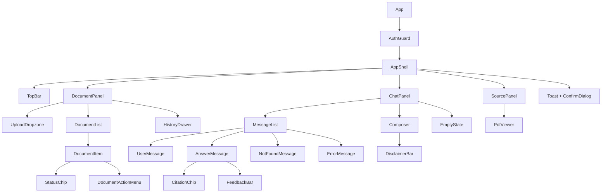
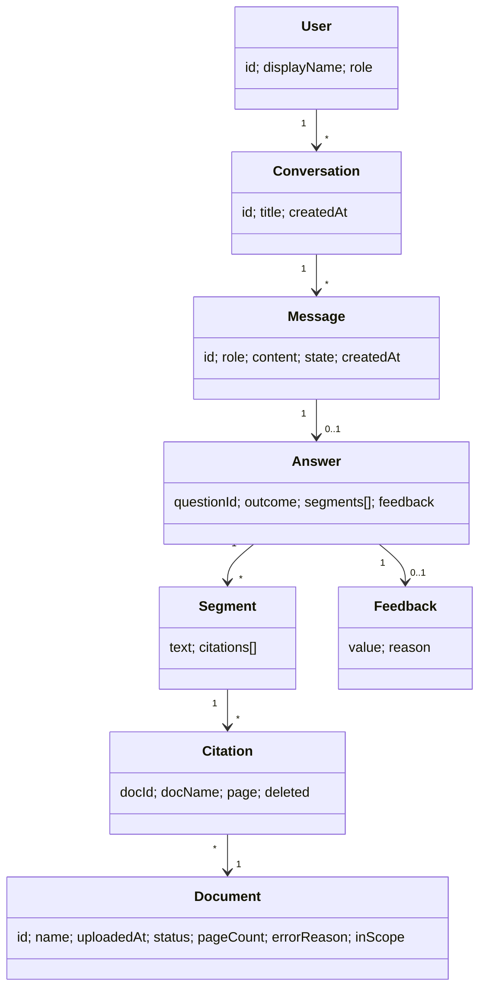
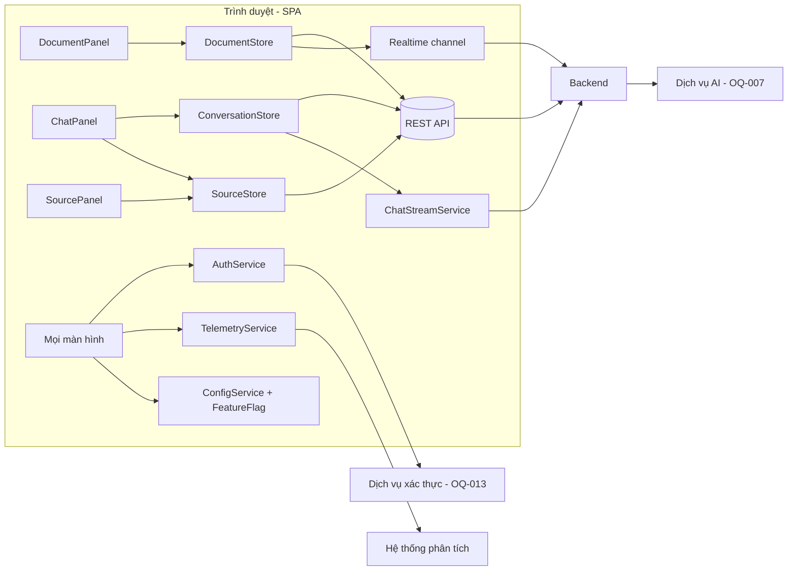
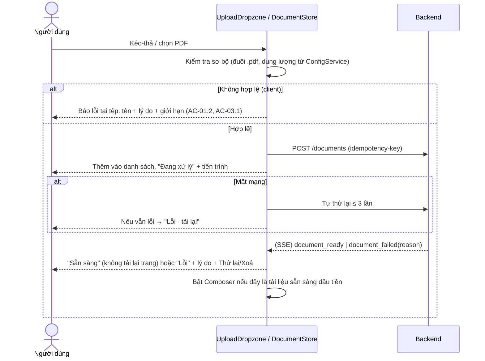
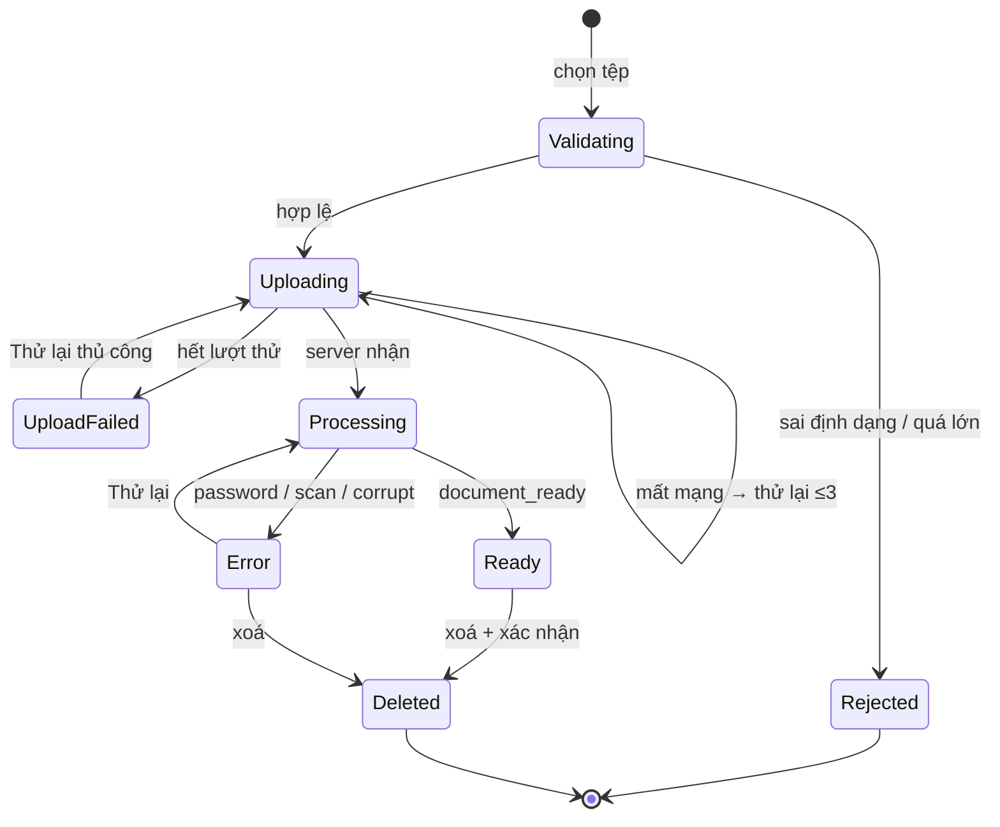
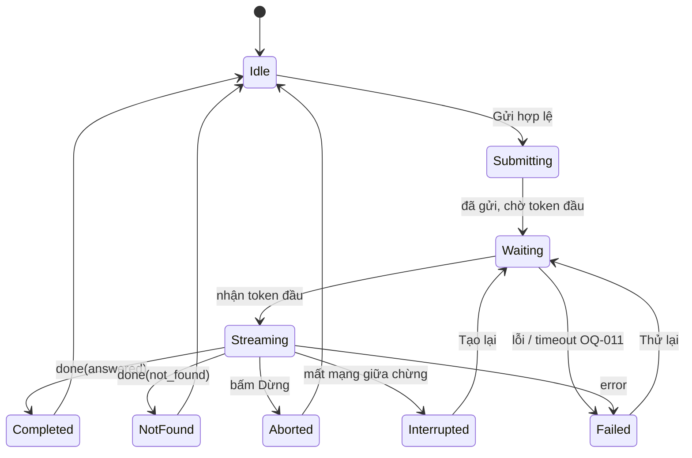

# Blueprint Design UI/UX (SDD) — Công cụ "Chat với tài liệu" (MVP)

> **Chuẩn áp dụng:** IEEE 1016-2009 — Software Design Descriptions
> **Đầu vào:** [PRD.md](../requirements/PRD.md) (PRD-CVD-001 v0.1) · [BRD.md](../requirements/BRD.md) (BRD-CVD-001 v0.1) · **Prompt nguồn:** [bluePrint_design_prompt.md](bluePrint_design_prompt.md)
> **Phạm vi:** Thiết kế UI/UX của ứng dụng web (lớp trình bày, tương tác và hợp đồng giao diện với backend). Thiết kế backend/AI/hạ tầng chỉ được nhắc tới ở mức ranh giới.
> **Quy ước:** `[TBD: OQ-xxx]` = chờ quyết định, kế thừa từ BRD/PRD. `[Giả định UX]` = giả định của tài liệu này, cần xác nhận. `[Đề xuất BA]` = chỉ hiệu lực khi OQ-014 được giải quyết. Động từ chuẩn: **phải / nên / có thể**.

---

## 1. Context & Subject

### 1.1 System Identification

| Thuộc tính | Giá trị |
|---|---|
| **Tên hệ thống** | Công cụ "Chat với tài liệu" (MVP, ứng dụng web) |
| **Mã tài liệu** | SDD-UX-CVD-001 |
| **Phiên bản SDD** | v0.1 (Draft) |
| **Ngày tài liệu** | 2026-10-19 |
| **Chủ sở hữu** | Minh Tran (UX/UI Design Lead) |
| **Tài liệu cha** | PRD-CVD-001 → BRD-CVD-001 |

**Lịch sử phiên bản**

| Phiên bản | Ngày | Tác giả | Thay đổi |
|---|---|---|---|
| 0.1 | 2026-10-19 | Minh Tran | Bản nháp đầu tiên, dựng từ PRD mục 2–5 |

### 1.2 System Scope and External Boundaries

| Loại ranh giới | Mô tả |
|---|---|
| **Mục đích hệ thống** | Người dùng tải PDF lên, hỏi bằng ngôn ngữ tự nhiên, nhận câu trả lời tổng hợp đa tài liệu **kèm trích dẫn (tên tệp + số trang) kiểm chứng được**. Giá trị: tiết kiệm thời gian tìm thông tin và có bằng chứng để quản lý quyết định go/no-go (BO-001…003). |
| **Hệ thống bên ngoài** | (1) Dịch vụ xác thực `[TBD: OQ-013]`; (2) Dịch vụ AI/LLM `[TBD: OQ-007]`; (3) Kho lưu trữ tệp + chỉ mục tìm kiếm (backend, ngoài phạm vi UI); (4) Dịch vụ phân tích/telemetry (mục 5.2 PRD). |
| **Loại người dùng** | P-A Nhân viên phát triển kinh doanh (chính) · P-B Quản lý dự án (phụ) · P-C Quản trị viên/IT (phụ). |
| **Giao diện bên ngoài của UI** | REST/JSON cho tài liệu, hội thoại, phản hồi; **SSE hoặc WebSocket** cho streaming câu trả lời và cập nhật trạng thái tài liệu `[Giả định UX]`; endpoint lấy PDF theo trang để hiển thị khung xem nguồn; sự kiện telemetry. |
| **Ranh giới tin cậy** | Trình duyệt người dùng (không tin cậy) ⇄ API gateway có xác thực (tin cậy) ⇄ dịch vụ AI bên thứ ba (tuỳ OQ-007). UI **không** chứa khoá API AI; nội dung hội thoại **không** đi vào hệ thống phân tích (PRD 5.2). |
| **Môi trường triển khai** | Ứng dụng web tĩnh (SPA) phục vụ qua CDN/web server nội bộ; đám mây vs. tự host `[TBD: OQ-007]`. |
| **Ngoài phạm vi UI** | Ứng dụng native; OCR; xuất hội thoại; kho tài liệu ngoài; màn hình báo cáo cho quản lý (BRD 5.2–5.3). |

### 1.3 Assumptions and Constraints

| Loại | Mô tả |
|---|---|
| **Ràng buộc kỹ thuật** | Ứng dụng web (CON-001); câu trả lời do AI sinh (CON-002) nên UI phải xử lý streaming, lỗi và độ trễ không xác định; chỉ nhận PDF (BRU-001). |
| **Ràng buộc nghiệp vụ** | Là MVP (CON-003): ưu tiên P0, tránh trang trí thừa; ngân sách/mốc thời gian chưa rõ (CON-005, OQ-004). |
| **Giả định môi trường** | Trình duyệt máy tính là chính; 2 phiên bản mới nhất của Chrome, Edge, Safari, Firefox; mạng văn phòng ổn định nhưng phải chịu được mất kết nối ngắn. |
| **Giả định dữ liệu** | Giới hạn dung lượng/trang/số tệp/số tài liệu `[TBD: OQ-005]`; UI đọc các giới hạn này từ cấu hình backend, **không hard-code**. Ngôn ngữ giao diện: tiếng Việt, tiếng Anh sẵn sàng qua i18n `[TBD: OQ-006]`. |
| **Giả định thiết kế** | Công nghệ front-end chưa được chốt; blueprint viết trung lập framework, ví dụ dùng khái niệm Component/Store. `[Giả định UX]` |

---

## 2. Stakeholders & Concerns

### 2.1 Stakeholder Identification

| Stakeholder | Vai trò | Mối quan tâm chính (với UI/UX) |
|---|---|---|
| Nhân viên phát triển kinh doanh (STK-002, P-A) | Người dùng cuối | Hỏi nhanh, câu trả lời đáng tin, kiểm chứng nguồn dễ, ít thao tác |
| Quản lý dự án (STK-001, P-B) | Nhà tài trợ | Bằng chứng sử dụng (telemetry), đánh giá chất lượng, người dùng chịu dùng lại |
| Quản trị viên / IT (STK-004, P-C) | Cấp quyền, vận hành | Truy cập bị kiểm soát, thông báo lỗi 403 rõ ràng, giới hạn dung lượng hiển thị đúng |
| Bảo mật / Pháp chế (STK-005) | Tuân thủ | UI không rò rỉ dữ liệu (cache, log, telemetry), xoá tài liệu có hiệu lực thấy được |
| Đội phát triển (STK-004) | Xây dựng UI | Component tái sử dụng, hợp đồng API rõ, dễ test |
| Đội BA (STK-003) | Duy trì yêu cầu | Truy vết từ thiết kế về US/AC |

### 2.2 Stakeholder Concerns

| ID | Stakeholder | Mối quan tâm | Ưu tiên | Tiêu chí chấp nhận (đo được) | Truy vết |
|---|---|---|---|---|---|
| CN-01 | P-A | Tin được câu trả lời nhờ thấy nguồn | High | 100% đoạn thông tin có chip trích dẫn `[Tên tệp, tr. N]`; câu "không tìm thấy" không có chip | BR-010, BR-011, US-10, US-11 |
| CN-02 | P-A | Kiểm chứng trích dẫn nhanh | High | Từ chip đến đúng trang PDF ≤ 2 thao tác (1 bấm) | BR-016, US-13d |
| CN-03 | P-A | Biết khi nào hỏi được | High | Trạng thái tài liệu cập nhật không cần tải lại; ô nhập tự bật khi có tài liệu "Sẵn sàng" | BR-004, AC-04.2, AC-07.2 |
| CN-04 | P-A | Cảm nhận phản hồi tức thời | High | Chữ đầu tiên hiển thị ≤ `[TBD: OQ-011]` (p90); có chỉ báo "đang suy nghĩ" trong ≤ 300 ms | BR-013, US-13 |
| CN-05 | P-A | Hiểu vì sao tệp bị từ chối | High | 100% lỗi tải lên nêu tên tệp + lý do + hành động tiếp theo | BR-003, AC-03.1…3 |
| CN-06 | P-A | Không mất công việc khi lỗi mạng/hết phiên | Med | Câu hỏi đang soạn được giữ 100% khi mất mạng/hết phiên | PRD 4.2 |
| CN-07 | P-B | Có dữ liệu chất lượng thực tế | High | Mọi câu trả lời hoàn tất đều có 👍/👎; ghi sự kiện `answer_feedback` | BR-022, US-19 |
| CN-08 | P-B | Dữ liệu sử dụng đúng | High | Số `question_submitted` khớp 100% số câu hỏi thực hiện; câu lỗi AI không tính | BR-023, US-20 |
| CN-09 | P-C / Bảo mật | Chỉ người được cấp quyền thấy dữ liệu | High | 0 truy cập thành công trái phép ở UI; 403 không lộ sự tồn tại tài liệu | BR-024, US-21 |
| CN-10 | Bảo mật | Dữ liệu xoá không còn hiển thị/dùng | High | Tài liệu xoá biến mất ≤ 1 s trên UI; chip cũ hiển thị "Tài liệu đã bị xoá" | BR-025, AC-06.1/2 |
| CN-11 | P-A | Giao diện dùng được bằng bàn phím, đọc bằng screen reader | Med | WCAG 2.1 AA ở luồng tải lên, hỏi, trích dẫn | PRD 4.1 NFR |
| CN-12 | Đội phát triển | UI dễ bảo trì, test | Med | ≥ 80% component có test; 100% màu/khoảng cách/chữ lấy từ token | — |
| CN-13 | P-A | Không hiểu nhầm AI là chắc chắn đúng | High | Dòng nhắc kiểm chứng luôn hiển thị; "không tìm thấy" trình bày khác biệt | RSK-001, ASM-005 |

### 2.3 Quality Attribute Scenarios (liên quan UI)

Định dạng sáu phần: Nguồn → Kích thích → Thành phần → Môi trường → Phản hồi → Thước đo.

| Thuộc tính | Kịch bản |
|---|---|
| **Performance** | *Người dùng* gửi câu hỏi *trong điều kiện bình thường, quy mô OQ-005*; *UI* hiển thị chỉ báo chờ ≤ 300 ms và chữ đầu tiên của câu trả lời ≤ `[TBD: OQ-011]` ở p90; render streaming không giật (≥ 50 fps khi cuộn). |
| **Availability / Resilience** | *Mạng mất giữa chừng streaming* → UI giữ phần đã nhận, đánh dấu "chưa hoàn tất", cung cấp "Tạo lại"; khôi phục không cần tải lại trang. |
| **Security** | *Phiên hết hạn* → chuyển về đăng nhập ≤ 1 s, không để lộ nội dung đã tải; token không lưu trong `localStorage` (dùng cookie HttpOnly/SameSite) `[Giả định UX]`; nội dung câu trả lời được sanitise (chống XSS khi render markdown). |
| **Maintainability** | Thay đổi một design token ảnh hưởng đồng bộ toàn UI; thay đổi một component chỉ ảnh hưởng ≤ 3 màn hình. |
| **Testability** | Mọi luồng P0 có test E2E mô phỏng được lỗi AI/mạng (mock SSE); ≥ 80% component có unit/visual test. |
| **Observability** | 100% sự kiện P0 ở PRD 5.2 phát đúng thuộc tính; không có nội dung câu hỏi/trả lời trong sự kiện. |
| **Deployability** | Bản phát hành front-end có feature flag cho tính năng `[Đề xuất BA]` (P1/P2) để bật/tắt theo OQ-014. |

### 2.4 UX/UI Quality Attribute Scenarios

| Thuộc tính | Kịch bản UX/UI |
|---|---|
| **Usability** | Người dùng mới (đã có tài khoản) tải 1 PDF và nhận câu trả lời đầu tiên có trích dẫn trong ≤ 3 phút (không tính thời gian xử lý nền), không cần hướng dẫn. Chỉ số nội bộ: ≥ 90% người thử hoàn thành không trợ giúp. |
| **Accessibility** | Toàn bộ điều khiển thao tác được bằng bàn phím; thứ tự Tab hợp lý; chip trích dẫn, 👍/👎, menu "⋯" có nhãn `aria-label`; trạng thái động (xử lý xong, lỗi) thông báo qua `aria-live`. WCAG 2.1 AA. |
| **Performance (web vitals)** | Trên 4G/mạng văn phòng: FCP < 1,5 s, LCP < 2,5 s, INP < 200 ms, CLS < 0,1. Khung xem PDF tải lười (lazy) và chỉ render trang cần xem. |
| **Responsiveness** | Layout 3 cột ≥ 1280 px; 2 cột (Tài liệu thu gọn + Hội thoại, Nguồn dạng ngăn trượt) 1024–1279 px; 1 cột dùng được ≥ 768 px; không cuộn ngang. Dưới 768 px: chỉ cam kết đọc/hỏi cơ bản (CON-001). |
| **Visual Consistency** | 100% màu, chữ, khoảng cách, bo góc, đổ bóng lấy từ design token; không có giá trị CSS thô trong component. |
| **Error Recovery** | Mọi lỗi nêu **nguyên nhân + hành động**; người dùng phục hồi bằng 1 thao tác (Thử lại / Tạo lại / Xoá) mà không mất dữ liệu đang soạn. |
| **Feedback & Affordance** | Mọi phần tử bấm được có trạng thái hover/focus/active/disabled; thao tác bất đồng bộ có phản hồi hiển thị ≤ 300 ms (skeleton/spinner/progress). |
| **Information Architecture** | Mọi chức năng P0 đạt được trong ≤ 2 bấm từ màn hình chính; màn hình chính duy nhất (single page, 3 vùng). |
| **Internationalization** | Chuỗi giao diện tách khỏi mã (i18n); chịu được giãn chữ +30%; ngày/giờ/số theo locale; tiếng Việt có dấu hiển thị đúng ở mọi font. `[TBD: OQ-006]` |
| **Mobile Experience** | Vùng chạm tối thiểu 44×44 px trên thiết bị cảm ứng; ngăn Nguồn mở dạng bottom sheet. Mức hỗ trợ: dùng được, không tối ưu (PRD trụ cột 4). |

### 2.5 UX/UI Constraints Matrix

| Ràng buộc | Yêu cầu | Công cụ / Chuẩn | Cách kiểm chứng |
|---|---|---|---|
| **Tương phản màu** | Chữ thường ≥ 4,5:1; chữ lớn và biểu tượng ≥ 3:1; **trạng thái không chỉ dựa vào màu** (luôn kèm biểu tượng + chữ) | WCAG 2.1 AA | Axe/Lighthouse + rà soát tay |
| **Kiểu chữ** | Nội dung ≥ 16 px (câu trả lời), nhãn phụ ≥ 12 px; line-height 1,5; co giãn tới 200% không vỡ layout | Design tokens | Audit thiết kế |
| **Vùng chạm** | ≥ 44×44 px (cảm ứng); ≥ 32×32 px (con trỏ) | Apple HIG / Material | UI test |
| **Trạng thái tải** | Skeleton/spinner ≤ 300 ms; tiến trình tải tệp có phần trăm | UX best practice | Giám sát hiệu năng |
| **Thông báo lỗi** | Rõ, hành động được, không lộ thuật ngữ kỹ thuật (PRD 4.2) | Hướng dẫn UX writing | Rà soát nội dung |
| **Trạng thái rỗng** | Mỗi trạng thái rỗng chỉ ra hành động tiếp theo (PRD 4.2) | UX best practice | Kiểm kê màn hình |
| **Thông báo (toast)** | Không chặn thao tác; tự ẩn 5 s (thông tin) / giữ lại (lỗi cần hành động); `aria-live=polite` | UX best practice | Thử nghiệm người dùng |
| **Trợ giúp / Onboarding** | Gợi ý ngữ cảnh ở trạng thái rỗng; tối đa 3 câu hỏi gợi ý `[Đề xuất BA]` | UX best practice | Chỉ số hoàn thành tác vụ |
| **Chuyển động** | Tôn trọng `prefers-reduced-motion`; animation ≤ 200 ms trừ streaming | WCAG 2.3.3 | Test thủ công |
| **Bảo mật hiển thị** | Không ghi nội dung hội thoại vào log/telemetry/URL; không cache PDF nhạy cảm ở nơi chia sẻ | Chính sách OQ-007 | Review bảo mật |

---

## 3. Design Views (IEEE 1016-2009)

Tám góc nhìn được chọn từ các viewpoint của IEEE 1016-2009: **Composition, Logical, Dependency, Information, Interface, Interaction, State Dynamics, Resource**. Mỗi view nêu rõ mối quan tâm (CN-xx) mà nó giải quyết.

### 3.0 Nguyên tắc thiết kế & Design System

**Bốn trụ cột UX** (PRD mục 0): (1) *Evidence-first*, (2) *Hỏi ngay, không thiết lập*, (3) *Phản hồi tức thời cảm nhận được*, (4) *Web-first, desktop-first*.

**Quyết định thiết kế chính (ADR rút gọn)**

| ID | Quyết định | Lý do | Đánh đổi |
|---|---|---|---|
| ADR-UX-01 | Màn hình chính duy nhất, 3 vùng (Tài liệu / Hội thoại / Nguồn) | Đối chiếu trích dẫn không rời ngữ cảnh; ≤ 2 bấm (CN-02) | Khó co về màn hình nhỏ → dùng ngăn trượt |
| ADR-UX-02 | Trích dẫn là **chip nội tuyến** gắn đúng đoạn, không gom cuối câu trả lời | Không tách nguồn khỏi nội dung (nguyên tắc 3, CN-01) | Phức tạp hơn khi render streaming |
| ADR-UX-03 | Streaming token qua SSE, render tăng dần; chip chỉ "kích hoạt" khi đoạn hoàn chỉnh | Phản hồi tức thời (CN-04) tránh chip nhấp nháy | Cần bộ phân tích trích dẫn tăng dần |
| ADR-UX-04 | Trạng thái tài liệu đẩy từ server (SSE), polling là phương án dự phòng | AC-04.2 không tải lại trang | Cần kênh realtime ổn định |
| ADR-UX-05 | Feature flag cho mọi mục `[Đề xuất BA]` | Chờ OQ-014, kiểm soát RSK-006 | Thêm nhánh logic |
| ADR-UX-06 | "Không tìm thấy" là trạng thái UI riêng (không phải lỗi) | BR-011; tránh hiểu là hỏng | Thêm một biến thể thẻ tin nhắn |

**Design tokens (đề xuất, giá trị cuối do giai đoạn UI visual chốt)** `[Giả định UX]`

| Nhóm | Token | Ghi chú |
|---|---|---|
| Màu ngữ nghĩa | `color.surface`, `color.surface-raised`, `color.text`, `color.text-muted`, `color.border`, `color.primary`, `color.focus-ring` | Hỗ trợ sáng/tối ngay từ đầu |
| Màu trạng thái | `status.processing` (xanh dương), `status.ready` (xanh lá), `status.error` (đỏ), `status.notfound` (xám-trung tính), `status.warning` (vàng) | Luôn kèm biểu tượng + nhãn |
| Chữ | `font.body 16/24`, `font.small 14/20`, `font.caption 12/16`, `font.h1…h3`, font hỗ trợ tiếng Việt đầy đủ | |
| Khoảng cách | Thang 4 px: 4, 8, 12, 16, 24, 32, 48 | |
| Bo góc / bóng | `radius.sm 4`, `radius.md 8`, `radius.pill 999`; `elevation.1…3` | |
| Chuyển động | `motion.fast 120ms`, `motion.base 200ms`, `ease-out` | Tắt khi reduced-motion |

---

### 3.1 Composition View — Phân rã thành phần UI

**Mục đích:** mô tả UI được lắp từ các đơn vị nhỏ hơn thế nào. **Mối quan tâm:** CN-12 (bảo trì), CN-03, CN-07.

| Phần tử | Loại | Cha | Trách nhiệm | Phụ thuộc |
|---|---|---|---|---|
| `AppShell` | Layout | Root | Khung ứng dụng, chia 3 vùng, quản lý responsive | AuthGuard, ThemeProvider |
| `AuthGuard` | Container | AppShell | Chặn truy cập chưa xác thực; xử lý hết phiên; trang 403 | AuthService |
| `TopBar` | Component | AppShell | Logo, nút "Hội thoại mới", menu người dùng | ConversationStore |
| `DocumentPanel` | Container | AppShell | Cột trái: tải lên, danh sách, chọn phạm vi, lịch sử | DocumentStore |
| `UploadDropzone` | Component | DocumentPanel | Chọn/kéo-thả, kiểm tra sơ bộ (đuôi, dung lượng), tiến trình | UploadService |
| `DocumentList` / `DocumentItem` | Component | DocumentPanel | Hiển thị tên, ngày, `StatusChip`, checkbox phạm vi, menu "⋯" | DocumentStore |
| `StatusChip` | Atom | DocumentItem | Đang xử lý / Sẵn sàng / Lỗi (biểu tượng + nhãn) | — |
| `DocumentActionMenu` | Component | DocumentItem | Xoá, Thử lại, (Tóm tắt – P2) | ConfirmDialog |
| `HistoryDrawer` | Component | DocumentPanel | Danh sách hội thoại cũ (P1) | ConversationStore |
| `ChatPanel` | Container | AppShell | Cột giữa: luồng tin nhắn + ô nhập | ConversationStore |
| `EmptyState` | Component | ChatPanel / DocumentPanel | 3 biến thể: chưa có tài liệu; chưa có hội thoại; đang xử lý hết | — |
| `MessageList` | Component | ChatPanel | Danh sách tin nhắn, tự cuộn, `aria-live` | — |
| `UserMessage` | Component | MessageList | Câu hỏi của người dùng | — |
| `AnswerMessage` | Component | MessageList | Câu trả lời streaming, chip trích dẫn, hành động | CitationChip, FeedbackBar |
| `NotFoundMessage` | Component | MessageList | Biến thể "Không tìm thấy" + gợi ý | — |
| `ErrorMessage` | Component | MessageList | Lỗi AI/timeout + "Thử lại"/"Tạo lại" | — |
| `CitationChip` | Atom | AnswerMessage | `[Tên tệp, tr. N]`, bấm mở Nguồn; biến thể "đã xoá" | SourceStore |
| `FeedbackBar` | Component | AnswerMessage | 👍/👎 + ô lý do tuỳ chọn | FeedbackService |
| `SuggestedQuestions` | Component | EmptyState | ≤ 3 gợi ý (P2) | — |
| `Composer` | Component | ChatPanel | Ô nhập, Gửi/Dừng, bộ đếm ký tự, nhắc kiểm chứng | — |
| `DisclaimerBar` | Atom | Composer | "Kiểm tra lại với tài liệu gốc…" cố định | — |
| `SourcePanel` | Container | AppShell | Cột phải: khung xem PDF | PdfViewer |
| `PdfViewer` | Component | SourcePanel | Hiển thị trang N, đánh dấu đoạn liên quan, điều hướng trang | PDF endpoint |
| `Toast/Notifier` | Service | AppShell | Thông báo không chặn | — |
| `ConfirmDialog` | Component | AppShell | Xác nhận xoá, thay thế tệp trùng tên | — |

**Sơ đồ:**



---

### 3.2 Logical View — Mô hình khái niệm & Design System

**Mục đích:** các khái niệm UI và quan hệ logic. **Mối quan tâm:** CN-12, CN-01.

**Phân cấp Atomic Design**

| Tầng | Thành phần |
|---|---|
| Atoms | Button, IconButton, Chip (`StatusChip`, `CitationChip`), Input/Textarea, Checkbox, Spinner, Skeleton, Tooltip, Badge |
| Molecules | `DocumentItem`, `FeedbackBar`, `Composer`, `UploadDropzone`, `EmptyState`, `Toast` |
| Organisms | `DocumentPanel`, `ChatPanel`, `SourcePanel`, `MessageList`, `TopBar` |
| Templates | `AppShell` (3 cột / 2 cột / 1 cột) |
| Pages | `MainPage`, `LoginPage`, `ForbiddenPage` |

**Thực thể logic phía UI**



**Quy tắc logic bất biến của UI**

1. Một `Segment` có thông tin tài liệu thì **phải** có ≥ 1 `Citation`; `outcome = not_found` thì **không** có `Citation` (BR-010, BR-011).
2. `Document.status ∈ {processing, ready, error}`; chỉ `ready` mới được đưa vào phạm vi hỏi.
3. `Answer.outcome ∈ {answered, not_found, error, aborted}` (khớp telemetry `answer_completed`).
4. `Citation.deleted = true` → chip hiển thị "Tài liệu đã bị xoá" và vô hiệu (BRU-006).

---

### 3.3 Dependency View — Phụ thuộc

**Mục đích:** quan hệ phụ thuộc giữa các mô-đun UI và dịch vụ ngoài. **Mối quan tâm:** CN-12, CN-09.

| Mô-đun | Phụ thuộc vào | Loại | Ghi chú |
|---|---|---|---|
| `DocumentPanel` | `DocumentStore`, `UploadService` | Dữ liệu / API | Trạng thái nhận qua kênh realtime |
| `ChatPanel` | `ConversationStore`, `ChatStreamService` | Dữ liệu / Realtime | SSE, huỷ bằng `AbortController` |
| `SourcePanel` | `SourceStore`, endpoint PDF theo trang | API | Tải lười từng trang |
| `FeedbackBar` | `FeedbackService` | API | Ghi ngầm, thử lại im lặng |
| Toàn bộ UI | `AuthService`, `ConfigService` (giới hạn OQ-005), `I18nService`, `TelemetryService` | Dịch vụ lõi | |
| Tính năng P1/P2 | `FeatureFlagService` | Cấu hình | ADR-UX-05 |



**Quy tắc phụ thuộc:** component trình bày **không** gọi API trực tiếp, chỉ qua Store/Service; Store không import component; Telemetry là phụ thuộc "bắn-và-quên", lỗi telemetry không ảnh hưởng luồng chính.

---

### 3.4 Information View — Thông tin hiển thị & quản lý dữ liệu phía UI

**Mục đích:** dữ liệu UI nắm giữ, vòng đời và nơi lưu. **Mối quan tâm:** CN-06, CN-09, CN-10, CN-08.

| Dữ liệu | Nguồn chân lý | Lưu ở client | Vòng đời / Xoá | Nhạy cảm |
|---|---|---|---|---|
| Danh sách tài liệu + trạng thái | Server | Bộ nhớ (Store) | Làm mới khi đăng nhập; xoá khi đăng xuất | Trung bình |
| Tài liệu đang chọn làm phạm vi | UI (client) | Bộ nhớ + `sessionStorage` | Hết phiên | Thấp |
| Hội thoại + tin nhắn | Server | Bộ nhớ | Xoá khi đăng xuất | **Cao** |
| Nháp câu hỏi đang soạn | Client | `sessionStorage` (mã hoá không bắt buộc) | Xoá sau khi gửi/đăng xuất; giữ khi hết phiên (CN-06) | Cao |
| Trang PDF đang xem | Server (stream) | Cache trình duyệt có `Cache-Control: private, no-store` `[Giả định UX]` | Không lưu bền | **Cao** |
| Token phiên | Server | Cookie HttpOnly | Theo chính sách OQ-013 | Cao |
| Sự kiện telemetry | Client → Analytics | Hàng đợi tạm | Chỉ ID/băm, **không** nội dung | Thấp |

**Quy tắc hiển thị thông tin**

- Thời gian: định dạng theo locale; ngày tải lên hiển thị tương đối ("hôm nay") kèm `title` tuyệt đối.
- Tên tệp dài: cắt giữa (`hop-dong…v2.pdf`), đầy đủ ở tooltip.
- Dung lượng: KB/MB, giới hạn hiển thị theo `ConfigService`.
- Trích dẫn: luôn dạng `[Tên tệp, tr. N]`; nếu nhiều trang gộp `tr. 7–8`.

**Hợp đồng dữ liệu stream (đề xuất)** `[Giả định UX]`

```json
// SSE: sự kiện từ server cho một câu trả lời
{ "type": "token",    "text": "Hạn chót là " }
{ "type": "citation", "docId": "d1", "docName": "hop-dong.pdf", "page": 7, "anchor": "seg-3" }
{ "type": "done",     "outcome": "answered", "questionId": "q42" }
{ "type": "done",     "outcome": "not_found", "questionId": "q43" }
{ "type": "error",    "code": "AI_TIMEOUT" }
```

---

### 3.5 Interface View — Giao diện

**Mục đích:** giao diện người dùng và hợp đồng giao diện với backend. **Mối quan tâm:** CN-01…CN-05, CN-13.

#### 3.5.1 Bố cục màn hình chính (desktop ≥ 1280 px)

```
┌───────────────────────────────────────────────────────────────────────┐
│ ◧ Logo      [+ Hội thoại mới]                       [Minh Tran ▾]      │  TopBar (56px)
├────────────────┬──────────────────────────────────┬───────────────────┤
│ TÀI LIỆU (280) │ HỘI THOẠI (flex)                 │ NGUỒN (400)       │
│ ┌────────────┐ │                                  │ hop-dong.pdf      │
│ │ ⬆ Kéo thả  │ │  Bạn: Hạn chót nộp hồ sơ là?     │ ◀ tr. 7 / 32 ▶    │
│ │ hoặc chọn  │ │                                  │ ┌───────────────┐ │
│ └────────────┘ │  AI: Hạn chót là 30/11/2026      │ │               │ │
│ ☑ hop-dong.pdf │  [hop-dong.pdf, tr. 7] và phụ    │ │  (trang PDF   │ │
│   ✔ Sẵn sàng   │  lục B gia hạn 7 ngày            │ │  đánh dấu     │ │
│ ☑ bao-gia.pdf  │  [phu-luc-B.pdf, tr. 2]          │ │  đoạn liên    │ │
│   ◐ Đang xử lý │  👍  👎                           │ │  quan)        │ │
│ ☐ spec.pdf     │                                  │ └───────────────┘ │
│   ⚠ Lỗi · Xoá  │                                  │                   │
│                │ ┌──────────────────────────────┐ │                   │
│ Lịch sử ▸      │ │ Nhập câu hỏi…        [Gửi ➤]│ │                   │
│                │ └──────────────────────────────┘ │                   │
│                │ ⓘ Kiểm tra lại với tài liệu gốc… │                   │
└────────────────┴──────────────────────────────────┴───────────────────┘
```

**Lưới & breakpoint**

| Breakpoint | Layout | Hành vi vùng Nguồn |
|---|---|---|
| ≥ 1280 px | 3 cột cố định 280 / linh hoạt / 400 | Cột cố định, rỗng cho tới khi bấm chip |
| 1024–1279 px | Tài liệu thu gọn thành rail biểu tượng (có thể mở rộng) + Hội thoại | Ngăn trượt từ phải, đè lên hội thoại |
| 768–1023 px | 1 cột; Tài liệu là ngăn trượt trái | Ngăn trượt toàn chiều rộng |
| < 768 px | 1 cột, hỗ trợ mức cơ bản | Bottom sheet |

#### 3.5.2 Danh mục màn hình / trạng thái

| Mã | Màn hình / trạng thái | Điều kiện | Yêu cầu |
|---|---|---|---|
| SCR-01 | Đăng nhập | Chưa xác thực `[TBD: OQ-013]` | US-21 |
| SCR-02 | Chính — **trống** (chưa có tài liệu) | 0 tài liệu | AC-07.2, PRD 4.2 |
| SCR-03 | Chính — **có tài liệu, chưa hội thoại** | ≥ 1 sẵn sàng | PRD 4.2, BR-021 |
| SCR-04 | Chính — **mọi tài liệu đang xử lý** | 0 sẵn sàng, ≥ 1 xử lý | PRD 4.2 |
| SCR-05 | Chính — **đang hội thoại** | Có tin nhắn | E2 |
| SCR-06 | Hộp thoại xác nhận xoá | Bấm Xoá | AC-06.1 |
| SCR-07 | Hộp thoại tệp trùng tên (Thay thế / Giữ cả hai) | Trùng tên | PRD 4.2 |
| SCR-08 | 403 Không có quyền | Chưa được cấp quyền | PRD 4.2 |
| SCR-09 | Lịch sử hội thoại (ngăn) | Bấm "Lịch sử" (P1) | US-15 |
| SCR-10 | Hết phiên → về đăng nhập | Token hết hạn | AC-21.2 |

#### 3.5.3 Đặc tả thành phần then chốt

**`StatusChip`**

| Trạng thái | Biểu tượng | Nhãn | Màu token | Hành động |
|---|---|---|---|---|
| Đang xử lý | ◐ (quay) | Đang xử lý | `status.processing` | — |
| Sẵn sàng | ✔ | Sẵn sàng | `status.ready` | Cho phép chọn phạm vi |
| Lỗi | ⚠ | Lỗi + lý do | `status.error` | Thử lại / Xoá |

**`Composer`**

| Trạng thái | Ô nhập | Nút | Ghi chú |
|---|---|---|---|
| Không có tài liệu sẵn sàng | Vô hiệu + placeholder "Tải PDF để bắt đầu" | Gửi vô hiệu | Có đường dẫn đến Upload |
| Sẵn sàng, rỗng/chỉ khoảng trắng | Bật | Gửi vô hiệu | |
| Có nội dung hợp lệ | Bật | **Gửi** bật | Enter = gửi; Shift+Enter = xuống dòng |
| Vượt giới hạn ký tự `[TBD: OQ-005]` | Bật, viền cảnh báo | Gửi vô hiệu | Hiển thị bộ đếm `n/max` |
| AI đang trả lời | Bật (soạn trước) hoặc khoá `[Giả định UX]` | **Dừng** | Bấm Dừng → `outcome = aborted` |

**`AnswerMessage` — biến thể**

| Biến thể | Nhận diện thị giác | Chip | FeedbackBar |
|---|---|---|---|
| Đang stream | Con trỏ nhấp nháy cuối văn bản; nút Dừng | Hiện dần theo đoạn hoàn chỉnh | Ẩn |
| Hoàn tất có nguồn | Thẻ chuẩn | Có (bắt buộc) | Hiện |
| Hoàn tất một phần (mất mạng) | Nhãn "Chưa hoàn tất" + nút **Tạo lại** | Chỉ phần đã nhận | Ẩn |
| **Không tìm thấy** | Thẻ trung tính (xám), biểu tượng 🔍, nội dung cố định "Không tìm thấy thông tin này trong các tài liệu đã tải lên" + gợi ý | **Không có** | Hiện |
| Lỗi AI | Thẻ lỗi nhẹ, "Hệ thống tạm thời không trả lời được, vui lòng thử lại" + **Thử lại** | Không | Ẩn |

**`CitationChip`**

| Trạng thái | Hiển thị | Hành vi |
|---|---|---|
| Mặc định | `hop-dong.pdf · tr. 7` (cắt tên nếu dài) | Bấm / Enter → mở `SourcePanel` tại trang, focus chuyển vào panel |
| Hover/Focus | Viền + tooltip tên đầy đủ | — |
| Đã chọn | Nền đậm hơn, đồng bộ với trang đang xem | — |
| Tài liệu đã xoá | Gạch ngang + "Tài liệu đã bị xoá", `aria-disabled` | Không mở được |
| Chưa có BR-016 (flag tắt) | Chữ thuần `[Tên tệp, tr. N]` | Không bấm được |

#### 3.5.4 Hợp đồng API cấp UI (đề xuất)

| Nhu cầu UI | Phương thức & đường dẫn | Ghi chú |
|---|---|---|
| Lấy cấu hình giới hạn | `GET /api/config` | Dung lượng, số trang, số tệp, độ dài câu hỏi (OQ-005) |
| Danh sách tài liệu | `GET /api/documents` | Chỉ tài liệu trong quyền (AC-05.2) |
| Tải lên | `POST /api/documents` (multipart, idempotency-key) | Thử lại không tạo bản ghi trùng (PRD 4.2) |
| Xoá | `DELETE /api/documents/{id}` | |
| Trạng thái realtime | `GET /api/documents/events` (SSE) | `document_ready`, `document_failed` |
| Gửi câu hỏi (stream) | `POST /api/conversations/{id}/ask` → SSE | Body: câu hỏi, `scopeDocIds[]` |
| Huỷ trả lời | Đóng kết nối + `POST …/cancel` | |
| Trang PDF | `GET /api/documents/{id}/pages/{n}` | Có xác thực, `private, no-store` |
| Lịch sử | `GET /api/conversations` | P1 |
| Đánh giá | `PUT /api/answers/{questionId}/feedback` | Idempotent: cập nhật, không trùng (AC-19.2) |

---

### 3.6 Interaction View — Tương tác & luồng

**Mục đích:** trình tự tương tác giữa người dùng, UI và backend. **Mối quan tâm:** CN-02, CN-04, CN-05, CN-06.

#### 3.6.1 Tải tài liệu lên



#### 3.6.2 Hỏi đáp có trích dẫn và kiểm chứng

```mermaid
sequenceDiagram
    actor U as Người dùng
    participant C as Composer / ChatPanel
    participant S as ChatStreamService
    participant B as Backend + AI
    participant SP as SourcePanel
    U->>C: Nhập câu hỏi, Enter
    C->>C: Vô hiệu hoá Gửi → "Dừng"; thêm UserMessage; hiện chỉ báo chờ (≤300ms)
    C->>S: ask(question, scopeDocIds)
    S->>B: POST … (SSE)
    B-->>S: token…
    S-->>C: Render tăng dần; telemetry answer_first_token
    B-->>S: citation(docId, page, anchor)
    S-->>C: Kích hoạt CitationChip cho đoạn
    alt Có thông tin
        B-->>S: done(answered)
        C-->>U: Hiện FeedbackBar + DisclaimerBar luôn có
    else Không có thông tin
        B-->>S: done(not_found)
        C-->>U: NotFoundMessage (không chip)
    else Lỗi/timeout
        B-->>S: error
        C-->>U: ErrorMessage + Thử lại (không tính MET-004)
    end
    U->>C: Bấm CitationChip
    C->>SP: open(docId, page)
    SP-->>U: Hiện đúng trang, đánh dấu đoạn; telemetry citation_clicked
```

#### 3.6.3 Đánh giá câu trả lời

`Bấm 👍/👎` → cập nhật lạc quan trên UI → `PUT feedback` → nếu 👎: mở ô lý do tuỳ chọn (có thể bỏ qua) → lỗi ghi: thử lại ngầm, không báo lỗi to (PRD 4.2). Đổi lựa chọn → cập nhật bản ghi, không tạo trùng.

#### 3.6.4 Xoá tài liệu

`Menu ⋯ → Xoá → ConfirmDialog (nêu tên tệp, cảnh báo ảnh hưởng hội thoại cũ) → DELETE → xoá khỏi danh sách (lạc quan, hoàn tác nếu lỗi) → các CitationChip trỏ tới tài liệu chuyển sang "Tài liệu đã bị xoá"`. Thao tác trên tài liệu đã bị người khác xoá → toast "Tài liệu không còn tồn tại" và làm mới danh sách.

#### 3.6.5 Bản đồ phím tắt & trợ năng

| Phím | Hành động |
|---|---|
| `Enter` / `Shift+Enter` | Gửi / xuống dòng |
| `Esc` | Dừng trả lời đang stream; đóng ngăn/hộp thoại |
| `Ctrl/⌘+K` | Focus vào ô nhập `[Giả định UX]` |
| `Tab` / `Shift+Tab` | Thứ tự: TopBar → Tài liệu → Hội thoại → Composer → Nguồn |
| `Enter`/`Space` trên chip | Mở Nguồn; focus chuyển vào panel, `Esc` trả focus về chip |

---

### 3.7 State Dynamics View — Động lực trạng thái

**Mục đích:** các trạng thái và chuyển đổi của đối tượng UI. **Mối quan tâm:** CN-03, CN-04, CN-06.

#### 3.7.1 Trạng thái tài liệu



#### 3.7.2 Trạng thái một lượt hỏi–đáp



| Trạng thái | Composer | Message | Telemetry |
|---|---|---|---|
| Submitting/Waiting | Nút "Dừng" | Chỉ báo "đang tìm trong tài liệu…" | `question_submitted` |
| Streaming | "Dừng" | Văn bản tăng dần | `answer_first_token` |
| Completed | "Gửi" | + FeedbackBar | `answer_completed(answered)` |
| NotFound | "Gửi" | NotFoundMessage | `answer_completed(not_found)` |
| Aborted | "Gửi" | Giữ phần đã nhận, nhãn "Đã dừng" | `answer_stopped`, `outcome=aborted` |
| Failed | "Gửi" | ErrorMessage | `answer_error` (loại khỏi MET-004) |

#### 3.7.3 Trạng thái phiên & quyền truy cập

`Anonymous → Authenticating → Authenticated → SessionExpired → (Anonymous, giữ nháp)`; `Authenticated → Forbidden (403)` khi chưa được cấp quyền (CN-09).

#### 3.7.4 Trạng thái khả dụng của Composer (tổng hợp)

| Tài liệu sẵn sàng | Đang xử lý | Composer |
|---|---|---|
| 0 | 0 | Vô hiệu + EmptyState "Tải PDF đầu tiên để bắt đầu hỏi" |
| 0 | ≥ 1 | Vô hiệu + "Đang xử lý n tài liệu…"; **tự bật** khi tài liệu đầu tiên sẵn sàng |
| ≥ 1 | bất kỳ | Bật |

---

### 3.8 Resource View — Tài nguyên, hiệu năng & ngân sách

**Mục đích:** ràng buộc tài nguyên phía client và thước đo chất lượng. **Mối quan tâm:** CN-04, CN-11, CN-12.

| Tài nguyên | Ngân sách / Chiến lược |
|---|---|
| **Gói JS ban đầu** | ≤ 250 KB gzip cho route chính; `PdfViewer` và thư viện render PDF **tải lười** khi bấm chip lần đầu |
| **Web vitals** | FCP < 1,5 s · LCP < 2,5 s · INP < 200 ms · CLS < 0,1 |
| **Render streaming** | Gom token theo khung hình (`requestAnimationFrame`), tối đa 1 lần render/16 ms; danh sách tin nhắn ảo hoá khi > 200 tin |
| **Bộ nhớ PDF** | Chỉ giữ ≤ 3 trang đã render trong bộ nhớ; huỷ khi đóng panel |
| **Kết nối realtime** | 1 SSE trạng thái tài liệu + 1 SSE mỗi câu hỏi đang chạy; tự kết nối lại (backoff luỹ thừa, tối đa 30 s) |
| **Tải lên** | Tối đa 3 tệp song song; mỗi tệp có tiến trình; huỷ được |
| **Trợ năng** | `aria-live=polite` cho thay đổi trạng thái; `role="log"` cho `MessageList`; focus quản lý khi mở/đóng panel và hộp thoại |
| **i18n** | Từ điển chuỗi theo khoá; dự phòng chuỗi tiếng Anh nếu thiếu |
| **Kiểm thử** | Unit/visual cho component; E2E cho luồng P0 với SSE mô phỏng; test trợ năng tự động (axe) trong CI |
| **Giám sát lỗi front-end** | Ghi lỗi JS/mạng (không kèm nội dung hội thoại); cảnh báo khi tỷ lệ `answer_error` vượt ngưỡng |

---

## 4. Ma trận truy vết

### 4.1 Mối quan tâm → View → Phần tử thiết kế → Yêu cầu

| Mối quan tâm | View giải quyết | Phần tử thiết kế chính | Yêu cầu PRD/BRD |
|---|---|---|---|
| CN-01 Tin cậy bằng nguồn | 3.2, 3.5, 3.6.2 | `CitationChip`, `AnswerMessage`, `NotFoundMessage`, quy tắc bất biến #1 | US-10, US-11 / BR-010, BR-011 |
| CN-02 Kiểm chứng nhanh | 3.5, 3.6.2, 3.8 | `CitationChip` → `SourcePanel` → `PdfViewer` | US-13d / BR-016 |
| CN-03 Biết khi nào hỏi được | 3.4, 3.7.1, 3.7.4 | `StatusChip`, kênh SSE, `Composer` | US-04, US-07 / BR-004 |
| CN-04 Phản hồi tức thời | 3.3, 3.6.2, 3.7.2, 3.8 | `ChatStreamService`, chỉ báo chờ, render theo khung hình | US-13 / BR-013 |
| CN-05 Hiểu lỗi tải lên | 3.5, 3.6.1 | `UploadDropzone`, thông báo theo từng tệp | US-01, US-03 / BR-003 |
| CN-06 Không mất công việc | 3.4, 3.6.1, 3.7.3 | Nháp ở `sessionStorage`, thử lại tự động | PRD 4.2, AC-21.2 |
| CN-07 Dữ liệu chất lượng | 3.5, 3.6.3 | `FeedbackBar`, `FeedbackService` | US-19 / BR-022 |
| CN-08 Dữ liệu sử dụng đúng | 3.4, 3.7.2 | Telemetry theo trạng thái | US-20 / BR-023 |
| CN-09 Kiểm soát truy cập | 3.1, 3.5, 3.7.3 | `AuthGuard`, SCR-08 | US-21 / BR-024 |
| CN-10 Xoá có hiệu lực | 3.2, 3.5, 3.6.4 | `ConfirmDialog`, chip "đã xoá" | US-06, US-23 / BR-025 |
| CN-11 Trợ năng | 2.4, 3.6.5, 3.8 | Phím tắt, `aria-*`, quản lý focus | PRD 4.1 NFR |
| CN-12 Bảo trì | 3.0, 3.1, 3.2, 3.3 | Design tokens, Atomic Design, tầng Store/Service | — |
| CN-13 Không tin mù quáng AI | 3.5 | `DisclaimerBar`, biến thể "Không tìm thấy" | RSK-001, ASM-005 |

### 4.2 User Story → Màn hình / Thành phần

| User Story | Ưu tiên | Màn hình / Thành phần | View |
|---|---|---|---|
| US-01, 03, 04, 05, 06 | P0 | SCR-02/04/05/06/07, `DocumentPanel`, `StatusChip`, `ConfirmDialog` | 3.1, 3.5, 3.6.1, 3.7.1 |
| US-02 (tải nhiều) | P1 | `UploadDropzone` (hàng đợi nhiều tệp) | 3.6.1, 3.8 |
| US-07, 08, 09, 11, 12 | P0 | `ChatPanel`, `Composer`, `AnswerMessage`, `NotFoundMessage` | 3.5, 3.6.2 |
| US-10 | P0 | `CitationChip` | 3.5.3 |
| US-13 | P0 | `ChatStreamService`, trạng thái Waiting/Streaming | 3.6.2, 3.7.2 |
| US-13b (ngôn ngữ) | P0 | I18n, ngôn ngữ giao diện | 3.8 |
| US-13c (phạm vi) | P1 | Checkbox trong `DocumentItem`, `scopeDocIds` | 3.5.3, 3.5.4 |
| US-13d (mở trang) | P1→P0* | `SourcePanel`, `PdfViewer` | 3.5, 3.6.2 |
| US-14, 15, 16 | P1 | Ngữ cảnh hội thoại, `HistoryDrawer`, nút "Hội thoại mới" | 3.1, 3.5.2 |
| US-17, 18 | P2 | Menu "Tóm tắt", `SuggestedQuestions` | 3.1 |
| US-19, 20 | P0 | `FeedbackBar`, `TelemetryService` | 3.6.3, 3.4 |
| US-21 | P0 | `AuthGuard`, SCR-01/08/10 | 3.1, 3.7.3 |
| US-22, 23 | P0 | Quy tắc dữ liệu client, chip "đã xoá" | 3.4, 3.6.4 |
| US-24 | P0 | `ConfigService`, hiển thị giới hạn | 3.4, 3.8 |

\* PRD khuyến nghị nâng US-13d lên P0 nếu OQ-014 chấp nhận BR-010.

### 4.3 Trạng thái biên PRD 4.2 → Thiết kế

| Tình huống PRD 4.2 | Nơi xử lý trong blueprint |
|---|---|
| Chưa có tài liệu / chưa có hội thoại / đang xử lý hết | SCR-02/03/04, mục 3.7.4 |
| Mất mạng khi tải / khi hỏi | 3.6.1, 3.7.1, 3.7.2 (Interrupted) |
| Dịch vụ AI lỗi / timeout | `ErrorMessage`, 3.7.2 (Failed) |
| Tệp không hợp lệ, trùng tên | 3.6.1, SCR-07 |
| Câu hỏi rỗng / quá dài | `Composer` (3.5.3) |
| Câu hỏi ngoài phạm vi | `NotFoundMessage` |
| Xoá tài liệu đang được trích dẫn | `CitationChip` biến thể "đã xoá", 3.6.4 |
| Xoá/tải đồng thời | 3.6.4 (làm mới + toast) |
| Hết phiên / Không có quyền | 3.7.3, SCR-08, SCR-10 |
| Đánh giá lỗi | 3.6.3 (thử lại ngầm) |
| Câu hỏi mơ hồ (P2) | Chưa thiết kế chi tiết — xem mục 5 |

---

## 5. Câu hỏi mở, rủi ro thiết kế và bước tiếp theo

| Mã | Vấn đề | Ảnh hưởng đến thiết kế | Liên quan |
|---|---|---|---|
| UXQ-01 | OQ-013 chưa chốt cách xác thực | SCR-01, luồng hết phiên, nơi lưu token | CN-09 |
| UXQ-02 | OQ-005 chưa có giới hạn | Văn bản lỗi, bộ đếm ký tự, hàng đợi tải lên, ngân sách danh sách | 3.5, 3.8 |
| UXQ-03 | OQ-011 chưa có ngưỡng chờ | Thời điểm hiện timeout, nội dung chỉ báo chờ | CN-04 |
| UXQ-04 | OQ-006 chưa chốt ngôn ngữ | Phạm vi i18n, font, độ dài chuỗi | 2.4 |
| UXQ-05 | OQ-008 tài liệu dùng chung hay riêng | Có cần hiển thị "người tải lên"/quyền sở hữu trong `DocumentItem`; ý nghĩa nút Xoá (xoá của cả đội?) | 3.5 |
| UXQ-06 | OQ-014 phạm vi `[Đề xuất BA]` | Bật/tắt feature flag; nếu BR-010/016 không vào MVP thì chip chỉ là chữ | ADR-UX-05 |
| UXQ-07 | Khi AI đang trả lời, cho soạn câu hỏi tiếp hay khoá ô nhập | Hành vi `Composer` | `[Giả định UX]` — cần thử nghiệm người dùng |
| UXQ-08 | Khả thi việc đánh dấu đoạn liên quan trong PDF (`anchor`) | Phụ thuộc backend cung cấp toạ độ/đoạn; nếu không, chỉ nhảy đến trang | BR-016 |
| UXQ-09 | Hành vi khi hỏi mơ hồ (P2) | Chưa có thiết kế | PRD 4.2 |

**Bước tiếp theo đề xuất**

1. Dựng wireframe độ trung thực thấp cho SCR-02…SCR-05 và `AnswerMessage` (5 biến thể), review với đại diện P-A.
2. Chốt design tokens và bộ component nền (Atoms/Molecules) trong Figma; kiểm tra tương phản.
3. Thống nhất hợp đồng SSE (3.4) và API (3.5.4) với đội backend; mock server cho phát triển song song.
4. Thử nghiệm khả dụng nhanh (5 người dùng) cho luồng "tải lên → hỏi → kiểm chứng trích dẫn", đo theo kịch bản Usability ở 2.4.
5. Giải quyết các OQ chặn thiết kế: OQ-013, OQ-005, OQ-011, OQ-006, OQ-008, OQ-014.

---

## Tuyên bố mức độ sẵn sàng

**Ready with conditions.** Blueprint đủ để bắt đầu wireframe, dựng design system và thống nhất hợp đồng giao diện; **chưa đủ để baseline** do các giá trị `[TBD]` kế thừa từ PRD (UXQ-01…UXQ-06). Các mục `[Giả định UX]` (kênh SSE, nơi lưu nháp, phím tắt, ngân sách hiệu năng) cần được đội kỹ thuật và UX xác nhận.
