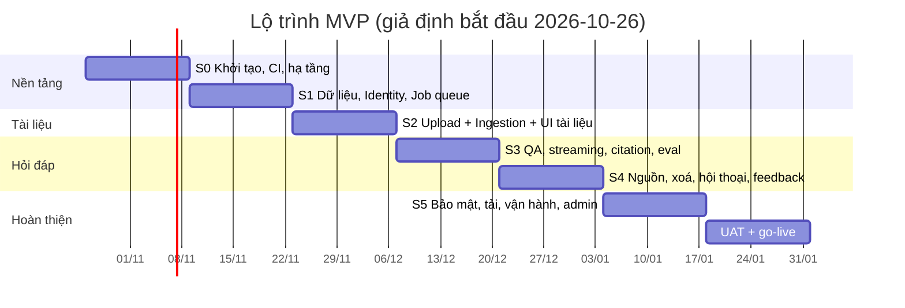
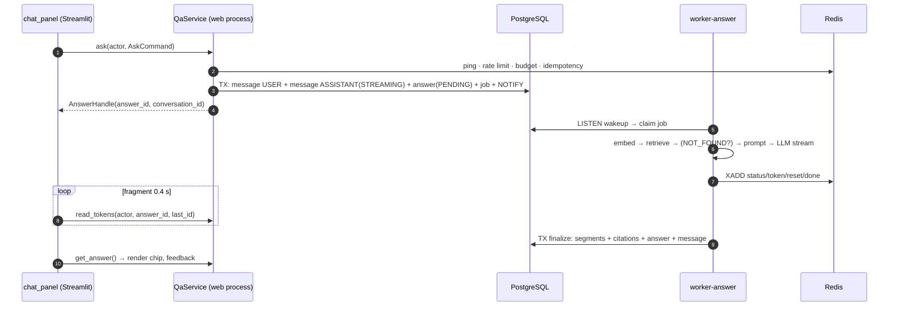
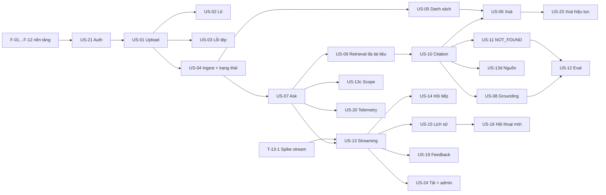

# Kế hoạch phát triển (Implementation Plan) — "Chat với tài liệu" MVP

| Mục | Giá trị |
|---|---|
| Mã tài liệu | **IMP-CVD-001** |
| Phiên bản | 0.2 (Draft) |
| Ngày | 2026-10-21 |
| Nguồn | [SADD.md](../design/SADD.md) (SADD-CVD-001 v1.0) · [User_Stories.md](../requirements/User_Stories.md) (US-CVD-001 v0.1) · [UIUX_Blueprint_Design.md](../design/UIUX_Blueprint_Design.md) · [PRD.md](../requirements/PRD.md) |
| Phạm vi | Đưa MVP nội bộ (Python 3.12 + Streamlit modular monolith) từ thiết kế đến go-live |

| Phiên bản | Nội dung |
|---|---|
| 0.1 | Kế hoạch tổng thể: gate, lộ trình, sprint, DoD, rủi ro |
| 0.2 | Thêm **Phần II — Đặc tả công việc phát triển theo user story** (§13–§23): quyết định làm rõ, nền tảng dùng chung, task theo từng story kèm hợp đồng, pseudo-code, trường hợp biên, test ↔ AC, ước lượng |

> **Cách đọc:** PM/Lead đọc Phần I (§1–§12). Developer nhận story đọc §13 (quy ước), §14 (quyết định làm rõ — **bắt buộc**), §15 (nền tảng dùng chung), rồi mục của story mình trong §16–§22.
>
> **Task chi tiết:** mỗi task là một file trong [tasks/](tasks/README.md) (156 task, mục lục theo sprint và theo story). File task là nguồn chi tiết nhất; khi task khác với bảng tóm tắt ở Phần II, **file task thắng**.

> **Giả định lập kế hoạch (cần Engineering Lead xác nhận):** đội 5 người (1 Tech Lead/Architect, 2 Backend, 1 AI/Backend, 1 QA kiêm DevOps bán thời gian); sprint 2 tuần; 6 sprint (S0–S5) + 2 tuần UAT/go-live ≈ **14 tuần**. Nếu đội nhỏ hơn, giữ nguyên thứ tự, kéo dài mốc theo tỷ lệ. Các giá trị `[TBD: OQ-xxx]` dùng mặc định của SADD §8.3 và đều cấu hình được.

---

## 1. Nguyên tắc triển khai

1. **Lát cắt dọc (vertical slice) sớm nhất có thể.** Hết S2 phải chạy được "tải PDF → Sẵn sàng"; hết S3 phải chạy được "hỏi → trả lời có trích dẫn" trên staging. Không làm xong hết hạ tầng rồi mới làm tính năng.
2. **Rủi ro cao làm trước:** chặn pháp lý (OQ-007), streaming + hủy qua Redis/fragment (ADR-005), chất lượng RAG (eval), giấy phép PyMuPDF (RISK-13).
3. **Đúng kiến trúc ngay từ đầu:** `ui → application → domain`, adapter qua port; `import-linter` chạy trong CI từ S0 (SADD §4.1, §5.5.2). Vi phạm là lỗi build.
4. **Eval harness xây từ S3, không để cuối.** Mọi thay đổi prompt/model sau đó đi qua eval gate (ADR-013).
5. **Tính năng P1/P2 sau cờ tính năng**, không chặn release P0.
6. **Không có gì "xong" nếu thiếu test, log không-nội-dung và (nếu có UI) đủ trạng thái trong sheet component.**

---

## 2. Cổng chặn (gates) và việc phi-code song song

| Cổng | Điều kiện | Chặn | Owner | Hạn |
|---|---|---|---|---|
| **G-01** | OQ-007: Bảo mật/Pháp chế duyệt bằng văn bản việc gửi nội dung tài liệu cho LLM/Embedding provider (US-22) | **Bắt đầu S1** với dữ liệu thật; S0 và dev với dữ liệu giả không bị chặn. Production luôn bị chặn | Security + PO | Cuối S0 |
| **G-02** | OQ-013: chốt SSO/OIDC, cấp client ID/secret, mapping group → role | Hoàn tất US-21 (S1) | IT/Security | Giữa S0 |
| **G-03** | Legal review giấy phép PyMuPDF (AGPL) — nếu không đạt, chuyển `pypdfium2` + `pdfplumber` sau `PdfPort` (RISK-13) | Chốt adapter PDF ở S2 | Legal + Architect | Giữa S1 |
| **G-04** | DEP-002: bộ ≥ 30 câu hỏi vàng + PDF mẫu do chuyên gia nghiệp vụ cung cấp, có doc/page chuẩn | Eval harness (S3) | PO/BA | Đầu S3 |
| **G-05** | OQ-002 (ngưỡng chất lượng), OQ-005, OQ-011, OQ-012 chốt hoặc chấp nhận mặc định bằng văn bản | Eval gate cuối (S5) | PO | Cuối S4 |
| **G-06** | Hạ tầng: VM, Postgres 16 + pgvector, Redis 7.2, MinIO/S3, egress allowlist, tài khoản LLM/Embedding | S0 (dev/staging), S5 (production) | IT/SRE | Đầu S0 |

Khi G-01 chưa xong: dùng PDF giả/công khai và provider mock/staging. **Không** đưa dữ liệu thật vào bất kỳ môi trường nào.

---

## 3. Lộ trình tổng thể



| Mốc | Cuối | Tiêu chí đạt |
|---|---|---|
| **M0** Walking skeleton | S0 | Repo, CI xanh, `docker compose up` chạy web/worker/ops + Postgres/Redis/MinIO, import-linter pass |
| **M1** Đăng nhập + nền dữ liệu | S1 | OIDC login thật (staging), migration đầy đủ, job queue chạy và reclaim được |
| **M2** Tài liệu dùng được | S2 | Tải PDF → Đang xử lý → Sẵn sàng/Lỗi tự cập nhật; danh sách đúng quyền |
| **M3** Hỏi đáp có nguồn | S3 | Hỏi → stream → trích dẫn / NOT_FOUND; hủy được; eval chạy được lần đầu (baseline) |
| **M4** Feature-complete P0 | S4 | Mở nguồn đúng trang, xoá có hiệu lực, hội thoại, feedback, telemetry |
| **M5** Release candidate | S5 | Security 0 Critical/High, load đạt SLO, eval đạt ngưỡng, backup/restore drill, runbook |
| **M6** Go-live | +UAT | Chữ ký G-01…G-05, checklist SADD §10.6 đầy đủ, người dùng thử nghiệm bắt đầu |

---

## 4. Chi tiết theo sprint

Ký hiệu: **[US-xx]** = user story; **[ADR-xx]**, **§** = tham chiếu SADD. Mỗi hạng mục kèm tiêu chí "xong" ngắn gọn; DoD chung ở §6. **Task chi tiết của từng story ở Phần II (§16–§22)**; bảng sprint dưới đây là góc nhìn tổng hợp.

### S0 — Khởi tạo và hạ tầng nền (M0)

**Mục tiêu:** đội có thể code, build, test, chạy cục bộ và triển khai staging; ranh giới kiến trúc được thực thi bằng máy.

| # | Hạng mục | Chi tiết | Xong khi |
|---|---|---|---|
| 0.1 | Scaffold repo | Cấu trúc §5.5.1: `app/{shared,identity,documents,ingestion,conversation,qa,feedback,telemetry,admin,infrastructure,ui}`, `prompts/`, `migrations/`, `tests/`, `deploy/`; `pyproject.toml`, `uv.lock`, `Dockerfile` một image | `uv sync` + `docker build` chạy |
| 0.2 | Công cụ chất lượng | Ruff, mypy (`--strict` cho domain/application), pytest + pytest-cov, **import-linter** (domain không import framework; ui không import infra), pre-commit, Conventional Commits | Vi phạm import làm CI đỏ |
| 0.3 | CI | Pipeline §5.5.4: lint/type → unit → integration (testcontainers Postgres+pgvector, Redis, MinIO) → build → Trivy + SBOM | PR kích hoạt đủ stage, ≤ 15 phút |
| 0.4 | Compose local/staging | `deploy/compose.yaml`: `web`, `worker-answer`, `worker-ingest`, `ops`, `postgres:16+pgvector`, `redis:7.2`, `minio`, Caddy; mạng app/data tách | `docker compose up` → `/readyz` 200 |
| 0.5 | Shared kernel | `Actor`, `Role`, UUIDv7, `Clock`, `AppError(code, user_message, retryable)`, `Result`, structlog JSON + correlation ID | Unit test pass |
| 0.6 | Cấu hình | `pydantic-settings` theo §10.2, fail-fast thiếu secret; bảng `app_config` (giới hạn) sẽ ở S1 | App không khởi động nếu thiếu secret |
| 0.7 | Ops service | `/healthz`, `/readyz` (kiểm tra DB/Redis/S3), metrics `prometheus_client` :9101–9103 | Test readiness khi ngắt dependency |
| 0.8 | Streamlit shell | `st.navigation` + trang rỗng Documents/Chat/History/Admin; cấu hình production §5.6.4 (XSRF, cookie, tắt CORS…) | Điều hướng chạy được |
| 0.9 | Chuẩn bị G-01…G-06 | Gửi yêu cầu duyệt OQ-007; xin IdP; xin hạ tầng; mời chuyên gia viết bộ câu hỏi vàng | Có người nhận và hạn cho từng gate |

**Rủi ro S0:** hạ tầng chậm (G-06) → dùng compose cục bộ làm "staging tạm".

---

### S1 — Dữ liệu, Identity, Job queue (M1)

**Mục tiêu:** nền tảng bền vững mà mọi tính năng sau dựa vào.

| # | Hạng mục | Story / ADR | Chi tiết | Xong khi |
|---|---|---|---|---|
| 1.1 | Schema & migration | §5.4, §10.1 | Alembic: `users, documents, document_chunks (vector(1536) + HNSW), conversations, messages, answers, answer_segments, citations, feedback, jobs, audit_log, telemetry_events, app_config`; chỉ mục §5.4.3; extension `vector`, `citext`, `pg_trgm`; role DB của app không có UPDATE/DELETE trên `audit_log` | `upgrade head` trên DB trống + có dữ liệu; mọi migration có `downgrade` |
| 1.2 | Repository + Unit of Work | §4.4 | SQLAlchemy 2.0 sync, pool `DB_POOL_SIZE`, statement timeout | Integration test với testcontainers |
| 1.3 | Identity | US-21, ADR-006 | `st.login()` OIDC, JIT provision user, map group → `END_USER`/`PM`/`ADMIN` (SADD §5.8.2), dựng `Actor` mỗi request; `AccessPolicy` (owner/shared theo OQ-008) | Authz test: không `Actor` → 0 truy cập |
| 1.4 | Màn hình SCR-01, SCR-08, SCR-10 | US-21 | Đăng nhập, 403 (không lộ tồn tại tài liệu), hết phiên (giữ nháp câu hỏi trong `session_state`) | AppTest 3 màn hình |
| 1.5 | Job queue | ADR-003, §5.3.7 | `JobQueuePort` trên Postgres: enqueue/claim `SKIP LOCKED`/complete/fail, backoff, partial unique, **reaper 60 s** (reclaim, DEAD, cập nhật trạng thái liên quan), scheduler giữ advisory lock | Test: kill worker → job reclaim ≤ visibility timeout; hai worker không nhận trùng |
| 1.6 | Worker runtime | §5.3.1, §5.3.10 | `python -m app.worker --queues …`, thread pool, graceful shutdown (30 s, trả job về QUEUED) | Test SIGTERM |
| 1.7 | Config nghiệp vụ + `GET`-tương-đương | US-24, ADR-011 | `app_config` + cache TTL 30 s + audit thay đổi; service cấp giới hạn (size, pages, files, ký tự) cho UI — **UI không hard-code** | Đổi giá trị → UI đọc lại ≤ 30 s |
| 1.8 | Telemetry nền | US-20 | `TelemetryService` ghi `question_submitted`, `answer_completed`, `answer_error`, **không chứa nội dung** | Test: payload không có trường text |
| 1.9 | Observability nền | §5.9 | Log JSON, metric cơ bản job/DB, trace ID | Dashboard tối thiểu |

**Gate:** G-01 phải xong trước khi sang S2 nếu cần dữ liệu thật; G-02 cần xong trong sprint này.

---

### S2 — Upload, Ingestion, UI tài liệu (M2)

**Mục tiêu:** vòng đời tài liệu trọn vẹn trừ xoá và xem trang.

| # | Hạng mục | Story / ADR | Chi tiết | Xong khi |
|---|---|---|---|---|
| 2.1 | Ports hạ tầng | ADR-008/009 | `ObjectStoragePort` (MinIO/S3, timeout/retry/breaker §5.7.6), `PdfPort` (adapter theo kết quả G-03), `EmbeddingPort` (adapter thật + fake cho test) | Contract test với fixture ghi sẵn |
| 2.2 | `DocumentService.upload` | US-01, 02, 03 | Stream SHA-256, kiểm magic `%PDF`, **inspect trong subprocess** (`needs_pass`, `page_count`), từ chối vượt size/trang với thông điệp nêu tên + giới hạn + thực tế; chống trùng `(owner, checksum)`; `putObject` rồi transaction (document + job) ; `seek(0)`, không nạp cả file vào RAM | Upload 5×20 MB ack p95 ≤ 2 s (NFR-PERF-03) |
| 2.3 | Trùng tên & lô | US-01, 02 | SCR-07 "Thay thế"/"Giữ cả hai"; tối đa 3 tệp song song, lỗi một tệp không chặn tệp khác | AppTest + integration |
| 2.4 | Ingestion worker | US-04, §5.3.3 | `document.ingest`: tải S3 → extract (subprocess, timeout 300 s) → chunk 700/105 token, không vượt trang, `anchor p{page}#c{n}`, `char_start/end` → embed batch (cache `sha256(model+text)`) → ghi chunk idempotent → READY; retry 3 (30 s/2 min/5 min); advisory lock theo document; kiểm tra `DELETING` trước mỗi batch | Test: PDF văn bản → READY có chunk; PDF scan → `PDF_NO_TEXT`; mã hoá → `PDF_ENCRYPTED` |
| 2.5 | Mã lỗi & thông điệp | US-03 | Ánh xạ `PDF_*`, `EMBED_FAILED`… (§10.4) sang thông điệp tiếng Việt đúng AC-03.x | Bảng mã lỗi có test |
| 2.6 | State machine Document | §5.3.8 | `PROCESSING/READY/ERROR/DELETING/DELETED` với kiểm tra chuyển trạng thái trong domain | Unit test mọi chuyển hợp lệ/không hợp lệ |
| 2.7 | UI tài liệu | US-04, 05, 07(AC-07.2), 24 | SCR-02/03/04: dropzone (hiển thị giới hạn từ config), `DocumentItem` + chip trạng thái (icon + nhãn), `@st.fragment(run_every=2–3s)` cập nhật trạng thái không reload, banner "Đang xử lý n tài liệu", "Thử lại"/"Xoá"; `DocumentService.retry` | AppTest: trạng thái đổi không cần tải lại |
| 2.8 | Danh sách & quyền | US-05 | `list` phân trang cursor, lọc theo quyền (OQ-008); widget `key` theo `doc_id` | Authz matrix cho `list/get` |
| 2.9 | GC lưu trữ | §5.3.2 | Job `storage.gc` dọn object mồ côi > 24 h | Integration test |
| 2.10 | Fuzz upload | NFR-SEC-03 | Tệp giả đuôi, PDF hỏng, zip-bomb, PDF khổng lồ: worker không sập, job vào DLQ | Fuzz suite chạy trong CI nightly |

---

### S3 — Hỏi đáp, streaming, trích dẫn, eval (M3) — **sprint rủi ro cao nhất**

**Mục tiêu:** lõi giá trị của sản phẩm chạy đúng và đo được.

| # | Hạng mục | Story / ADR | Chi tiết | Xong khi |
|---|---|---|---|---|
| 3.1 | Spike sớm (đầu sprint, 2–3 ngày) | ADR-005 | Chứng minh: worker → Redis Stream → `st.fragment(run_every=0.4s)` hiển thị token mượt, nút **Dừng nằm trong fragment** hoạt động giữa chừng, không treo UI | Demo ghi hình; quyết định go/no-go phương án |
| 3.2 | `LLMPort` + adapter | ADR-009 | `stream_chat`, timeout first-token 10 s/total 60 s, retry 1 nếu chưa có token, circuit breaker 60 s; fake LLM cho test | Contract test + fake |
| 3.3 | Retrieval | US-07, 09, 13c | Embed câu hỏi, pgvector cosine `top_k=8`, `min_score=0.25`, `SET LOCAL hnsw.ef_search=40`, lọc `READY` + `deleted_at IS NULL` + `scope_doc_ids` + quyền, mở rộng lân cận ±1 (≤ 8 chunk), chỉ đúng `embedding_model` hiện tại | Test lọc: tài liệu đã xoá/không quyền/ngoài scope không bao giờ xuất hiện |
| 3.4 | `QaService.ask` | US-07, 13 | Kiểm tra Redis, rate limit `INCR`+TTL, tài liệu READY trong scope, idempotency key `(user, conv, key)`; một transaction: message USER + ASSISTANT(STREAMING) + Answer(PENDING) + Job | Double-submit không tạo 2 answer |
| 3.5 | Worker `answer.generate` | US-08, 11 | Nhánh NOT_FOUND **trước** khi gọi LLM (DR-03, tiết kiệm chi phí); build prompt `qa_answer.v1` với `[S1..Sn]`; stream batch token → Redis (`MAXLEN~5000`, TTL 1 h); kiểm tra cancel trước LLM và sau mỗi batch | Hủy → dừng ≤ 2 s |
| 3.6 | Citation pipeline | US-10, ADR-007 | `CitationValidator` (parse, loại marker lạ, `reset` + retry 1 lần với prompt chặt, rồi NOT_FOUND), `CitationAssembler` (snapshot tên/trang/anchor/quote), ghi segments + citations trong 1 transaction; ẩn marker `[S#]` khi stream | Không có Answer `ANSWERED` thiếu citation (invariant + test) |
| 3.7 | Hủy & phục hồi | NFR-UX-01, §5.3.4 | `QaService.cancel` (Redis flag + cập nhật job `QUEUED`→`DEAD` nguyên tử), partial segments lưu, fallback đọc DB mỗi 2 s, watchdog 120 s, reaper chuyển answer `ERROR` khi job chết | Chaos test: kill worker giữa stream; ngắt Redis |
| 3.8 | UI hội thoại | US-07, 08, 11, 13, 13b | SCR-05: `Composer` (Enter/Shift+Enter, đếm ký tự, trạng thái vô hiệu), `AnswerView` (stream, chỉ báo "đang tìm…" ≤ 300 ms, nút Dừng, thẻ NOT_FOUND 🔍, trạng thái lỗi AI / chưa hoàn tất), `CitationChip` (nhãn, tên dài, `key` `cite:{answer}:{ord}:{idx}`), disclaimer cố định; chuỗi UI tách khỏi mã (sẵn sàng i18n) | AppTest các biến thể ở sheet component |
| 3.9 | Chọn phạm vi | US-13c (P1) | Hộp chọn ở tài liệu READY, gửi `scopeDocIds` | 100% citation thuộc tài liệu đã chọn |
| 3.10 | **Eval harness** | US-12, ADR-013, G-04 | `python -m app.eval`: nạp bộ ≥ 30 câu (trong 1 tài liệu / đa tài liệu / ngoài phạm vi); đo accuracy, citation precision, not-found accuracy, p90 first-token, cost/answer; lưu **baseline**; chạy nightly | Có baseline đầu tiên và báo cáo |
| 3.11 | Telemetry hỏi đáp | US-20 | Phát `question_submitted/answer_completed/answer_error` từ luồng thật; `answers.first_token_ms`, `total_ms`, `model`, `prompt_version` | Số liệu khớp 100% trong kịch bản kiểm thử |

**Điều kiện thoát S3:** nếu spike 3.1 thất bại, dừng và họp kiến trúc (phương án B: tách API streaming mỏng – ghi ADR) **trước** khi tiếp tục. Eval lần đầu có thể chưa đạt ngưỡng; mục tiêu S3 là *đo được*, mục tiêu S5 là *đạt*.

---

### S4 — Nguồn, xoá, hội thoại, feedback (M4)

**Mục tiêu:** hoàn tất toàn bộ P0 và P1.

| # | Hạng mục | Story / ADR | Chi tiết | Xong khi |
|---|---|---|---|---|
| 4.1 | Source viewer | US-13d, ADR-008 | `DocumentService.render_page` (PyMuPDF/adapter, 144 dpi, highlight `quote`, `no-store`, cache in-process 30 phút theo `(doc, page, version)`, không cache chéo user); khung "Nguồn" với điều hướng trang; `Esc` trả focus về chip; khuyến nghị PM: coi là P0 | E2E: bấm chip → đúng trang ≤ 1 thao tác |
| 4.2 | Xoá tài liệu | US-06, 23, ADR-010 | SCR-06; transaction: `DELETING` + `deleted_at` + audit + job; retrieval/UI lọc ngay (≤ 1 s); job `document.purge` (xoá vector, S3, đánh dấu `citations.deleted`, `DELETED`) dùng cùng advisory lock với ingest; retry 5 | E2E: hỏi lại câu cũ → không có thông tin/citation từ tài liệu đã xoá; chip "Tài liệu đã bị xoá" |
| 4.3 | Xử lý đua | §5.3.3, §5.3.6 | Xoá khi đang ingest; thao tác trên tài liệu đã bị người khác xoá → toast "Tài liệu không còn tồn tại" | Test đồng thời ingest ∥ delete |
| 4.4 | Conversation | US-14, 15, 16 | `ConversationService`: tạo/list/get, tiêu đề, phân trang, giới hạn lượt ngữ cảnh (3 lượt gần nhất), "＋ Hội thoại mới" ở TopBar, SCR-09 lịch sử nhóm theo ngày; chỉ thấy hội thoại của mình | Authz + E2E; AC-16.1 |
| 4.5 | Hỏi tiếp (follow-up) | US-14 | Đưa lịch sử vào prompt; `is_followup` vào telemetry; `FEATURE_QUERY_REWRITE` (TD-08) chỉ bật nếu eval follow-up < 8/10 | Kịch bản mẫu ≥ 8/10 |
| 4.6 | Feedback | US-19 | `FeedbackBar` 👍/👎, upsert `ON CONFLICT(answer_id,user_id)`, ô lý do tuỳ chọn, retry ngầm 3 lần, ẩn khi stream/lỗi | Bấm lại = cập nhật, không trùng |
| 4.7 | Retention job | OQ-012 | `retention.sweep` theo `CONVERSATION_RETENTION_DAYS`, audit/telemetry/job history | Test theo ngày giả lập |
| 4.8 | `integrity.check` | §5.4.5 | READY không chunk, ANSWERED không citation, citation mồ côi | Job chạy hằng ngày, alert khi lệch |
| 4.9 | Gợi ý & tóm tắt | US-17, 18 (P2) | **Chỉ làm nếu còn dung lượng**; đặt sau `FEATURE_SUMMARIZE`; US-18: 1–3 chip gợi ý, mỗi gợi ý phải trả lời được có trích dẫn | Có cờ; mặc định tắt |
| 4.10 | Accessibility & i18n | UX | Trạng thái không chỉ dựa vào màu, thao tác bàn phím, chịu giãn chữ +30% | Rà soát theo checklist UI/UX |

---

### S5 — Hoàn thiện: bảo mật, tải, vận hành, admin (M5)

**Mục tiêu:** đủ điều kiện production.

| # | Hạng mục | Story / ADR | Chi tiết | Xong khi |
|---|---|---|---|---|
| 5.1 | Admin | US-24, ADR-011 | Trang `/admin` (ADMIN): chỉnh giới hạn, feature flag, xem `audit_log`; mọi thay đổi có validate + audit | Người không phải ADMIN → 403 |
| 5.2 | Ngân sách & rate limit | NFR-COST-01, QA-10 | `DAILY_TOKEN_BUDGET` (chặn/giảm tần suất, không vượt 120%), `RATE_LIMIT_ASKS_PER_HOUR`, thông báo `ERR-RATE-LIMIT` | Test vượt hạn mức |
| 5.3 | Kiểm thử bảo mật | §5.8, NFR-SEC-* | **Authz matrix 100%** (đoán `docId`/`convId`/`answerId` của người khác → 403/404, có audit); prompt-injection trong PDF; ZAP/DAST; log audit không chứa nội dung; cookie `Secure/HttpOnly/SameSite`; Trivy 0 Critical/High; egress allowlist | 0 lỗi Critical/High |
| 5.4 | Kiểm thử tải | US-24, QA-03, QA-09 | Locust: 10 đồng thời, 50 câu/giờ, kèm upload; đo p90 first-token ≤ 4 s, lỗi < 2%; benchmark truy hồi p95 ≤ 300 ms | Báo cáo đạt SLO (AC-24.1) |
| 5.5 | Chaos/độ bền | NFR-REL-02/03 | Kill worker, ngắt Redis, LLM 5xx/timeout, đầy đĩa | Hành vi đúng QA-05, QA-08; không treo UI |
| 5.6 | Eval gate cuối | US-12, ADR-013 | Tinh chỉnh prompt/chunk/top_k; đạt ngưỡng OQ-002 (mặc định accuracy ≥ 80%, citation ≥ 90%, NOT_FOUND ≥ 9/10); lưu baseline phát hành; gắn eval vào CI nightly + trước đổi prompt/model | Báo cáo eval ký duyệt |
| 5.7 | Quan sát & cảnh báo | §5.9 | Dashboard (SLI/SLO, job backlog, chi phí token), alert đến on-call, 5 sự cố chính có runbook (RUN-01…09) | Alert test: phát hiện ≤ 5 phút |
| 5.8 | Backup/restore | NFR-OPS-02 | `pg_dump` + `mc mirror` định kỳ; **drill restore sang DB mới**, đo RPO/RTO (RTO ≤ 4 h) | Biên bản drill |
| 5.9 | Triển khai production | ADR-012 | Compose production, Caddy TLS 1.3, blue/green hai cổng, migration trước app, script rollback | Diễn tập deploy + rollback trên staging |
| 5.10 | Tài liệu bàn giao | §9.3, §10.6 | README dev, biến môi trường, runbook, sơ đồ 4+1 cập nhật hoặc đánh dấu "reference" (§10.7), hướng dẫn người dùng | Ops xác nhận nhận bàn giao |

---

### UAT và go-live (2 tuần)

| Tuần | Hoạt động |
|---|---|
| U1 | UAT với nhóm nhân viên phát triển kinh doanh (persona P-A) trên staging bằng tài liệu thật *đã được duyệt* (G-01); chuyên gia nghiệp vụ chấm lại bộ câu hỏi; sửa lỗi P0/P1 |
| U2 | Checklist production readiness (SADD §10.6) hoàn tất; ký G-01…G-05; phê duyệt thủ công; deploy production; theo dõi 24 h; bắt đầu thu thập MET-002/003/004 phục vụ go/no-go |

---

## 5. Phủ user story theo sprint

| Story | Ưu tiên | Sprint | Ghi chú |
|---|---|---|---|
| US-01 Tải 1 PDF | P0 | S2 | |
| US-02 Tải nhiều PDF | P1 | S2 | 3 tệp song song |
| US-03 Lý do bị từ chối | P0 | S2 | Mã lỗi §10.4 |
| US-04 Trạng thái tài liệu | P0 | S2 | Fragment poll DB |
| US-05 Danh sách theo quyền | P0 | S2 | Authz matrix |
| US-06 Xoá tài liệu | P0 | S4 | Soft delete + purge |
| US-07 Hỏi câu tự nhiên | P0 | S3 | |
| US-08 Chỉ dựa tài liệu | P0 | S3 → S5 | Đạt ngưỡng ở eval cuối |
| US-09 Tổng hợp đa tài liệu | P0 | S3 | |
| US-10 Trích dẫn tên + trang | P0 | S3 | |
| US-11 NOT_FOUND | P0 | S3 | Không gọi LLM khi không có chunk |
| US-12 Chất lượng cam kết | P0 | S3 (harness) → S5 (đạt) | G-04, G-05 |
| US-13 Thấy trả lời nhanh | P0 | S3 → S5 | Load test cuối |
| US-13b Ngôn ngữ làm việc | P0 | S3 | Prompt + eval VN/EN |
| US-13c Giới hạn phạm vi | P1 | S3 | |
| US-13d Bấm chip mở nguồn | P1 (khuyến nghị P0) | S4 | |
| US-14 Hỏi tiếp | P1 | S4 | |
| US-15 Lịch sử | P1 | S4 | |
| US-16 Hội thoại mới | P1 | S4 | |
| US-17 Tóm tắt | P2 | S4 (nếu còn dung lượng) | Cờ tắt |
| US-18 Gợi ý câu hỏi | P2 | S4 (nếu còn dung lượng) | Cờ tắt |
| US-19 Đánh giá 👍/👎 | P0 | S4 | |
| US-20 Đếm câu hỏi/người/tuần | P0 | S1 (nền) → S3 (phát sự kiện) | |
| US-21 Truy cập có quyền | P0 | S1 | G-02 |
| US-22 Xác nhận tuân thủ | P0 | S0 → trước S2 | **G-01** |
| US-23 Dữ liệu xoá không còn dùng | P0 | S4 | |
| US-24 Giới hạn vận hành | P0 | S1 (config) → S5 (tải) | |

Nếu phải cắt phạm vi: bỏ theo thứ tự **US-17 → US-18 → US-14 (rewrite) → US-15/16 → US-02**. Không bao giờ cắt: citation, NOT_FOUND, authz, xoá có hiệu lực, eval gate.

---

## 6. Định nghĩa "Sẵn sàng" và "Xong"

**Definition of Ready (story vào sprint):** AC rõ; màn hình/thiết kế có (SCR-xx); `[TBD]` liên quan có giá trị mặc định cấu hình được; dữ liệu/PDF mẫu sẵn sàng.

**Definition of Done (mỗi hạng mục):**

- [ ] Code qua review (1 approval), CI xanh: ruff, mypy, import-linter, unit, integration.
- [ ] Coverage domain/application ≥ 80%, toàn bộ ≥ 60%.
- [ ] Mọi use case nhận `Actor` và có test phân quyền (cả trường hợp bị từ chối).
- [ ] Migration có `downgrade` hoặc ghi rõ "irreversible" + kế hoạch backup.
- [ ] Không log nội dung câu hỏi/trả lời/tài liệu; lỗi có `corrId`, không lộ stack trace.
- [ ] UI: đủ trạng thái (rỗng, đang tải, lỗi, vô hiệu), widget `key` ổn định theo ID nghiệp vụ, không `unsafe_allow_html`.
- [ ] Triển khai staging tự động và smoke test pass.
- [ ] AC của story được QA xác nhận; tài liệu/runbook cập nhật nếu đổi hành vi vận hành.

---

## 7. Chiến lược kiểm thử theo sprint

| Tầng | Bắt đầu | Công cụ | Ghi chú |
|---|---|---|---|
| Unit | S0 | pytest | Domain policy, state machine, chunking, citation parser |
| Integration | S1 | testcontainers (Postgres+pgvector, Redis, MinIO) | Repository, job queue, stream, migration |
| Contract | S2 | respx/VCR | LLM/Embedding adapter, không gọi mạng thật |
| UI | S2 | `streamlit.testing.v1.AppTest` | Mọi màn hình SCR-xx |
| E2E | S4 | Playwright + OIDC mock | 5 luồng: tải lên, hỏi–trích dẫn, hủy, xoá, feedback |
| RAG eval | S3 | `app.eval` | Nightly + trước đổi prompt/model; chặn nếu giảm > 5% |
| Security | S5 (authz từ S1) | pytest + ZAP | Authz matrix chạy từ S1, mở rộng mỗi sprint |
| Load / Chaos | S5 | Locust / script | Kịch bản §7.2 SADD |
| Restore drill | S5 | script | RTO ≤ 4 h |

---

## 8. Rủi ro triển khai và cách xử lý

| ID | Rủi ro | Dấu hiệu | Xử lý | Liên kết |
|---|---|---|---|---|
| IR-01 | OQ-007/OQ-013 chậm | Chưa có văn bản duyệt cuối S0 | Dev bằng dữ liệu giả + mock provider; leo thang PO; **không** đẩy dữ liệu thật; lùi go-live thay vì bỏ gate | RISK-06 |
| IR-02 | Streaming + Dừng không mượt trong Streamlit | Spike 3.1 thất bại / UI giật | Giảm tần suất poll, tối ưu fragment; nếu vẫn không đạt → ADR phương án B (endpoint streaming mỏng), ảnh hưởng ≤ 1 sprint | ADR-005, RISK-01 |
| IR-03 | Chất lượng RAG dưới ngưỡng | Eval S3 baseline thấp | Tinh chỉnh chunk size/overlap, `min_score`, `top_k`, prompt; bật query rewrite; xem xét hybrid search (TD-01) — mỗi thay đổi qua eval gate | RISK-02 |
| IR-04 | Giấy phép PyMuPDF không được duyệt | G-03 từ chối | Chuyển `pypdfium2` + `pdfplumber` sau `PdfPort`; dự trù +3–5 ngày ở S2 và kiểm tra lại chất lượng extract/highlight | RISK-13 |
| IR-05 | PDF thực tế nhiều bảng/scan | Tỷ lệ `PDF_NO_TEXT`/extract kém cao | Thông báo rõ, không hứa OCR (BR-028); thu thập tỷ lệ để quyết định TD-02 | RISK-03 |
| IR-06 | Chi phí LLM/embedding vượt | Dashboard token | NOT_FOUND không gọi LLM, cache embedding, giới hạn context, ngân sách ngày | RISK-05 |
| IR-07 | Bộ câu hỏi vàng trễ | G-04 trễ | Dev tự soạn bộ tạm trên PDF công khai để xây harness; thay bằng bộ thật trước S5 | DEP-002 |
| IR-08 | Đội thiếu người/nghỉ | Velocity thấp | Cắt phạm vi theo thứ tự §5; giữ P0 | — |
| IR-09 | Race ingest ∥ delete, cancel ∥ claim | Lỗi hiếm khó tái hiện | Advisory lock, `UPDATE … WHERE status='QUEUED'`; test đồng thời bắt buộc ở S3/S4 | §5.3 |
| IR-10 | Hạ tầng đơn (SPOF) | Sự cố VM | Backup + drill; runbook; chấp nhận cho MVP (RISK-07) | ADR-012 |

---

## 9. Vai trò và trách nhiệm (gợi ý)

| Vai trò | Trách nhiệm chính | Module owner (SADD §5.2.3) |
|---|---|---|
| Tech Lead / Architect | Ranh giới kiến trúc, ADR, review, spike 3.1 | `shared`, ranh giới tổng |
| Backend 1 | Documents, Conversation, Feedback, UI tài liệu/hội thoại | `documents`, `conversation`, `feedback` |
| Backend 2 / Platform | Identity, job queue, telemetry, admin, CI/CD, observability | `identity`, `telemetry`, `admin`, `infrastructure/db` |
| AI/Backend | Ingestion, QA, prompt, citation, eval | `ingestion`, `qa` |
| QA/DevOps | Test tự động, load/chaos, deploy, backup drill | `tests/`, `deploy/` |
| PO / BA | OQ, bộ câu hỏi vàng, UAT, chấm chất lượng | — |
| Security / Legal / IT | G-01, G-02, G-03, G-06, review bảo mật | — |

---

## 10. Theo dõi tiến độ và báo cáo

- **Hằng sprint:** demo vào cuối sprint trên staging; review/retro; cập nhật bảng §5 và trạng thái gate §2.
- **Chỉ số theo dõi:** velocity, số bug P0/P1 mở, độ phủ test, kết quả eval (accuracy / citation / not-found / p90 first-token / cost), thời gian CI.
- **Escalation:** gate trễ > 1 tuần hoặc spike thất bại → báo PO ngay trong ngày; quyết định dời mốc hoặc cắt phạm vi được ghi lại (ADR hoặc biên bản).

---

## 11. Tiêu chí hoàn thành MVP (khớp SADD §9.3 và §10.6)

- [ ] Tất cả story P0 xong và có test; P1 xong hoặc có quyết định hoãn bằng văn bản.
- [ ] Authz matrix 100% pass; Trivy/ZAP 0 Critical/High.
- [ ] Eval 30 câu đạt ngưỡng OQ-002; load test 10 đồng thời đạt p90 first-token ≤ 4 s (hoặc ngưỡng OQ-011 đã chốt).
- [ ] Xoá tài liệu có hiệu lực ngay, citation hiển thị "Tài liệu đã bị xoá".
- [ ] Backup/restore drill thành công; dashboard + alert + runbook cho các sự cố chính.
- [ ] OQ-007 và OQ-013 được duyệt bằng văn bản; không còn `[TBD]` ảnh hưởng release.
- [ ] Tài liệu vận hành đã bàn giao và Ops xác nhận.

---

## 12. Điểm cần xác nhận trước khi khởi động

1. Quy mô đội và ngày bắt đầu thực tế (lịch ở §3 là giả định).
2. Chọn nhà cung cấp LLM/Embedding (ảnh hưởng `EMBEDDING_DIM` = 1536 trong schema và chi phí).
3. Quyết định pháp lý PyMuPDF (G-03) — ảnh hưởng adapter PDF.
4. US-13d nâng lên P0 hay giữ P1 (khuyến nghị: P0).
5. Phạm vi P2 (US-17, US-18) có nằm trong MVP hay hoãn sang giai đoạn sau.
6. Các quyết định làm rõ ở §14 (đặc biệt C-01, C-04, C-06, C-12) — Tech Lead chốt trước S2.

---
---

# Phần II — Đặc tả công việc phát triển theo user story

## 13. Quy ước đọc Phần II

**Mã task:** `T-<story>-<n>` (ví dụ `T-01-3`); nền tảng dùng chung là `F-<n>`.
**Tầng** (theo SADD §4.1): `DB` migration · `DOM` domain (không import framework) · `APP` application service · `INF` adapter hạ tầng · `WRK` job handler trong worker · `UI` Streamlit · `TEST` · `OPS` cấu hình/vận hành.
**Ước lượng:** ngày công lý tưởng của một developer (d), **đã gồm unit test** của task đó; chưa gồm review và họp.

**Mỗi story có:**

1. **Mục tiêu kỹ thuật**: nói ngắn story cần gì ở mức code.
2. **Phụ thuộc**: task/story phải xong trước.
3. **File chính**: theo cấu trúc SADD §5.5.1 (`app/<module>/{domain,service,ports,repository,schemas}.py`).
4. **Bảng task**.
5. **Hợp đồng & pseudo-code**: chữ ký hàm, SQL, khóa Redis. Đây là nguồn chuẩn để code; nếu lệch SADD, mục này chỉ ra lý do.
6. **Trường hợp biên**: phải có test.
7. **Test ↔ AC**: mỗi AC có ít nhất một test tự động hoặc một bước kiểm thủ công được ghi rõ.

**Quy tắc bất biến khi code (nhắc lại từ SADD, vi phạm = không merge):**

- UI không import `app.infrastructure.*`, không SQL, không gọi LLM. UI chỉ gọi service lấy từ `app/bootstrap.py`.
- Mọi method service nhận `Actor` làm tham số đầu tiên và tự kiểm tra quyền. Không tin `doc_id`, `answer_id`, `conversation_id` từ UI.
- Không log nội dung câu hỏi, câu trả lời, chunk hay tên tệp đầy đủ. Chỉ log ID, hash và độ dài.
- Không `unsafe_allow_html=True`. Không `st.cache_data` cho dữ liệu có phân quyền. `st.cache_resource` chỉ dùng cho engine, pool và client.
- Widget lặp có `key` theo ID nghiệp vụ.
- Chuỗi hiển thị lấy từ `app/ui/i18n/vi.py` qua `t("key", **params)`, không viết cứng trong component.

---

## 14. Quyết định làm rõ (đọc trước khi code)

Các điểm dưới đây là chỗ tài liệu nguồn chưa khớp nhau hoặc Streamlit có giới hạn kỹ thuật. Đây là **mặc định để triển khai**; Tech Lead có quyền đổi, nhưng đổi thì phải cập nhật bảng này.

| ID | Vấn đề | Quyết định triển khai | Ảnh hưởng |
|---|---|---|---|
| **C-01** | SADD §5.7.1 dùng nhiều page (`/`, `/chat`, `/history`), còn Blueprint/HTML là **một màn hình chính 3 cột** | Làm **một page chính** `app/ui/pages/main.py` với `st.columns([0.22, 0.48, 0.30])`: Tài liệu / Hội thoại / Nguồn. Lịch sử là `@st.dialog`. `/admin` là page riêng. Các "page" của SADD trở thành component: `document_panel.py`, `chat_panel.py`, `source_panel.py`, `history_dialog.py` | US-04…US-16 |
| **C-02** | Blueprint dùng SSE và có sự kiện `citation` trong stream | Theo **ADR-005**: Redis Stream + `st.fragment(run_every=…)`. Sự kiện stream chỉ có `status / token / reset / done`. **Citation không đi qua stream**: sau `done`, UI đọc `AnswerDTO` từ DB rồi render chip | US-10, US-13 |
| **C-03** | Chip citation phải "nội tuyến" (ADR-UX-02), nhưng Streamlit không chèn được nút vào giữa văn bản | Render từng **segment** bằng `st.markdown`, ngay dưới đó là **một hàng chip** (`st.button`) của segment đó. Chip vẫn gắn đúng đoạn, không gom cuối câu trả lời | US-10, US-13d |
| **C-04** | `st.file_uploader(type=["pdf"])` tự từ chối tệp khác bằng thông điệp tiếng Anh, nên không đạt AC-03.1 | Dùng `type=None` và tự kiểm tra đuôi + magic bytes trong `DocumentService` để hiển thị đúng "<tên tệp>: chỉ hỗ trợ PDF". Đặt `server.maxUploadSize` = `MAX_UPLOAD_MB + 5` để tệp vượt giới hạn một chút vẫn đến được code và nhận thông điệp của ta; tệp lớn hơn nữa nhận thông điệp của Streamlit (chấp nhận) | US-01, US-03 |
| **C-05** | Streamlit đã giữ `UploadedFile` trong RAM, nên yêu cầu "không nạp toàn bộ vào RAM" chỉ đạt được một phần | Không gọi `.getvalue()` hoặc copy bytes. Truyền thẳng đối tượng file-like xuống service; băm SHA-256 theo khối 1 MB; `seek(0)` trước khi `put` | US-01 |
| **C-06** | `st.chat_input` không prefill được nháp, không đổi được nút Gửi thành Dừng, không hiện bộ đếm `n/max` | Composer = `st.chat_input(max_chars=MAX_QUESTION_CHARS, disabled=…)`. Khi đang trả lời: `chat_input` bị `disabled`, nút **⏹ Dừng** nằm trong fragment stream (SADD §5.7.1). Bộ đếm: `chat_input` tự chặn khi vượt `max_chars`; caption "Tối đa {n} ký tự" hiển thị dưới ô | US-07, US-13, US-21 |
| **C-07** | AC-21.2 yêu cầu giữ nháp khi hết phiên, nhưng sau `st.login()` thì session mới, `session_state` mất | Khi phát hiện hết phiên lúc người dùng gửi câu hỏi: lưu câu hỏi vào Redis `draft:{sha256(subject)}` với TTL 24 h. Sau khi đăng nhập lại, hiện banner "Câu hỏi chưa gửi: … [Gửi lại] [Bỏ]". Đạt mức "nếu có thể" của AC | US-21 |
| **C-08** | Phím tắt `Esc` (dừng, trả focus) và `Ctrl+K` không có sẵn trong Streamlit | **Không làm trong MVP** (ghi nợ `TD-UX-01`). Thay bằng nút Dừng và nút "✕ Đóng" ở khung Nguồn. Nếu UX bắt buộc thì làm custom component sau | US-13, US-13d |
| **C-09** | Giới hạn độ dài câu hỏi là `[TBD: OQ-005]`, chưa có trong SADD §10.2 | Thêm `MAX_QUESTION_CHARS` = **2000** vào `app_config` | US-07, US-24 |
| **C-10** | OQ-008 (tài liệu dùng chung hay riêng) chưa chốt; thiết kế không có nút chia sẻ | Schema có `visibility`. Mặc định theo SADD là `PRIVATE`. Thêm `DOCUMENT_DEFAULT_VISIBILITY` (`PRIVATE`/`SHARED`) trong `app_config`; mục "Chia sẻ / Thôi chia sẻ" trong menu ⋯ để sau cờ `FEATURE_DOC_SHARING` (mặc định tắt). **PO cần chốt trước S2** | US-05, US-06 |
| **C-11** | Danh sách tài liệu của ADMIN | Màn hình chính của ADMIN hiển thị **giống người dùng thường** (của mình + được chia sẻ). Truy cập tài liệu private của người khác chỉ qua `/admin` và có audit, để tránh audit tràn ngập mỗi lần list | US-05 |
| **C-12** | Trùng lặp khi tải lên | (a) **Cùng nội dung** (cùng `checksum` với tài liệu chưa xoá của mình): không tạo mới, trả tài liệu cũ, toast "Tệp đã có trong danh sách". (b) **Cùng tên, khác nội dung**: mở SCR-07 "Thay thế" / "Giữ cả hai". *Thay thế* = xoá mềm tài liệu cũ + tạo mới trong cùng transaction. *Giữ cả hai* = đặt tên `ten (2).pdf` | US-01, US-02 |
| **C-13** | Lô vượt `MAX_FILES_PER_UPLOAD` | Từ chối **cả lô** trước khi xử lý, thông báo "Tối đa {n} tệp mỗi lần, bạn đã chọn {m}" | US-02 |
| **C-14** | Nút "Thử lại" cho tài liệu lỗi | Chỉ hiện với lỗi **tạm thời** (`EXTRACT_FAILED`, `EMBED_FAILED`, `INDEX_FAILED`, `WORKER_LOST`). Lỗi vĩnh viễn (`PDF_NO_TEXT`, `PDF_CORRUPT`, `PDF_ENCRYPTED`) chỉ có "Xoá" | US-03, US-04 |
| **C-15** | Tiến trình theo phần trăm cho từng tệp | Streamlit đã có thanh tiến trình **tải lên**. Bước **xử lý** chỉ có chip "Đang xử lý" quay, không có %. Nếu cần % sau này thì thêm cột `documents.ingest_progress` | US-02, US-04 |
| **C-16** | Mã lỗi mới chưa có trong SADD §5.7.5 / §10.4 | Bổ sung: `PDF_NOT_PDF`, `ERR-Q-EMPTY`, `ERR-Q-TOO-LONG`, `ERR-NO-READY-DOC`, `ERR-BUDGET`, `ERR-REDIS-UNAVAILABLE`, `WORKER_LOST` (SADD đã nhắc trong reaper). Cập nhật lại SADD khi review | Nhiều story |
| **C-17** | Mô tả "Thử lại / Tạo lại" cho câu trả lời lỗi | `answers.question_message_id` là UNIQUE nên không tái dùng được. "Thử lại" = gọi `ask` lại cùng nội dung câu hỏi trong cùng hội thoại (tạo cặp message mới). Chỉ cho phép khi answer cũ đã ở trạng thái kết thúc (SADD watchdog) | US-13 |
| **C-18** | Bật/tắt các mục `[Đề xuất BA]` (ADR-UX-05) | Cờ trong `app_config`: `FEATURE_SOURCE_VIEWER` (US-13d), `FEATURE_SCOPE_SELECT` (US-13c), `FEATURE_FEEDBACK` (US-19), `FEATURE_QUERY_REWRITE`, `FEATURE_SUMMARIZE`, `FEATURE_SUGGESTIONS`, `FEATURE_DOC_SHARING`. P0/P1 mặc định **bật**, P2 mặc định **tắt** | Nhiều story |

---

## 15. Nền tảng dùng chung (F-xx)

Các task này nằm trong S0–S1 (Phần I §4). Story nào cũng dùng chúng, nên phải xong và ổn định hợp đồng **trước** khi làm story.

| Task | Tầng | Mô tả | File | Ước lượng |
|---|---|---|---|---|
| F-01 | DOM | `Actor(user_id, role, session_id)`, `Role = END_USER/PM/ADMIN`, `Page[T](items, next_cursor)`, cursor keyset mã hoá base64 `(ts, id)` | `app/shared/types.py` | 0.5d |
| F-02 | DOM | `AppError(code: ErrorCode, params: dict, retryable: bool)`, các lớp con `NotFound` / `Forbidden` / `Invalid` / `Conflict` / `RateLimited` / `Unavailable`. Worker có thêm `PermanentJobError(code)` và `RetryableJobError(code)` | `app/shared/errors.py` | 0.5d |
| F-03 | UI | Từ điển chuỗi `vi.py` + hàm `t(key, **params)`; ánh xạ `ErrorCode` → chuỗi; fallback tiếng Anh `en.py` | `app/ui/i18n/` | 1d |
| F-04 | DB/APP | `ConfigService.limits()` và `flags()`: đọc `app_config`, cache TTL 30 s trong process, `invalidate()` sau khi admin cập nhật. Migration seed toàn bộ khoá ở bảng F-04a | `app/admin/service.py` | 1.5d |
| F-05 | APP | `AuditService.record(tx, actor, action, entity_type, entity_id, metadata)`: **ghi trong cùng transaction** với hành động | `app/admin/audit.py` | 0.5d |
| F-06 | APP | `TelemetryService.emit(event, user_id, answer_id=None, **props)`. Chỉ nhận khoá props có trong whitelist (bảng §21, US-20). Lỗi ghi thì chỉ log warn, không ném ngoại lệ | `app/telemetry/service.py` | 1d |
| F-07 | INF | Engine + `UnitOfWork` (context manager, commit/rollback) + repository base; `SET LOCAL statement_timeout` | `app/infrastructure/db/` | 1.5d |
| F-08 | INF/WRK | `JobQueue` (enqueue/claim/complete/fail/reaper) + **`NOTIFY cvd_jobs`** khi enqueue; worker `LISTEN` để nhận job ngay lập tức, fallback poll 1 s (cần cho p90 first-token, §17 US-13) | `app/infrastructure/db/jobs.py`, `app/worker.py` | 3d |
| F-09 | WRK | Registry handler `HANDLERS: dict[str, Callable[[Job, WorkerContext], None]]`. Quy ước: `PermanentJobError` → FAILED, không retry; `RetryableJobError` → retry theo backoff; exception khác → retryable | `app/worker.py` | 0.5d |
| F-10 | INF | `run_in_sandbox(fn, *args, timeout_s, mem_mb)`: subprocess `spawn` với `RLIMIT_AS`. Chạy được trên Linux; trên Windows dev chỉ áp timeout. **Mọi thao tác parse/render PDF đi qua hàm này** (SADD §5.8.4) | `app/infrastructure/pdf/sandbox.py` | 1.5d |
| F-11 | UI | `bootstrap.get_services()` (`st.cache_resource`), `state.get_actor()` (gọi `IdentityService.resolve_actor` một lần mỗi session; role đọc lại từ DB khi session mới), tiền tố key `docs.* / chat.* / source.* / auth.*` | `app/bootstrap.py`, `app/ui/state.py` | 1d |
| F-12 | INF | structlog JSON + processor **lọc khoá cấm** (`question`, `answer`, `text`, `content`, `chunk`, `file_name`, `quote`, `reason`) và `corr_id` theo contextvar | `app/shared/logging.py` | 0.5d |

**F-04a — Khoá `app_config` cần seed** (giới hạn nghiệp vụ và cờ; secret **không** nằm ở đây):

| Khoá | Mặc định | Dùng ở |
|---|---|---|
| `MAX_UPLOAD_MB` | 25 | US-01, US-24 |
| `MAX_PAGES` | 400 | US-01 |
| `MAX_FILES_PER_UPLOAD` | 5 | US-02 |
| `MAX_QUESTION_CHARS` | 2000 | US-07 (C-09) |
| `RETRIEVAL_TOP_K` / `RETRIEVAL_MIN_SCORE` | 8 / 0.25 | US-07, US-11 |
| `MAX_CHUNKS_PER_DOC` | 4 | US-09 |
| `MAX_CONTEXT_TOKENS` / `MAX_OUTPUT_TOKENS` | 8000 / 1200 | US-08 |
| `HISTORY_TURNS` | 3 | US-14 |
| `MIN_TEXT_CHARS_PER_PAGE` | 20 | US-03 |
| `RATE_LIMIT_ASKS_PER_HOUR` | 30 | US-24 |
| `DAILY_TOKEN_BUDGET` | 2 000 000 | US-24 |
| `CONVERSATION_RETENTION_DAYS` | 180 | US-15 |
| `DOCUMENT_DEFAULT_VISIBILITY` | `PRIVATE` | C-10 |
| `ACCESS_REQUEST_CONTACT` | `it-helpdesk@…` | US-21 |
| `FEATURE_*` | xem C-18 | — |

---

## 16. E1 — Quản lý tài liệu

### US-01 — Tải một tệp PDF lên (P0) · S2

**Mục tiêu kỹ thuật:** nhận một PDF từ `st.file_uploader`, kiểm tra hợp lệ, lưu vào object storage, tạo `documents(PROCESSING)` và job `document.ingest` trong **một transaction**, trả quyền điều khiển cho UI trong ≤ 2 s.

**Phụ thuộc:** F-01…F-11, US-21 (cần `Actor`), `ObjectStoragePort` (T-01-1), `PdfPort.inspect` (T-01-2).

**File chính:** `app/documents/{domain,service,schemas,repository}.py`, `app/infrastructure/storage/s3.py`, `app/infrastructure/pdf/pymupdf_adapter.py`, `app/ui/components/document_panel.py`, `app/ui/components/upload_dropzone.py`, `app/ui/components/duplicate_dialog.py`.

| Task | Tầng | Mô tả | Ước lượng |
|---|---|---|---|
| T-01-1 | INF | `S3Storage(ObjectStoragePort)`: `put/get/delete/exists`, boto3 với timeout connect 3 s / read 30 s, retry 3 lần exponential, circuit breaker 60 s; `delete` idempotent (bỏ qua 404); bucket private | 1d |
| T-01-2 | INF | `PdfPort.inspect(path) -> PdfInfo(needs_pass, page_count, is_pdf)` chạy qua `run_in_sandbox` (timeout 10 s, 512 MB). Ghi `UploadedFile` ra tệp tạm `NamedTemporaryFile` rồi truyền **đường dẫn** cho subprocess (không pickle bytes lớn) | 1d |
| T-01-3 | DOM | `Document` entity + `DocumentStatus` + `UploadPolicy.validate_name/size/pages(limits)` trả về mã lỗi; `next_copy_name("a.pdf", existing) -> "a (2).pdf"` | 0.5d |
| T-01-4 | APP | `DocumentService.upload(...)` (pseudo-code bên dưới), trả `list[UploadResult]` | 1.5d |
| T-01-5 | APP | Nhánh `on_conflict=REPLACE/KEEP_BOTH` (C-12). REPLACE gọi chung hàm nội bộ `_mark_deleting(tx, doc)` với US-06 | 0.5d |
| T-01-6 | UI | Dropzone: `st.file_uploader(t("upload.label"), accept_multiple_files=True, type=None, key=f"upl:{nonce}")`, caption giới hạn đọc từ `ConfigService`. Xử lý **một lần mỗi nonce** (`docs.processed_nonce`), xong thì tăng nonce để xoá widget. Lỗi từng tệp hiển thị bằng `st.error` trong danh sách `docs.upload_errors` cho tới khi người dùng bấm ✕ | 1d |
| T-01-7 | UI | SCR-07 `@st.dialog(t("dup.title"))`: nêu tên tệp, 2 nút "Thay thế" / "Giữ cả hai" / "Huỷ". Giữ `UploadedFile` (không tăng nonce) cho tới khi người dùng chọn | 0.5d |

**Hợp đồng:**

```python
# app/documents/schemas.py
class UploadOutcome(StrEnum):
    ACCEPTED = "ACCEPTED"; DUPLICATE = "DUPLICATE"; REJECTED = "REJECTED"; NAME_CONFLICT = "NAME_CONFLICT"

@dataclass(frozen=True)
class UploadInput:
    file_name: str
    size_bytes: int
    stream: BinaryIO                       # UploadedFile, không copy
    on_conflict: Literal["REPLACE", "KEEP_BOTH"] | None = None

@dataclass(frozen=True)
class UploadResult:
    file_name: str
    outcome: UploadOutcome
    document: DocumentDTO | None
    error_code: str | None = None          # PDF_NOT_PDF, PDF_TOO_LARGE, ...
    error_params: dict[str, Any] = field(default_factory=dict)  # {"limit_mb": 25, "actual_mb": 31.2}
```

**Pseudo-code `DocumentService._upload_one`** (mỗi tệp được bọc try/except riêng, nên lỗi một tệp không ảnh hưởng tệp khác):

```text
1. if not name.lower().endswith(".pdf")            → REJECTED PDF_NOT_PDF
2. if size_bytes > limits.max_upload_mb * MiB      → REJECTED PDF_TOO_LARGE {limit_mb, actual_mb}
3. head = stream.read(5); stream.seek(0)
   if head != b"%PDF-"                             → REJECTED PDF_NOT_PDF
4. checksum = sha256 theo khối 1 MiB; stream.seek(0)
5. tmp = ghi stream ra tệp tạm; info = pdf.inspect(tmp)   # sandbox
   info.needs_pass                                 → REJECTED PDF_ENCRYPTED
   info lỗi mở                                     → REJECTED PDF_CORRUPT
   info.page_count > limits.max_pages              → REJECTED PDF_TOO_MANY_PAGES {limit, actual}
6. existing = repo.find_active_by_checksum(owner=actor.user_id, checksum)
   if existing                                     → DUPLICATE (document=existing)
7. same_name = repo.find_active_by_name(owner, name)
   if same_name and on_conflict is None            → NAME_CONFLICT
   if on_conflict == KEEP_BOTH: name = next_copy_name(name, repo.names_like(owner, stem))
8. doc_id = uuid7(); key = f"documents/{doc_id}/original.pdf"; stream.seek(0)
   storage.put(key, stream, "application/pdf")
9. with uow() as tx:
       if on_conflict == REPLACE: _mark_deleting(tx, actor, same_name)       # US-06
       repo.insert(Document(id=doc_id, owner_id, file_name=name, size_bytes, page_count=info.page_count,
                            storage_key=key, checksum, visibility=limits.default_visibility, status=PROCESSING))
       jobs.enqueue(tx, "document.ingest", {"documentId": str(doc_id)}, priority=100, max_attempts=3)
       audit.record(tx, actor, "document.upload", "document", doc_id, {"size": size_bytes})
   except UniqueViolation(ux_documents_owner_checksum):   # hai request đua nhau
       → DUPLICATE (đọc lại bản ghi thắng); object vừa put sẽ do storage.gc dọn
10. telemetry.emit("document_uploaded", actor.user_id, document_id=doc_id, size_bytes, page_count)
11. xoá tệp tạm (finally)
```

**Trường hợp biên (đều phải có test):** tệp 0 byte; đuôi `.PDF` viết hoa; đuôi `.pdf` nhưng nội dung là docx; tên Unicode tiếng Việt và tên dài 255 ký tự; hai tab cùng tải một tệp (đua `checksum`); `put` thành công nhưng transaction lỗi (object mồ côi); MinIO ngừng hoạt động (`ERR-INTERNAL` có `corrId`, tệp không vào danh sách); Streamlit rerun sau khi upload xong (không xử lý lại nhờ nonce).

**Test ↔ AC:**

| AC | Test |
|---|---|
| AC-01.1 | `tests/integration/documents/test_upload.py::test_valid_pdf_creates_processing_doc_and_job`; AppTest: sau khi upload, `DocumentItem` có chip "Đang xử lý" |
| AC-01.2 | `test_upload_rejects_too_large` / `test_upload_rejects_too_many_pages`: không có bản ghi `documents`, không có object trong bucket, thông điệp chứa tên tệp + giới hạn + thực tế |
| NFR-PERF-03 | `tests/perf/test_upload_ack.py`: 5 × 20 MB, p95 ≤ 2 s (chạy với MinIO local) |

---

### US-02 — Tải lên nhiều PDF cùng lúc (P1) · S2

**Mục tiêu kỹ thuật:** một lô ≤ `MAX_FILES_PER_UPLOAD`, xử lý song song tối đa 3 tệp, mỗi tệp có kết quả riêng.

**Phụ thuộc:** US-01.

| Task | Tầng | Mô tả | Ước lượng |
|---|---|---|---|
| T-02-1 | APP | `upload()` kiểm tra `len(files) > max_files` → `Invalid(ERR-DOC-413, {max, actual})` cho cả lô (C-13); sau đó `ThreadPoolExecutor(max_workers=3)` chạy `_upload_one`, mỗi luồng một UoW riêng; giữ nguyên thứ tự kết quả theo đầu vào | 0.5d |
| T-02-2 | UI | Hiển thị kết quả lô: mỗi tệp một dòng (✔ đã nhận / ℹ trùng / ⚠ lỗi + lý do). Nhiều `NAME_CONFLICT` thì mở SCR-07 **lần lượt từng tệp**, có checkbox "Áp dụng cho các tệp còn lại" | 1d |
| T-02-3 | TEST | Lô 5 tệp gồm 2 hợp lệ, 1 docx, 1 mã hoá, 1 trùng: 2 ACCEPTED, 2 REJECTED, 1 DUPLICATE | 0.5d |

**Test ↔ AC:** AC-02.1 là `test_batch_at_max_all_accepted`; AC-02.2 là `test_batch_with_invalid_does_not_block_valid`; `test_batch_over_max_rejected_whole`.

---

### US-03 — Biết tệp nào bị từ chối và vì sao (P0) · S2

**Mục tiêu kỹ thuật:** mọi lỗi tệp có mã lỗi máy đọc được và thông điệp tiếng Việt **đúng nguyên văn AC**. Có hai nơi hiển thị: (a) lỗi ngay khi tải lên (tệp không vào danh sách), (b) lỗi bất đồng bộ khi xử lý (tệp có trong danh sách với chip "Lỗi").

**Phụ thuộc:** US-01, US-04 (worker ghi `error_code`).

| Task | Tầng | Mô tả | Ước lượng |
|---|---|---|---|
| T-03-1 | UI | Bảng chuỗi lỗi trong `vi.py` (dưới đây) + test so khớp **nguyên văn** AC | 0.5d |
| T-03-2 | WRK | Phát hiện `PDF_NO_TEXT` trong ingest: nếu **mọi** trang có `len(text.strip()) < MIN_TEXT_CHARS_PER_PAGE` thì `PermanentJobError(PDF_NO_TEXT)`. Nếu chỉ một số trang không có chữ thì vẫn index các trang có chữ | 0.5d |
| T-03-3 | UI | `DocumentItem` ở trạng thái ERROR: chip "⚠ Lỗi", dòng lý do `t(f"doc.error.{code}")`, nút "Thử lại" chỉ cho lỗi tạm thời (C-14), nút "Xoá" luôn có | 0.5d |
| T-03-4 | TEST | Bộ PDF mẫu `tests/fixtures/pdf/`: `text.pdf`, `scan_only.pdf`, `encrypted.pdf`, `corrupt.pdf`, `mixed_scan.pdf`, `fake.docx`, `big_401_pages.pdf` (sinh bằng script) | 0.5d |

**Bảng chuỗi (khoá → nội dung):**

| Mã | Khi nào | Chuỗi hiển thị |
|---|---|---|
| `PDF_NOT_PDF` | upload | `{file_name}: chỉ hỗ trợ PDF` |
| `PDF_ENCRYPTED` | upload | `{file_name}: tệp được bảo vệ bằng mật khẩu, không thể đọc` |
| `PDF_TOO_LARGE` | upload | `{file_name}: dung lượng {actual_mb} MB vượt giới hạn {limit_mb} MB` |
| `PDF_TOO_MANY_PAGES` | upload | `{file_name}: {actual} trang vượt giới hạn {limit} trang` |
| `PDF_CORRUPT` | upload / ingest | `{file_name}: tệp PDF không hợp lệ hoặc bị hỏng` |
| `PDF_NO_TEXT` | ingest | `{file_name}: không có văn bản trích xuất được (PDF dạng ảnh scan chưa được hỗ trợ)` |
| `EXTRACT_FAILED` | ingest | `{file_name}: không thể đọc tệp, hãy thử lại hoặc liên hệ quản trị` |
| `EMBED_FAILED` / `INDEX_FAILED` / `WORKER_LOST` | ingest | `{file_name}: tạm thời không xử lý được tài liệu, hãy thử lại` |

**Test ↔ AC:** AC-03.1 là `test_docx_rejected_message`; AC-03.2 là `test_encrypted_rejected_message`; AC-03.3 là `test_scan_pdf_goes_error_no_text` (integration qua worker, trạng thái cuối `ERROR` + `PDF_NO_TEXT`) và AppTest kiểm tra chip "Lỗi" + chuỗi.

---

### US-04 — Thấy trạng thái từng tài liệu (P0) · S2

**Mục tiêu kỹ thuật:** worker `document.ingest` đưa tài liệu tới READY hoặc ERROR; UI tự cập nhật bằng fragment poll **mà không tải lại trang**; Composer tự bật khi có tài liệu READY đầu tiên.

**Phụ thuộc:** F-08, F-09, F-10, US-01; `EmbeddingPort` (T-04-3).

**File chính:** `app/ingestion/{service,chunker,domain}.py`, `app/infrastructure/pdf/`, `app/infrastructure/embedding/`, `app/infrastructure/redis/embedding_cache.py`, `app/ui/components/document_panel.py`.

| Task | Tầng | Mô tả | Ước lượng |
|---|---|---|---|
| T-04-1 | INF | `PdfPort.extract_pages(path) -> list[PageText(page, text, blocks[(char_start, char_end)])]` qua sandbox (timeout 300 s, 1.5 GB). Chuẩn hoá Unicode **NFC** (quan trọng với tiếng Việt), gộp khoảng trắng, nối block bằng `\n` | 1d |
| T-04-2 | DOM | `Chunker` (thuật toán bên dưới), tokenizer `tiktoken cl100k_base` dùng làm xấp xỉ, có thể đổi qua cấu hình | 1.5d |
| T-04-3 | INF | `EmbeddingAdapter(EmbeddingPort)`: batch 64, timeout 30 s, retry 3, breaker 60 s. `CachedEmbedding`: Redis `emb:{sha256(model + "\n" + text)}` lưu float32 bytes, TTL 30 ngày. Kèm `FakeEmbedding` sinh vector tất định cho test | 1d |
| T-04-4 | WRK | Handler `document.ingest` (pseudo-code bên dưới) | 1.5d |
| T-04-5 | WRK | Reaper: job ingest chết thì `documents.status='ERROR'`, `error_code='WORKER_LOST'` (SADD §5.3.7) | 0.5d |
| T-04-6 | APP | `DocumentService.retry(actor, doc_id)`: chỉ owner/ADMIN, chỉ khi `ERROR` với lỗi tạm thời; transaction: `status=PROCESSING, error_code=NULL, version=version+1` + enqueue ingest + audit | 0.5d |
| T-04-7 | UI | Fragment trạng thái + banner + tự bật Composer (code bên dưới) | 1d |

**Thuật toán chunk (T-04-2):**

```text
input: pages[] (page, text, blocks), size=700, overlap=105 token
chunk_index = 0 (đếm liên tục cho cả tài liệu)
for page in pages:                         # KHÔNG ghép chunk qua ranh giới trang
    paras = blocks của trang (đã có char_start/char_end trong page.text)
    buf = []; buf_tokens = 0
    for para in paras:
        if tokens(para) > size: tách para theo câu (regex [.!?…]\s), câu vẫn quá dài thì cắt theo token
        if buf_tokens + tokens(para) > size and buf:
            emit(buf); buf = tail_overlap(buf, overlap)   # giữ ~105 token cuối làm đầu chunk sau
        buf.append(para)
    emit(buf) nếu còn
emit(buf): text = page.text[buf[0].start : buf[-1].end]
           Chunk(page, chunk_index, text, token_count, char_start, char_end, anchor=f"p{page}#c{chunk_index}")
           chunk_index += 1
```

Unit test: không chunk nào vượt `size`; không chunk nào trộn hai trang; `page.text[char_start:char_end] == chunk.text`; overlap nằm trong khoảng ±10% của 105; trang rỗng không sinh chunk.

**Pseudo-code handler `document.ingest`:**

```text
doc_id = job.payload["documentId"]
with uow(): doc = docs.get(doc_id)
if doc is None or doc.status != PROCESSING: return            # đã xoá / đã xử lý → bỏ qua, SUCCEEDED
tmp = storage.get_to_tempfile(doc.storage_key)
pages = pdf.extract_pages(tmp)                                 # PermanentJobError(PDF_CORRUPT/PDF_ENCRYPTED)
if all(len(p.text.strip()) < MIN_TEXT_CHARS_PER_PAGE for p in pages): raise PermanentJobError(PDF_NO_TEXT)
chunks = chunker.chunk(pages)
for batch in batched(chunks, EMBEDDING_BATCH_SIZE):
    vectors = embedding.embed([c.text for c in batch])         # RetryableJobError(EMBED_FAILED)
    with uow() as tx:
        if not tx.scalar("SELECT pg_try_advisory_xact_lock(hashtext(:id))", id=doc_id): raise RetryableJobError(INDEX_FAILED)
        if docs.status(tx, doc_id) != PROCESSING: return       # bị xoá giữa chừng → purge sẽ dọn
        chunks_repo.upsert(tx, batch, vectors, model=EMBEDDING_MODEL)   # ON CONFLICT (document_id, chunk_index) DO UPDATE
with uow() as tx:
    lock như trên; kiểm tra PROCESSING
    chunks_repo.delete_where(tx, doc_id, chunk_index >= len(chunks))     # dọn chunk thừa của lần chạy trước
    docs.mark_ready(tx, doc_id, page_count=len(pages), ready_at=now)
telemetry.emit("document_ready", doc.owner_id, document_id=doc_id, duration_ms=...)
on PermanentJobError(code) → docs.mark_error(code); job FAILED; telemetry document_failed
on RetryableJobError hết lượt → docs.mark_error(code); job DEAD
```

**UI fragment (T-04-7):**

```python
def render_document_panel(svc, actor):
    docs = svc.documents.list(actor, cursor=None, limit=st.session_state.get("docs.limit", 50)).items
    processing = [d for d in docs if d.status == "PROCESSING"]

    @st.fragment(run_every=2.5 if processing else None)   # run_every tính lại mỗi lần script chạy
    def _panel():
        fresh = svc.documents.list(actor, cursor=None, limit=st.session_state.get("docs.limit", 50)).items
        had_ready = st.session_state.get("docs.has_ready", False)
        now_ready = any(d.status == "READY" for d in fresh)
        st.session_state["docs.has_ready"] = now_ready
        if now_ready != had_ready or not any(d.status == "PROCESSING" for d in fresh):
            st.rerun()                     # rerun toàn app: bật Composer và dừng poll
        if any(d.status == "PROCESSING" for d in fresh):
            st.info(t("docs.processing_banner", n=sum(d.status == "PROCESSING" for d in fresh)))
        for d in fresh:
            document_item(d, key=f"doc:{d.id}")
    _panel()
```

**Trường hợp biên:** worker chết giữa ingest (reclaim sau `visibility_timeout`, ingest idempotent); xoá tài liệu đang ingest (handler thoát, không ghi chunk mới); embedding provider lỗi liên tục (ERROR `EMBED_FAILED` sau 3 lần, có nút Thử lại); PDF 400 trang (p95 ≤ 5 phút, SADD §5.9.1); hai worker cùng claim (`SKIP LOCKED` ngăn); retry sau khi đổi `CHUNK_SIZE` (chunk thừa bị dọn).

**Test ↔ AC:** AC-04.1 là AppTest chip "Đang xử lý"; AC-04.2 là `tests/e2e/test_status_autorefresh.py` (Playwright: upload, chờ, chip chuyển "Sẵn sàng" mà không reload, Composer bật); AC-04.3 là integration `corrupt.pdf` → ERROR + lý do, rồi bấm "Thử lại" → PROCESSING.

---

### US-05 — Xem danh sách tài liệu được phép hỏi (P0) · S2

**Mục tiêu kỹ thuật:** `list` trả **đúng và đủ** tài liệu trong quyền, có phân trang keyset; UI hiển thị tên (cắt giữa), ngày, số trang, chip, checkbox phạm vi, menu ⋯.

| Task | Tầng | Mô tả | Ước lượng |
|---|---|---|---|
| T-05-1 | DOM | `AccessPolicy.can_view(actor, doc)`, `can_delete(actor, doc)`, `visible_filter(actor)` theo SADD §5.8.3 và C-11 | 0.5d |
| T-05-2 | INF | Repository `list_visible(actor, cursor, limit)` (SQL bên dưới) | 0.5d |
| T-05-3 | UI | `DocumentItem`: `truncate_middle(name, 32)` + `help=` hiện tên đầy đủ, ngày tương đối "Hôm nay/Hôm qua/dd/MM/yyyy" theo `Asia/Ho_Chi_Minh`, "{n} trang", chip, checkbox (US-13c), `st.popover("⋯")` gồm Xoá / Thử lại / (Tóm tắt – P2). Nút "Xem thêm" khi có `next_cursor` | 1d |
| T-05-4 | TEST | Authz matrix cho `list`/`get`: A không thấy private của B; thấy SHARED của B; tài liệu `DELETING`/`DELETED` không xuất hiện | 0.5d |

```sql
SELECT id, owner_id, file_name, page_count, status, error_code, uploaded_at, visibility
FROM documents
WHERE deleted_at IS NULL
  AND (owner_id = :uid OR visibility = 'SHARED')
  AND (uploaded_at, id) < (:cursor_ts, :cursor_id)      -- bỏ điều kiện này ở trang đầu
ORDER BY uploaded_at DESC, id DESC
LIMIT :limit + 1;                                       -- dư 1 dòng để biết còn trang sau
```

`DocumentDTO`: `id, file_name, uploaded_at, page_count, status, error_code, is_owner, can_delete, can_retry, selectable (= status == READY)`.

**Test ↔ AC:** AC-05.1 là `test_list_returns_all_visible_with_fields` (seed 120 tài liệu, duyệt hết các trang, đếm đủ 120); AC-05.2 là `test_list_hides_other_users_private`.

---

### US-06 — Xoá một tài liệu (P0) · S4

**Mục tiêu kỹ thuật:** xoá mềm có hiệu lực **ngay khi commit** với retrieval và UI; purge vật lý chạy bất đồng bộ; citation cũ hiện "Tài liệu đã bị xoá".

**Phụ thuộc:** US-05, F-05, F-08; US-10 (citation) để kiểm thử AC-06.2.

| Task | Tầng | Mô tả | Ước lượng |
|---|---|---|---|
| T-06-1 | DOM | `Document.mark_deleting(now)`: chỉ hợp lệ từ `PROCESSING/READY/ERROR`; đặt `status=DELETING, deleted_at=now` | 0.25d |
| T-06-2 | APP | `DocumentService.delete` (pseudo-code bên dưới) + hàm nội bộ `_mark_deleting(tx, actor, doc)` dùng chung với REPLACE (US-01) | 0.75d |
| T-06-3 | WRK | Handler `document.purge` (pseudo-code bên dưới), max_attempts 5, priority 150, chạy ở queue của `worker-answer` | 1d |
| T-06-4 | INF | Truy vấn đọc citation tính `deleted = c.deleted OR d.deleted_at IS NOT NULL`, để chip đổi trạng thái **ngay**, không phải chờ purge | 0.25d |
| T-06-5 | UI | SCR-06 `@st.dialog(t("delete.title"))`: tên tệp, cảnh báo ảnh hưởng tới trích dẫn cũ, nút "Huỷ" / "Xoá" (`type="primary"`). Xoá xong: `st.toast`, bỏ tài liệu khỏi `chat.scope`, đóng khung Nguồn nếu đang xem tài liệu đó, `st.rerun()`. Gặp `NotFound` thì toast "Tài liệu không còn tồn tại" và làm mới danh sách | 0.75d |
| T-06-6 | TEST | Test AC-06.2 **trước khi purge chạy** (dừng worker) và **sau khi purge** | 0.5d |

```text
DocumentService.delete(actor, doc_id):
  with uow() as tx:
    doc = repo.get_for_update(tx, doc_id)                         # SELECT ... FOR UPDATE
    if doc is None or doc.deleted_at or not policy.can_view(actor, doc): raise NotFound(ERR-DOC-404)
    if not policy.can_delete(actor, doc): raise Forbidden(ERR-AUTH-403)
    _mark_deleting(tx, actor, doc):
        doc.mark_deleting(clock.now()); repo.save(tx, doc)
        tx.execute("UPDATE jobs SET status='DEAD', last_error='CANCELED'
                    WHERE type='document.ingest' AND payload->>'documentId'=:id AND status='QUEUED'")
        jobs.enqueue(tx, "document.purge", {"documentId": id}, priority=150, max_attempts=5)
        audit.record(tx, actor, "document.delete", "document", id, {"admin_override": actor.user_id != doc.owner_id})
  telemetry.emit("document_deleted", actor.user_id, document_id=id)

handler document.purge:
  with uow() as tx:
    if not try_advisory_xact_lock(doc_id): raise RetryableJobError(PURGE_PARTIAL)
    tx.execute("UPDATE citations SET deleted = true, chunk_id = NULL WHERE document_id = :id")
    tx.execute("DELETE FROM document_chunks WHERE document_id = :id")
  storage.delete(doc.storage_key)                                  # idempotent
  with uow() as tx: tx.execute("UPDATE documents SET status='DELETED' WHERE id=:id AND status='DELETING'")
  lỗi giữa chừng → RetryableJobError(PURGE_PARTIAL); hết lượt → DEAD + alert (tài liệu vẫn DELETING, retrieval đã bị chặn)
```

**Trường hợp biên:** xoá khi đang ingest; hai người cùng xoá một tài liệu SHARED (người sau nhận NotFound + toast); ADMIN xoá tài liệu của người khác (audit có `admin_override`); xoá tài liệu đang nằm trong scope; xoá rồi tải lại đúng tệp đó (partial unique `WHERE deleted_at IS NULL` cho phép tạo lại).

**Lưu ý AC-06.1 "biến mất khỏi danh sách của mọi người dùng":** người xoá thấy ngay (≤ 1 s, CN-10). Người khác thấy ở lần rerun hoặc poll tiếp theo; nếu họ thao tác trên tài liệu đó thì nhận toast "Tài liệu không còn tồn tại". Không cần push realtime cho MVP.

**Test ↔ AC:** AC-06.1 là `test_delete_hides_from_all_lists` (A chia sẻ, B thấy, A xoá, B list không còn); AC-06.2 là `tests/integration/qa/test_deleted_doc_not_retrieved.py` (tài liệu chứa một "sự thật duy nhất"; hỏi thì có citation; xoá; hỏi lại thì NOT_FOUND hoặc không có citation tới tài liệu đó, chạy cả khi purge chưa chạy).

---

## 17. E2 — Hỏi đáp có nguồn

### Luồng tổng quát (áp dụng cho US-07…US-13d)



**File chính:** `app/qa/{service,retrieval,prompt,citation,ports,schemas}.py`, `app/qa/worker_handler.py`, `app/infrastructure/llm/`, `app/infrastructure/redis/token_stream.py`, `prompts/qa_answer.v1.md`, `app/ui/components/{chat_panel,composer,answer_view,citation_chip}.py`.

### US-07 — Hỏi bằng câu tự nhiên (P0) · S3

**Mục tiêu kỹ thuật:** `QaService.ask` kiểm tra điều kiện và tạo answer + job; Composer bật/tắt đúng trạng thái (Blueprint §3.7.4).

| Task | Tầng | Mô tả | Ước lượng |
|---|---|---|---|
| T-07-1 | APP | `AskCommand(conversation_id: UUID | None, question: str, scope_doc_ids: list[UUID], idempotency_key: str)` và `AnswerHandle(answer_id, conversation_id)` | 0.25d |
| T-07-2 | APP | `QaService.ask` (pseudo-code bên dưới) | 1.5d |
| T-07-3 | INF | `RedisGuard`: `ping()` timeout 1 s; `rate_limit(user_id)` = `INCR rl:ask:{uid}:{yyyymmddHH}` + `EXPIRE 3600`; `idempotency(uid, conv, key)` = `SET idem:… answer_id NX EX 60` | 0.5d |
| T-07-4 | UI | Composer: `st.chat_input(t("composer.placeholder"), max_chars=limits.max_question_chars, disabled=not has_ready or active_answer, key="chat.input")`. Khi chưa có tài liệu READY: placeholder "Tải PDF để bắt đầu" + EmptyState SCR-02. `DisclaimerBar` cố định bên dưới | 1d |
| T-07-5 | UI | Ngay sau khi submit (trong cùng lần chạy script): render `UserMessage` + chỉ báo "Đang tìm trong tài liệu…" **trước** khi gọi `ask` để đạt ≤ 300 ms, rồi gọi `ask` và đặt `chat.active_answer_id`, `chat.last_id="0-0"`, `chat.buf=""` | 0.5d |
| T-07-6 | APP | Tạo hội thoại **lười**: `conversation_id=None` thì tạo mới với `title = question[:60]` (US-16) | 0.25d |

```text
QaService.ask(actor, cmd):
  q = cmd.question.strip()
  if not q: raise Invalid(ERR-Q-EMPTY)
  if len(q) > limits.max_question_chars: raise Invalid(ERR-Q-TOO-LONG, {max})
  if not redis.ping(): raise Unavailable(ERR-REDIS-UNAVAILABLE)          # không tạo job mồ côi
  if not redis.rate_limit_ok(actor.user_id): raise RateLimited(ERR-RATE-LIMIT, {retry_after})
  if budget.exhausted_today(): raise Unavailable(ERR-BUDGET)                # US-24
  if existing := redis.idempotency_get(actor.user_id, cmd.conversation_id, cmd.idempotency_key): return existing
  scope = documents.resolve_scope(actor, cmd.scope_doc_ids)    # chỉ giữ id READY + trong quyền; rỗng = mọi tài liệu READY trong quyền
  if not scope.has_any_ready: raise Invalid(ERR-NO-READY-DOC)
  with uow() as tx:
     conv = conversations.get_owned(tx, actor, cmd.conversation_id) or conversations.create(tx, actor, title=q[:60])
     is_followup = conversations.has_completed_answer(tx, conv.id)
     m_user = messages.insert(tx, conv.id, USER, q, COMPLETE)
     m_asst = messages.insert(tx, conv.id, ASSISTANT, "", STREAMING)
     ans = answers.insert(tx, m_user.id, m_asst.id, PENDING, model=LLM_MODEL, prompt_version=prompt.version,
                          embedding_model=EMBEDDING_MODEL)
     jobs.enqueue(tx, "answer.generate", {"answerId": ans.id, "scopeDocIds": scope.ids_or_empty,
                  "isFollowup": is_followup}, priority=200, max_attempts=1)      # enqueue có NOTIFY
     conversations.touch(tx, conv.id)
  redis.idempotency_set(..., ans.id)
  telemetry.emit("question_submitted", actor.user_id, answer_id=ans.id, conversation_id=conv.id,
                 is_followup=is_followup, scope_count=len(scope.ids), question_len=len(q))
  return AnswerHandle(ans.id, conv.id)
```

**Test ↔ AC:** AC-07.1 là `test_ask_creates_answer_and_job` + E2E hỏi một câu thì nhận câu trả lời hoặc thẻ NOT_FOUND; AC-07.2 là AppTest với 0 tài liệu READY: `chat_input.disabled is True` và có EmptyState; `test_ask_rejects_without_ready_doc` ở tầng service (không tin UI).

---

### US-08 — Câu trả lời chỉ dựa trên tài liệu (P0) · S3 → S5

**Mục tiêu kỹ thuật:** prompt và tham số buộc mô hình chỉ dùng ngữ cảnh; đo được bằng bộ eval "phản thực tế" (đáp án trong tài liệu khác kiến thức phổ thông).

| Task | Tầng | Mô tả | Ước lượng |
|---|---|---|---|
| T-08-1 | APP | `prompts/qa_answer.v1.md` theo SADD §10.3; `PromptLoader` đọc file, tính `version = "qa_answer.v1@" + sha256[:8]` lưu vào `answers.prompt_version` | 0.5d |
| T-08-2 | APP | `PromptBuilder.build(question, sources, history, lang)`: ngữ cảnh bọc trong `<<<NGU_CANH>>> … <<<HET_NGU_CANH>>>`, mỗi nguồn `[S{i}] {file_name} — tr. {page}`; cắt theo `MAX_CONTEXT_TOKENS`; `temperature=0.1`, `max_tokens=MAX_OUTPUT_TOKENS`; **không** khai báo tool | 1d |
| T-08-3 | INF | `LLMAdapter(LLMPort)` cho `openai-compatible` (httpx stream): timeout first-token 10 s, total 60 s; retry 1 lần chỉ khi chưa nhận token nào; breaker 60 s; trả `TokenEvent(text)` và `Usage(prompt_tokens, completion_tokens)` ở cuối. Kèm `FakeLLM` phát kịch bản cố định cho test | 1.5d |
| T-08-4 | TEST | Bộ eval loại `counter_factual` ≥ 10 câu (thuộc US-12) | 0.5d |

**Test ↔ AC:** AC-08.1: eval subset `counter_factual` đạt ≥ 9/10 (chạy `python -m app.eval run --only counter_factual`). DisclaimerBar luôn hiển thị (AppTest).

---

### US-09 — Câu trả lời tổng hợp từ nhiều tài liệu (P0) · S3

**Mục tiêu kỹ thuật:** retrieval không bị một tài liệu chiếm hết ngữ cảnh; mỗi phần câu trả lời mang citation của đúng tài liệu.

| Task | Tầng | Mô tả | Ước lượng |
|---|---|---|---|
| T-09-1 | APP | `Retriever.search` (SQL bên dưới), lấy dư ứng viên rồi lọc trong Python: `score >= min_score`, tối đa `MAX_CHUNKS_PER_DOC` chunk mỗi tài liệu, tối đa 6 chunk lõi; mở rộng lân cận `chunk_index ± 1` cùng tài liệu, tổng ≤ 8, vừa `MAX_CONTEXT_TOKENS` | 1.5d |
| T-09-2 | TEST | Benchmark NFR-PERF-02: seed 1.000 tài liệu giả (~2 triệu chunk vector ngẫu nhiên) trên staging, p95 truy vấn ≤ 300 ms | 0.5d (chạy ở S5) |

```sql
BEGIN;
SET LOCAL hnsw.ef_search = 40;
-- pgvector >= 0.8: SET LOCAL hnsw.iterative_scan = relaxed_order;  -- để lọc sau không làm thiếu kết quả
SELECT c.id, c.document_id, d.file_name, c.page, c.chunk_index, c.anchor, c.text,
       1 - (c.embedding <=> :q) AS score
FROM document_chunks c
JOIN documents d ON d.id = c.document_id
WHERE d.status = 'READY' AND d.deleted_at IS NULL
  AND c.embedding_model = :model
  AND (d.owner_id = :uid OR d.visibility = 'SHARED')
  AND (cardinality(:scope::uuid[]) = 0 OR d.id = ANY(:scope))
ORDER BY c.embedding <=> :q
LIMIT 40;                      -- dư ứng viên vì HNSW lọc sau (post-filter)
COMMIT;
```

**Test ↔ AC:** AC-09.1: eval subset `multi_doc` (mỗi câu có ≥ 2 `expected_citations` khác tài liệu, đạt khi câu trả lời có citation tới **tất cả**); unit `test_per_doc_cap_keeps_diversity`.

---

### US-10 — Trích dẫn tên tài liệu và số trang (P0) · S3

**Mục tiêu kỹ thuật:** biến chuỗi LLM có marker `[S#]` thành `segments[] + citations[]` đã kiểm tra; không lưu `ANSWERED` nếu không có citation hợp lệ; chip hiển thị đúng `[Tên tệp, tr. N]`.

| Task | Tầng | Mô tả | Ước lượng |
|---|---|---|---|
| T-10-1 | DOM | `CitationValidator.validate(raw, sources) -> Answered(segments) | NotFound | NoCitation` (thuật toán bên dưới) | 1.5d |
| T-10-2 | DOM | `CitationAssembler`: từ `Segment.source_ids` tạo `Citation(document_id, chunk_id, doc_name_snapshot, page, anchor, quote)`. `quote` = câu trong chunk trùng token nhiều nhất với segment (Jaccard), cắt 300 ký tự; bỏ trùng theo `chunk_id` trong một segment | 1d |
| T-10-3 | DOM | `strip_markers_for_stream(buf)`: bỏ `\[S\d+\]` và **marker dở dang ở cuối** (`\[S?\d*$`) để không nhấp nháy khi stream | 0.25d |
| T-10-4 | UI | `citation_chip(c, key=f"cite:{answer_id}:{seg_ord}:{idx}")`: nhãn `"{truncate_middle(name, 24)} · tr. {page}"`, gộp trang liên tiếp cùng tài liệu thành `tr. 7–8`; `help=` tên đầy đủ; tài liệu đã xoá thì `disabled=True`, nhãn `~~{name}~~ · Tài liệu đã bị xoá`; cờ `FEATURE_SOURCE_VIEWER` tắt thì hiện chữ thuần `[{name}, tr. {page}]` | 1d |
| T-10-5 | UI | `answer_view(answer)`: lặp segment, `st.markdown(seg.text)` (HTML bị escape mặc định) rồi hàng chip; segment `cited=False` hiển thị chữ thường, không chip | 0.75d |
| T-10-6 | TEST | Unit validator với ≥ 15 kịch bản (bên dưới); eval đo citation precision (MET-003) | 0.5d |

**Thuật toán `CitationValidator`:**

```text
MARKER = r"\[S(\d+)\]"
text = raw.strip()
if normalize(text) bắt đầu bằng câu NOT_FOUND chuẩn (vi/en) và không có marker hợp lệ → NotFound
segments = tách text theo dòng trống; mỗi mục danh sách (-, *, 1.) là một segment
for seg in segments:
    ids = các số trong MARKER, giữ thứ tự, bỏ trùng
    valid = [i for i in ids if i in sources]          # marker không có trong context bị loại (SADD bước 2)
    clean = xoá marker, chuẩn hoá khoảng trắng trước dấu câu
    Segment(ord, clean, cited=bool(valid), source_ids=valid)
if không segment nào cited → NoCitation              # worker: reset + retry 1 lần với prompt chặt → vẫn vậy → NOT_FOUND
return Answered(segments)
```

Kịch bản unit tối thiểu: marker hợp lệ một nguồn; nhiều nguồn trong một segment; marker `[S9]` không tồn tại; không có marker nào; chỉ có câu NOT_FOUND; câu NOT_FOUND kèm marker; marker dính chữ `abc[S1].`; danh sách gạch đầu dòng; segment dẫn "Theo tài liệu:" không marker (`cited=False`); markdown có `<script>`; câu trả lời tiếng Anh; marker lặp `[S1][S1]`; marker kiểu `[s1]` viết thường (chấp nhận, không phân biệt hoa thường); `【S1】` (từ chối); chuỗi rỗng.

**Test ↔ AC:** AC-10.1: invariant test `test_answered_has_citation_on_every_informative_segment` + eval chỉ số `uncited_informative_segments == 0`; AC-10.2: eval `citation_precision >= MET-003` (so `expected_citations` doc/page).

---

### US-11 — Được báo rõ khi không có thông tin (P0) · S3

**Mục tiêu kỹ thuật:** ba đường dẫn tới NOT_FOUND, tất cả đều 0 citation và không bịa.

| Task | Tầng | Mô tả | Ước lượng |
|---|---|---|---|
| T-11-1 | WRK | Đường (a): retrieval không có chunk ≥ `min_score` thì finalize NOT_FOUND **không gọi LLM** (DR-03, tiết kiệm chi phí) | 0.25d |
| T-11-2 | WRK | Đường (b): LLM trả câu NOT_FOUND. Đường (c): validator `NoCitation` hai lần. Cả hai: `XADD reset` rồi NOT_FOUND (`error_code='CITATION_INVALID'` với đường c) | 0.25d |
| T-11-3 | DOM | `detect_lang(question) -> "vi" | "en"` (heuristic: có ký tự dấu tiếng Việt `[ăâđêôơưáàảãạ…]` là `vi`); segment NOT_FOUND dùng chuỗi theo ngôn ngữ | 0.25d |
| T-11-4 | UI | `NotFoundMessage`: `st.container(border=True)`, 🔍, câu cố định, gợi ý "Thử diễn đạt khác hoặc chọn thêm tài liệu"; **không** chip; có FeedbackBar (Blueprint §3.5.3) | 0.5d |

**Test ↔ AC:** AC-11.1: eval subset `out_of_scope` ≥ 9/10 và 0 citation; `test_no_hits_skips_llm` (FakeLLM ghi nhận 0 lần gọi).

---

### US-12 — Câu trả lời đạt chất lượng cam kết (P0) · S3 (harness) → S5 (đạt ngưỡng)

**Mục tiêu kỹ thuật:** công cụ `python -m app.eval` chạy bộ câu hỏi vàng qua **đúng luồng production** (`QaService` + worker), sinh báo cáo, so với baseline và chặn CI khi hồi quy.

**Phụ thuộc:** G-04 (bộ câu hỏi), US-07…US-11.

| Task | Tầng | Mô tả | Ước lượng |
|---|---|---|---|
| T-12-1 | TEST | Định dạng bộ dữ liệu `tests/eval/golden_v1.yaml` (bên dưới) + validator schema | 0.5d |
| T-12-2 | TEST | Runner: tạo user hệ thống `eval-bot`, nạp PDF của bộ eval (chờ READY), chạy từng câu (kèm `history` nếu là follow-up), chờ answer kết thúc (timeout 90 s), thu `outcome, segments, citations, first_token_ms, total_ms, tokens, cost` | 1.5d |
| T-12-3 | TEST | Chỉ số tự động: `citation_precision`, `citation_recall`, `not_found_accuracy`, `must_include_recall` (xấp xỉ accuracy), `uncited_informative_segments`, `p90_first_token`, `cost_per_answer` | 1d |
| T-12-4 | TEST | Chấm tay: xuất `reports/eval/<run>/grading.csv` (câu hỏi, đáp án chuẩn, câu trả lời, citation) cho chuyên gia; `app.eval grade --import grading.csv` tính `accuracy` (MET-002) | 0.5d |
| T-12-5 | OPS | `app.eval compare --baseline tests/eval/baselines/v1.json`: thoát mã ≠ 0 nếu chỉ số nào giảm > 5% hoặc dưới ngưỡng OQ-002; job CI nightly trên staging; bắt buộc chạy trong PR có đổi `prompts/**`, `app/qa/**`, `LLM_MODEL`, `EMBEDDING_MODEL` | 1d |
| T-12-6 | TEST | Corpus prompt injection ≥ 20 mẫu (SADD §5.8.7): PDF chứa "bỏ qua hướng dẫn…". Đạt khi không lộ system prompt và không làm theo chỉ dẫn | 0.5d |

```yaml
# tests/eval/golden_v1.yaml
documents: [hop-dong.pdf, phu-luc-B.pdf, bao-gia.pdf]     # nằm trong tests/eval/docs/
items:
  - id: Q01
    type: in_doc            # in_doc | multi_doc | out_of_scope | counter_factual | followup | lang_en | injection
    question: "Hạn chót nộp hồ sơ là ngày nào?"
    expected_answer: "30/11/2026"
    must_include: ["30/11/2026"]
    expected_citations: [{file: hop-dong.pdf, page: 7}]
  - id: Q21
    type: followup
    history: ["Hợp đồng ký với bên nào?"]
    question: "Còn hạn chót của nó?"
    must_include: ["30/11/2026"]
    expected_citations: [{file: hop-dong.pdf, page: 7}]
  - id: Q30
    type: out_of_scope
    question: "Giá cổ phiếu công ty hôm nay?"
    expected_outcome: NOT_FOUND
```

Phân bổ tối thiểu 30 câu: 10 `in_doc`, 6 `multi_doc`, 6 `out_of_scope`, 4 `counter_factual`, 2 `followup`, 2 `lang_en`; cộng thêm bộ `injection` riêng.

**Test ↔ AC:** AC-12.1: báo cáo `grading` có `accuracy ≥ MET-002` được PO ký (S5).

---

### US-13 — Thấy câu trả lời xuất hiện nhanh (P0) · S3 → S5

**Mục tiêu kỹ thuật:** stream token qua Redis tới fragment UI, nút Dừng hoạt động giữa chừng, p90 first-token ≤ 4 s.

**Ngân sách độ trễ first-token (để đạt p90 ≤ 4 s):**

| Bước | Ngân sách | Cách đạt |
|---|---|---|
| `ask` transaction + NOTIFY → worker claim | ≤ 200 ms | F-08 `LISTEN/NOTIFY`, không chờ vòng poll |
| Embed câu hỏi | ≤ 500 ms | cache, timeout 5 s |
| Retrieval | ≤ 300 ms | HNSW, `ef_search=40` |
| Dựng prompt | ≤ 50 ms | — |
| LLM time-to-first-token | ≤ 2.5 s | model nhỏ, context ≤ 8k |
| Redis + chu kỳ poll UI | ≤ 450 ms | `run_every=0.4` |

| Task | Tầng | Mô tả | Ước lượng |
|---|---|---|---|
| T-13-1 | INF | **Spike (đầu S3, 2–3 ngày)**: worker giả phát token → Redis → fragment 0.4 s, nút Dừng trong fragment; đo độ mượt và CPU web với 10 phiên song song. Kết quả: demo + ghi chú go/no-go (Phần I §4 S3, mục 3.1) | 2.5d |
| T-13-2 | INF | `RedisTokenStream(TokenStreamPort)`: `append` = `XADD answer:{id} MAXLEN ~ 5000 * type data seq` + `EXPIRE 3600`; `read` = `XREAD COUNT 200 STREAMS answer:{id} last_id` (không block); `request_cancel` = `SET answer:{id}:cancel 1 EX 300`; `is_cancelled` | 0.75d |
| T-13-3 | WRK | Handler `answer.generate` (pseudo-code bên dưới); gom token, flush mỗi 50 ms hoặc 20 token; ghi `first_token_ms` (tính từ `answers.created_at`) | 2d |
| T-13-4 | APP | `QaService.read_tokens(actor, answer_id, last_id) -> TokenBatch(events, last_id)`: kiểm tra quyền **một lần** cho mỗi `answer_id` rồi nhớ trong `session_state` (tránh truy vấn DB mỗi 0.4 s); `get_answer(actor, id) -> AnswerDTO` | 0.5d |
| T-13-5 | APP | `QaService.cancel` (pseudo-code bên dưới) | 0.5d |
| T-13-6 | UI | Fragment stream (code bên dưới): hiển thị phase, buffer đã lọc marker + con trỏ ▌, nút ⏹ Dừng; fallback đọc DB mỗi 2 s hoặc khi stream im > 5 s; watchdog 120 s hiển thị "Đang xử lý lâu hơn dự kiến" + nút Huỷ | 1.5d |
| T-13-7 | UI | Biến thể `AnswerMessage`: hoàn tất, **Đã dừng** (giữ phần đã nhận), **Chưa hoàn tất** (INTERRUPTED + nút Tạo lại), **Lỗi AI** + nút Thử lại (C-17); FeedbackBar chỉ ở hoàn tất / NOT_FOUND | 1d |
| T-13-8 | WRK | Reaper: job `answer.generate` chết thì answer `ERROR`, message `INTERRUPTED`, `XADD done(error)`; bỏ qua job `DEAD` có `last_error='CANCELED'` | 0.5d |
| T-13-9 | OPS | Metric `cvd_first_token_seconds` (histogram), `cvd_answer_seconds`, `cvd_ask_total{outcome}` | 0.25d |

**Pseudo-code handler `answer.generate`:**

```text
aid = job.payload["answerId"]
with uow(): ans, question, conv_user_id, history = load(aid)        # transaction ngắn, đóng ngay
if ans.outcome != PENDING: return
actor = system_actor_for(conv_user_id)                               # quyền tính theo chủ hội thoại
if stream.is_cancelled(aid): finalize(ABORTED, segments=[]); return
stream.append(status, "retrieving")
qtext = retrieval_query(question, history, is_followup)              # US-14
hits = retriever.search(actor, embed(qtext), job.payload["scopeDocIds"])
if not hits: finalize(NOT_FOUND); return                             # không gọi LLM
prompt = builder.build(question, hits, history, detect_lang(question))
stream.append(status, "generating")
for attempt in (1, 2):
    buf = ""
    for ev in llm.stream_chat(prompt, ...):                          # đóng HTTP stream khi break
        mark_first_token_once()
        buf += ev.text; batcher.add(ev.text)
        if batcher.should_flush():
            stream.append(token, batcher.drain())
            if stream.is_cancelled(aid):
                finalize(ABORTED, partial=validator.parse_partial(buf, hits)); return
    stream.append(token, batcher.drain())
    match validator.validate(buf, hits):
        Answered(segs): finalize(ANSWERED, segs, usage); return
        NotFound:       stream.append(reset); finalize(NOT_FOUND); return
        NoCitation if attempt == 1: stream.append(reset); prompt = builder.strict(prompt); continue
stream.append(reset); finalize(NOT_FOUND, error_code="CITATION_INVALID")

except LLMTimeout → finalize(ERROR, "LLM_TIMEOUT"); LLMUnavailable → finalize(ERROR, "LLM_UNAVAILABLE")
except RedisError → finalize(ERROR, "REDIS_UNAVAILABLE")               # không stream được thì kết thúc rõ ràng

finalize(outcome, segs, usage):    # MỘT transaction
   insert answer_segments + citations; update answers(outcome, first_token_ms, total_ms, tokens, cost, completed_at)
   update messages(assistant): content = text đã bỏ marker, state = COMPLETE | INTERRUPTED
   sau commit: stream.append(done, outcome); budget.add(tokens);
   telemetry answer_completed | answer_error (+ answer_first_token đã phát lúc có token đầu)
```

**Pseudo-code `QaService.cancel`:**

```text
ensure answer thuộc hội thoại của actor (không thì NotFound)
stream.request_cancel(aid)
with uow() as tx:
   rows = UPDATE jobs SET status='DEAD', last_error='CANCELED'
          WHERE type='answer.generate' AND payload->>'answerId'=:aid AND status='QUEUED' RETURNING id
   if rows: answers.set(tx, aid, ABORTED); messages.set_state(tx, asst_id, INTERRUPTED)
   audit.record(tx, actor, "answer.cancel", "answer", aid)
if rows: stream.append(done, "aborted")          # nếu job đang RUNNING thì worker tự kết thúc ≤ 2 s
telemetry.emit("answer_stopped", actor.user_id, answer_id=aid)
```

**UI fragment stream:**

```python
def render_streaming(svc, actor, answer_id):
    s = st.session_state

    @st.fragment(run_every=0.4)
    def _stream():
        batch = svc.qa.read_tokens(actor, answer_id, s["chat.last_id"])
        for ev in batch.events:
            match ev.type:
                case "status": s["chat.phase"] = ev.data
                case "token":  s["chat.buf"] += ev.data
                case "reset":  s["chat.buf"] = ""
                case "done":   s["chat.done"] = ev.data
        s["chat.last_id"] = batch.last_id
        if not s.get("chat.done") and fallback_due(s):           # mỗi 2 s, hoặc im lặng > 5 s
            if svc.qa.get_answer(actor, answer_id).is_terminal: s["chat.done"] = "db"
        if s.get("chat.done"):
            s["chat.active_answer_id"] = None
            st.rerun()                                            # rerun toàn app → render AnswerDTO từ DB, dừng fragment
        st.caption(t(f"chat.phase.{s.get('chat.phase', 'retrieving')}"))
        st.markdown(strip_markers_for_stream(s["chat.buf"]) + " ▌")
        if watchdog_exceeded(s, seconds=120):
            st.warning(t("chat.slow"))
        if st.button(t("chat.stop"), key=f"stop:{answer_id}", icon="⏹"):
            svc.qa.cancel(actor, answer_id)
    _stream()
```

**Trường hợp biên:** bấm Dừng trước khi worker claim (job DEAD, không gọi provider); bấm Dừng nhiều lần (idempotent); Redis mất giữa stream (fallback DB kết thúc ở `ERROR`); worker chết giữa stream (reaper chuyển `ERROR`, UI hiện "Chưa hoàn tất" + Tạo lại); web restart khi có answer `PENDING` (lần tải hội thoại sau thấy message `STREAMING` thì nối lại fragment với `last_id="0-0"`); người dùng chuyển hội thoại khi đang stream (answer vẫn chạy và được lưu, fragment cũ không render nữa); LLM trả 0 token (timeout first-token, `ERROR`).

**Test ↔ AC:** AC-13.1: load test S5 (US-24) đo p90 first-token; AC-13.2: AppTest kiểm tra chỉ báo hiện trong cùng lần chạy với submit + E2E đo thời gian từ submit tới khi chỉ báo xuất hiện ≤ 300 ms; E2E `test_stop_midstream` (FakeLLM chậm, bấm Dừng, ≤ 2 s có "Đã dừng" và phần đã nhận được giữ).

---

### US-13b — Hỏi và nhận câu trả lời bằng ngôn ngữ làm việc (P0) · S3

| Task | Tầng | Mô tả | Ước lượng |
|---|---|---|---|
| T-13b-1 | APP | Quy tắc 1 của prompt (cùng ngôn ngữ câu hỏi) + `detect_lang` cho chuỗi NOT_FOUND (T-11-3) | 0.25d |
| T-13b-2 | UI | Toàn bộ chuỗi UI nằm trong `app/ui/i18n/vi.py`; test `tests/unit/ui/test_no_hardcoded_strings.py`: quét AST `app/ui/components/**` và `pages/**`, báo lỗi nếu có hằng chuỗi chứa ký tự tiếng Việt nằm ngoài `i18n/` | 0.75d |
| T-13b-3 | UI | Không đặt chiều rộng cố định bằng px cho nhãn/nút; kiểm thủ công với chuỗi dài hơn 30% (`vi_long.py` giả lập) | 0.25d |
| T-13b-4 | TEST | Eval `lang_en`: hỏi tiếng Anh trên tài liệu tiếng Việt thì trả lời tiếng Anh (kiểm tra bằng `detect_lang(answer) == "en"`) | 0.25d |

**Test ↔ AC:** AC-13b.1 là eval `lang_en` + `in_doc` (tiếng Việt) đạt 100% đúng ngôn ngữ.

---

### US-13c — Giới hạn câu hỏi vào một số tài liệu (P1) · S3

| Task | Tầng | Mô tả | Ước lượng |
|---|---|---|---|
| T-13c-1 | UI | Checkbox trên mỗi `DocumentItem`, `key=f"scope:{doc_id}"`, **mặc định tích** với tài liệu READY, `disabled` với PROCESSING/ERROR. State `chat.scope: dict[UUID, bool]`; tài liệu mới READY được thêm với giá trị `True`. Caption trên Composer: "Đang hỏi trên {k}/{n} tài liệu". Cờ `FEATURE_SCOPE_SELECT` | 0.75d |
| T-13c-2 | APP | `DocumentService.resolve_scope(actor, ids)`: bỏ id không READY/không có quyền/đã xoá; tích tất cả thì gửi `[]` (nghĩa là mọi tài liệu); tích 0 thì `ERR-NO-READY-DOC` "Chọn ít nhất một tài liệu sẵn sàng" | 0.5d |
| T-13c-3 | TEST | `test_scope_single_doc_citations_only_that_doc` (2 tài liệu cùng chủ đề, chọn 1, 100% citation thuộc tài liệu đó); `test_scope_ignores_foreign_ids` | 0.5d |

---

### US-13d — Bấm trích dẫn để mở tài liệu gốc đúng trang (P1, khuyến nghị P0) · S4

**Mục tiêu kỹ thuật:** render ảnh trang PDF có highlight, kiểm tra quyền **mỗi lần xem**, không lộ URL storage (ADR-008).

| Task | Tầng | Mô tả | Ước lượng |
|---|---|---|---|
| T-13d-1 | INF | `PdfPort.render_page(path, page, highlight) -> bytes` trong sandbox: `page.search_for(quote[:80])`, không thấy thì thử `quote[:40]`, vẫn không thấy thì không highlight; `add_highlight_annot` trên bản sao; pixmap 144 dpi PNG. Pool subprocess dùng lâu dài (`ProcessPoolExecutor`, spawn, 2 worker) giữ trong `st.cache_resource` | 1d |
| T-13d-2 | APP | `DocumentService.render_page(actor, doc_id, page, quote)`: kiểm tra quyền và `deleted_at` (không có quyền hoặc đã xoá đều trả `NotFound`, không phân biệt); kiểm tra `1 ≤ page ≤ page_count`; cache PDF gốc trên đĩa `/tmp/cvd-cache/{doc_id}-{version}.pdf` (LRU 1 GB, TTL 30 phút); cache PNG trong process theo `(doc_id, version, page, sha1(quote))` TTL 30 phút. **Kiểm tra quyền luôn chạy trước khi tra cache** | 1d |
| T-13d-3 | UI | `source_panel`: rỗng thì hiển thị hướng dẫn "Bấm vào một trích dẫn để xem trang gốc"; có chọn thì tên tệp, "◀ tr. {p} / {n} ▶" (trang khác không có highlight), `st.image(png)`, nút "✕ Đóng". State `source.doc_id/page/quote/citation_key`; chip đang chọn hiển thị `type="primary"` | 1d |
| T-13d-4 | APP | Telemetry `citation_clicked {answer_id, page}`; audit khi ADMIN xem tài liệu private của người khác | 0.25d |
| T-13d-5 | TEST | E2E bấm chip thì đúng trang (so số trang hiển thị); tài liệu đã xoá thì chip disabled; gọi `render_page` với `doc_id` của người khác thì `NotFound` | 0.5d |

**Trường hợp biên:** PDF xoay trang; quote chứa ký tự gạch nối xuống dòng; trang ngoài phạm vi; tài liệu bị xoá **khi** khung Nguồn đang mở (lần bấm ◀/▶ tiếp theo nhận `NotFound`, đóng khung và toast).

**Test ↔ AC:** AC-13d.1 là E2E ≤ 1 bấm tới đúng trang + highlight (kiểm tra ảnh có vùng vàng bằng phân tích pixel đơn giản). Phần `Esc` trả focus: xem C-08. AC-13d.2 là AppTest chip `disabled` + nhãn "Tài liệu đã bị xoá".

---

## 18. E3 — Hội thoại

### US-14 — Hỏi tiếp không nhắc lại bối cảnh (P1) · S4

| Task | Tầng | Mô tả | Ước lượng |
|---|---|---|---|
| T-14-1 | APP | `ConversationService.recent_turns(conv_id, n=HISTORY_TURNS)`: n cặp (câu hỏi, câu trả lời đã bỏ marker) gần nhất **có outcome ANSWERED/NOT_FOUND**, cắt tổng ≤ 1.500 token, bỏ lượt cũ trước | 0.5d |
| T-14-2 | WRK | `retrieval_query`: nếu `is_followup` và **cờ rewrite tắt** thì `question + "\n" + câu hỏi trước`; nếu `FEATURE_QUERY_REWRITE` bật thì gọi LLM với `prompts/query_rewrite.v1.md` (timeout 3 s, lỗi thì quay về heuristic). Lịch sử đưa vào mục "LỊCH SỬ GẦN NHẤT" của prompt | 1d |
| T-14-3 | TEST | Eval `followup` (mở rộng lên 10 kịch bản ở S4); đạt ≥ 8/10. Không đạt thì bật rewrite và chạy lại eval gate | 1d |

**Test ↔ AC:** AC-14.1 là eval `followup` ≥ 8/10; `test_followup_flag_in_telemetry`.

### US-15 — Xem lại hội thoại cũ (P1) · S4

| Task | Tầng | Mô tả | Ước lượng |
|---|---|---|---|
| T-15-1 | APP | `ConversationService.list(actor, cursor, limit=30)`: `WHERE user_id=:uid AND archived=false ORDER BY updated_at DESC, id DESC` (keyset); `get(actor, conv_id) -> ConversationDTO(messages[], answers{segments[], citations[deleted computed]})`, tải bằng ≤ 3 truy vấn (messages; answers + segments; citations JOIN documents) | 1d |
| T-15-2 | UI | `history_dialog` (`@st.dialog(t("history.title"), width="large")`): nhóm Hôm nay / Hôm qua / 7 ngày trước / Cũ hơn theo `Asia/Ho_Chi_Minh`; bấm một mục thì đặt `chat.conversation_id`, xoá state stream/nguồn, `st.rerun()` | 1d |
| T-15-3 | WRK | `retention.sweep`: xoá `conversations` có `updated_at < now() - CONVERSATION_RETENTION_DAYS` theo lô 500 (cascade messages/answers/segments/citations); telemetry > 90 ngày; job SUCCEEDED > 30 ngày. Payload `{runDate}` để idempotent | 0.75d |
| T-15-4 | TEST | AppTest phiên mới (giả lập logout/login) vẫn thấy hội thoại; `get` hội thoại của người khác thì `NotFound` | 0.5d |

**Test ↔ AC:** AC-15.1 là `test_history_survives_new_session` + `test_cannot_read_others_conversation` (kể cả với role ADMIN, theo SADD §5.8.3).

### US-16 — Bắt đầu hội thoại mới (P1) · S4

| Task | Tầng | Mô tả | Ước lượng |
|---|---|---|---|
| T-16-1 | UI | TopBar: nút "＋ Hội thoại mới" xoá `chat.conversation_id`, `chat.active_answer_id`, `chat.buf`, `source.*` (giữ `chat.scope`), hiển thị SCR-03. Hội thoại chỉ được tạo khi gửi câu đầu tiên (T-07-6), không sinh hội thoại rỗng | 0.5d |
| T-16-2 | TEST | Hỏi A ở hội thoại 1; tạo mới; hỏi "còn hạn chót của nó?" thì prompt **không** chứa lịch sử hội thoại 1 (kiểm tra bằng FakeLLM ghi lại prompt) | 0.5d |

**Test ↔ AC:** AC-16.1 là `test_new_conversation_has_no_prior_context`.

---

## 19. E4 — Hỗ trợ nắm tài liệu (P2, sau cờ — chỉ làm nếu còn dung lượng)

### US-17 — Tóm tắt tài liệu (P2)

| Task | Tầng | Mô tả | Ước lượng |
|---|---|---|---|
| T-17-1 | APP | `QaService.summarize(actor, doc_id)`: tạo cặp message trong hội thoại hiện tại (câu hỏi "Tóm tắt tài liệu {name}") và job `answer.generate` với `mode="summarize"` | 0.5d |
| T-17-2 | WRK | Nhánh `summarize`: không dùng vector search mà lấy ≤ 12 chunk rải đều theo `chunk_index` (vừa `MAX_CONTEXT_TOKENS`); prompt `prompts/summarize.v1.md` vẫn bắt buộc marker `[S#]`; đi qua cùng `CitationValidator` | 1d |
| T-17-3 | UI | Mục "Tóm tắt" trong menu ⋯ (chỉ READY), sau cờ `FEATURE_SUMMARIZE` | 0.25d |
| T-17-4 | TEST | 5 tài liệu mẫu, chuyên gia chấm ≥ 4/5 (AC-17.1) | 0.5d |

### US-18 — Gợi ý tối đa 3 câu hỏi (P2)

| Task | Tầng | Mô tả | Ước lượng |
|---|---|---|---|
| T-18-1 | DB | Bảng `document_suggestions(id, document_id FK ON DELETE CASCADE, ord, question, created_at)` | 0.25d |
| T-18-2 | WRK | Job `document.suggest` (enqueue khi tài liệu READY, chỉ khi cờ bật): LLM sinh 5 câu từ 6 chunk đầu; **giữ câu nào chạy retrieval có ≥ 1 chunk ≥ min_score**; lưu tối đa 3 | 1.5d |
| T-18-3 | UI | SCR-03 (hội thoại trống): ≤ 3 chip gợi ý lấy từ tài liệu READY mới nhất trong scope; bấm thì `ask(question)` | 0.5d |
| T-18-4 | TEST | AC-18.1: mỗi gợi ý khi hỏi đều ra `ANSWERED` có citation (chạy như một eval) | 0.5d |

---

## 20. E5 — Phản hồi và đo lường

### US-19 — Đánh giá từng câu trả lời (P0) · S4

| Task | Tầng | Mô tả | Ước lượng |
|---|---|---|---|
| T-19-1 | APP | `FeedbackService.upsert(actor, answer_id, value, reason=None) -> FeedbackDTO`: answer thuộc hội thoại của actor; `outcome ∈ {ANSWERED, NOT_FOUND}`; `reason` ≤ 500 ký tự, chỉ lưu khi `NOT_HELPFUL`; SQL bên dưới; telemetry `feedback_submitted {answer_id, value, has_reason}` (không gửi nội dung lý do) | 0.5d |
| T-19-2 | UI | `feedback_bar(answer)`: hai nút "👍 Hữu ích" / "👎 Không hữu ích", `key=f"fb:{answer_id}:{v}"`, lựa chọn hiện tại `type="primary"` (giá trị ban đầu đọc từ `AnswerDTO.my_feedback`). Chọn 👎 thì hiện `st.text_input(t("fb.reason"), max_chars=500)` + "Gửi" / "Bỏ qua". Xác nhận bằng `st.toast(t("fb.thanks"))`. Ẩn khi đang stream / ERROR / INTERRUPTED. Cờ `FEATURE_FEEDBACK` | 1d |
| T-19-3 | UI | Ghi lạc quan: cập nhật `session_state` trước; gọi service với retry 3 lần (0.2/0.5/1 s); vẫn lỗi thì đưa vào `fb.pending` và thử lại ở lần rerun sau, chỉ log warn (không báo lỗi to) | 0.5d |

```sql
INSERT INTO feedback (id, answer_id, user_id, value, reason)
VALUES (:id, :answer_id, :uid, :value, :reason)
ON CONFLICT (answer_id, user_id)
DO UPDATE SET value = EXCLUDED.value, reason = EXCLUDED.reason, updated_at = now()
RETURNING *;
```

**Test ↔ AC:** AC-19.1 là `test_feedback_saved_and_confirmed`; AC-19.2 là `test_feedback_change_updates_single_row` (đếm 1 bản ghi); AC-19.3 là AppTest 👎 hiện ô lý do, bỏ qua vẫn lưu.

### US-20 — Đếm số câu hỏi mỗi người mỗi tuần (P0) · S1 → S3

**Mục tiêu kỹ thuật:** sự kiện telemetry phát **ở server** (không từ trình duyệt), không có nội dung; truy vấn báo cáo cho PM không cần UI.

**Danh mục sự kiện và props được phép (whitelist trong F-06):**

| Sự kiện | Phát ở | Props |
|---|---|---|
| `question_submitted` | `QaService.ask` | `conversation_id, is_followup, scope_count, question_len` |
| `answer_first_token` | worker | `first_token_ms` |
| `answer_completed` | worker finalize | `outcome, total_ms, segment_count, citation_count` |
| `answer_stopped` | `QaService.cancel` | — |
| `answer_error` | worker / reaper | `error_code` |
| `citation_clicked` | `DocumentService.render_page` | `page` |
| `feedback_submitted` | `FeedbackService` | `value, has_reason` |
| `document_uploaded` / `document_ready` / `document_failed` / `document_deleted` | documents / ingestion | `document_id, size_bytes, page_count, duration_ms, error_code` |

| Task | Tầng | Mô tả | Ước lượng |
|---|---|---|---|
| T-20-1 | APP | Gắn `emit` vào các điểm trên (cùng task với từng story; mục này để kiểm tra đủ) + test whitelist: props có khoá ngoài danh sách thì bị bỏ và log warn | 0.5d |
| T-20-2 | DB | View `v_weekly_questions` (SQL bên dưới) | 0.25d |
| T-20-3 | OPS | CLI `python -m app.ops report weekly-questions --week 2026-W45 --format csv` (chỉ ADMIN/PM chạy trên máy chủ); xuất `user_id, display_name, week, questions` (**PO/Security xác nhận** việc xuất tên) | 0.5d |
| T-20-4 | TEST | Kịch bản: 3 người dùng, 17 câu trong tuần, gồm 2 câu `ERROR`, 1 `ABORTED`, 2 `NOT_FOUND`; báo cáo khớp 100% (15 câu; ABORTED và NOT_FOUND vẫn tính) | 0.75d |

```sql
CREATE VIEW v_weekly_questions AS
SELECT e.user_id,
       date_trunc('week', e.created_at AT TIME ZONE 'Asia/Ho_Chi_Minh')::date AS week_start,
       count(*) AS questions
FROM telemetry_events e
JOIN answers a ON a.id = e.answer_id
WHERE e.event = 'question_submitted'
  AND a.outcome NOT IN ('ERROR', 'PENDING')          -- "câu lỗi AI không tính" (AC-20.1)
GROUP BY 1, 2;
```

**Test ↔ AC:** AC-20.1 là T-20-4.

---

## 21. E6 — Truy cập và bảo vệ dữ liệu

### US-21 — Chỉ người được cấp quyền mới truy cập (P0) · S1

**File chính:** `app/main.py`, `app/identity/{service,domain}.py`, `app/infrastructure/oidc/`, `app/ui/pages/{login,forbidden,session_expired}.py`, `deploy/entrypoint.sh`.

| Task | Tầng | Mô tả | Ước lượng |
|---|---|---|---|
| T-21-1 | OPS | `entrypoint.sh` sinh `.streamlit/secrets.toml` từ env/secret lúc container khởi động (SADD §5.6.4), không commit; `config.toml` production (`showErrorDetails="none"`, XSRF, `maxUploadSize` theo C-04) | 0.5d |
| T-21-2 | UI | **Fail closed** ở đầu `app/main.py`: `if not st.user.is_logged_in: render_login(); st.stop()`. SCR-01 có nút "Đăng nhập bằng tài khoản công ty" gọi `st.login()`. Không page nào render trước đoạn kiểm tra này | 0.5d |
| T-21-3 | APP | `IdentityService.resolve_actor(claims) -> Actor`: JIT upsert `users` theo `sub` (email, name, `last_login_at`); role theo `ROLE_GROUP_MAPPING` (`cvd-admins`→ADMIN, `cvd-pms`→PM, `cvd-users`→END_USER, ưu tiên role cao nhất); không có nhóm hợp lệ hoặc `status=DISABLED` thì `Forbidden` và hiển thị SCR-08 | 1d |
| T-21-4 | APP | Thời hạn phiên (idle 8 h / absolute 12 h, SADD §5.8.2): absolute dựa trên claim `iat` trong `st.user`; idle dùng Redis `sess:{sha256(sub)}:{iat}` gia hạn TTL 8 h mỗi lần rerun có tương tác. Hết hạn thì SCR-10. **Cần xác nhận trong spike S1** rằng `st.user` có `iat` với IdP đã chọn; nếu không thì ghi `login_at` vào Redis ở lần resolve đầu tiên | 1d |
| T-21-5 | UI | SCR-08: "Bạn chưa được cấp quyền sử dụng công cụ", cách xin quyền (`ACCESS_REQUEST_CONTACT`), nút Đăng xuất; không nhắc tới tài liệu nào | 0.25d |
| T-21-6 | UI | SCR-10 + giữ nháp (C-07): khi submit lúc đã hết phiên thì lưu `draft:{sha256(sub)}` (TTL 24 h), hiển thị "Phiên đăng nhập đã hết hạn" + "Đăng nhập lại" (`st.logout()` rồi login). Sau khi vào lại: banner "Câu hỏi chưa gửi" [Gửi lại] [Bỏ] | 0.75d |
| T-21-7 | UI | Menu người dùng ở TopBar: tên, role, "Đăng xuất" (`st.logout()`, xoá `session_state`) | 0.25d |
| T-21-8 | TEST | **Authz matrix** `tests/security/test_authz_matrix.py`: tham số hoá `role × action × (own / other-private / other-shared / deleted)` cho mọi method service công khai (documents, qa, conversation, feedback, admin), đối chiếu bảng SADD §5.8.3. Thêm test "mọi method public của service nhận `Actor` làm tham số đầu" (quét bằng `inspect`) | 1.5d |

**Test ↔ AC:** AC-21.1 là T-21-8 (0 truy cập thành công) + AppTest khi chưa đăng nhập: không component nào ngoài SCR-01 được render; AC-21.2 là AppTest giả lập hết hạn: SCR-10, nháp được lưu và khôi phục.

### US-22 — Xác nhận xử lý tài liệu tuân thủ chính sách (P0) · S0 (gate G-01)

| Task | Tầng | Mô tả | Ước lượng |
|---|---|---|---|
| T-22-1 | OPS | Tài liệu luồng dữ liệu cho Security/Legal: dữ liệu nào (chunk, câu hỏi, lịch sử 3 lượt) gửi tới provider nào, vùng địa lý, retention/zero-retention, DPA, dữ liệu **không** gửi (PDF gốc, tên người dùng) | 1d (Architect) |
| T-22-2 | INF | Khoá an toàn `ALLOW_EXTERNAL_AI` (env): `APP_ENV=production` mà chưa `true` thì adapter LLM/Embedding thật **từ chối khởi tạo** (fail closed), chỉ còn Fake. Biến này chỉ bật sau khi có văn bản G-01 | 0.25d |
| T-22-3 | OPS | Egress allowlist (domain IdP, LLM, Embedding) ở firewall/compose network; test: gọi domain ngoài danh sách thì bị chặn | 0.5d |
| T-22-4 | TEST | Test log không chứa nội dung: chạy luồng ask/upload với chuỗi canary `CANARY-7f3a` trong câu hỏi và PDF, grep toàn bộ log stdout + bảng `telemetry_events`/`audit_log`: không xuất hiện | 0.5d |

**Test ↔ AC:** AC-22.1 là văn bản phê duyệt lưu ở `docs/compliance/` (ngoài repo nếu nhạy cảm); T-22-2/T-22-4 là bằng chứng kỹ thuật kèm theo.

### US-23 — Dữ liệu đã xoá không còn bị dùng (P0) · S4

Dùng lại toàn bộ US-06. Bổ sung:

| Task | Tầng | Mô tả | Ước lượng |
|---|---|---|---|
| T-23-1 | WRK | `integrity.check` hằng ngày: (1) tài liệu READY không có chunk; (2) answer ANSWERED không có citation; (3) chunk của tài liệu có `deleted_at` (purge sót); (4) tài liệu DELETING > 24 h. Lệch thì log error + metric `cvd_integrity_violations` (alert) | 0.75d |
| T-23-2 | TEST | Đo "biến mất khỏi UI ≤ 1 s" (CN-10): E2E từ lúc bấm Xoá trong dialog tới khi phần tử biến khỏi DOM | 0.25d |
| T-23-3 | TEST | Hội thoại cũ sau khi xoá: văn bản câu trả lời giữ nguyên, chip "Tài liệu đã bị xoá" và không mở được (AppTest + service `render_page` trả `NotFound`) | 0.25d |

---

## 22. E7 — Giới hạn vận hành

### US-24 — Giới hạn rõ số tài liệu và người dùng đồng thời (P0) · S1 (cấu hình) → S5 (tải)

| Task | Tầng | Mô tả | Ước lượng |
|---|---|---|---|
| T-24-1 | UI | Mọi giới hạn hiển thị đọc từ `ConfigService` (thay cho `GET /api/config` của Blueprint): caption dropzone "Chỉ PDF · tối đa {mb} MB / tệp · {pages} trang · {files} tệp mỗi lần", thông điệp lỗi upload, `max_chars` của Composer. Test: đổi `app_config` thì UI đổi sau ≤ 30 s mà không deploy | 0.5d |
| T-24-2 | APP | `BudgetService`: Redis `budget:{yyyymmdd}` `INCRBY` tokens sau mỗi answer; `exhausted_today()` khi ≥ 100% `DAILY_TOKEN_BUDGET` thì `ERR-BUDGET` ("Hệ thống đã đạt hạn mức sử dụng AI hôm nay"); cảnh báo khi ≥ 80% (metric + log). Mục tiêu QA-10: không vượt 120% | 0.75d |
| T-24-3 | UI | Trang `/admin` (chỉ ADMIN; PM chỉ xem audit): form chỉnh khoá `app_config` (validate kiểu/khoảng, ghi audit `config.update` với giá trị cũ/mới), bật/tắt cờ, bảng `audit_log` (lọc theo ngày/hành động), danh sách job `DEAD` + nút "Chạy lại" (audit) | 2d |
| T-24-4 | TEST | **Load harness** `tests/load/harness.py` (bên dưới) | 2d |
| T-24-5 | TEST | Kịch bản tải: 10 người dùng ảo đồng thời, tổng 50 câu/giờ trong 30 phút + 5 upload 20 MB ở phút 10; dữ liệu nền 1.000 tài liệu. Đạt khi p90 first-token ≤ 4 s, lỗi < 2%, upload ack p95 ≤ 2 s, queue age p95 ≤ 60 s | 1d |

**Load harness:** Locust không điều khiển websocket Streamlit thuận tiện, nên harness gọi **trực tiếp `QaService`** (cùng image, cùng DB/Redis/worker như staging) để đo phần backend. Một Playwright nhỏ (2 người dùng) chạy song song để đo phần UI cộng thêm (poll, render). Kết quả first-token **UI** = backend p90 + overhead UI đo được.

```text
python -m tests.load.harness --users 10 --rate 50/h --duration 30m \
       --dataset tests/eval/golden_v1.yaml --report reports/load/<date>.json
mỗi người dùng ảo: Actor riêng (user seed), chọn câu ngẫu nhiên, gọi ask → đọc Redis stream cho tới token đầu / done,
                   ghi t_submit, t_first_token, t_done, outcome
```

**Test ↔ AC:** AC-24.1 là báo cáo T-24-5 đính kèm vào M5.

---

## 23. Tổng hợp ước lượng và thứ tự phụ thuộc

### 23.1 Ước lượng theo story (ngày công lý tưởng, đã gồm unit test)

| Story | Sprint | Ước lượng | Ghi chú |
|---|---|---|---|
| F-01…F-12 nền tảng | S0–S1 | 13d | Phải xong trước mọi story |
| US-21 | S1 | 5.75d | + spike `iat` |
| US-22 | S0–S1 | 2.25d | 1d là của Architect |
| US-01 | S2 | 6d | |
| US-02 | S2 | 2d | |
| US-03 | S2 | 2d | |
| US-04 | S2 | 7d | |
| US-05 | S2 | 2.5d | |
| US-07 | S3 | 4d | |
| US-08 | S3 | 3.5d | |
| US-09 | S3 (+S5 bench) | 2d | |
| US-10 | S3 | 5d | |
| US-11 | S3 | 1.25d | |
| US-12 | S3 → S5 | 5d | |
| US-13 | S3 | 9.5d | gồm spike 2.5d |
| US-13b | S3 | 1.5d | |
| US-13c | S3 | 1.75d | |
| US-06 | S4 | 3.5d | |
| US-13d | S4 | 3.75d | |
| US-14 | S4 | 2.5d | |
| US-15 | S4 | 3.25d | |
| US-16 | S4 | 1d | |
| US-19 | S4 | 2d | |
| US-20 | S1 → S3 | 2d | |
| US-23 | S4 | 1.25d | |
| US-24 | S1 → S5 | 6.25d | gồm trang admin |
| **Tổng P0 + P1** | | **≈ 100d** | |
| US-17 (P2) | S4 nếu dư | 2.25d | |
| US-18 (P2) | S4 nếu dư | 2.75d | |

Các hạng mục ở Phần I §4 **không** nằm trong bảng trên (CI, compose, observability, security scan, backup drill, deploy, tài liệu bàn giao) và cần khoảng 25–30d. Với đội 5 người × 6 sprint (≈ 200d hiệu dụng sau review, họp, sửa lỗi), tổng ≈ 130d để lại khoảng 35% dự phòng cho rủi ro IR-02/IR-03, sửa lỗi sau eval và P2. **Lưu ý: S3 đang nặng nhất (≈ 33d)**; nên cho Backend 1 làm trước T-13-6/T-13-7 (UI stream) trên `FakeLLM` từ cuối S2.

### 23.2 Thứ tự phụ thuộc giữa các story



### 23.3 Checklist "sẵn sàng code" cho developer nhận story

- [ ] Đã đọc §13, §14 và mục story của mình; mọi câu hỏi về C-xx đã hỏi Tech Lead.
- [ ] Các task phụ thuộc (bảng "Phụ thuộc") đã merge, hoặc có fake/stub thống nhất hợp đồng.
- [ ] Đã có fixture PDF/dữ liệu test cần thiết (T-03-4, `tests/eval/docs/`).
- [ ] Biết test nào chứng minh từng AC (bảng "Test ↔ AC").
- [ ] Biết sự kiện telemetry và audit mà story phải phát (§20 US-20, F-05).
- [ ] Nếu story có UI: đã mở file thiết kế SCR-xx tương ứng trong [html_design](../design/html_design/index.html) và sheet component `11-component-states.html`.
