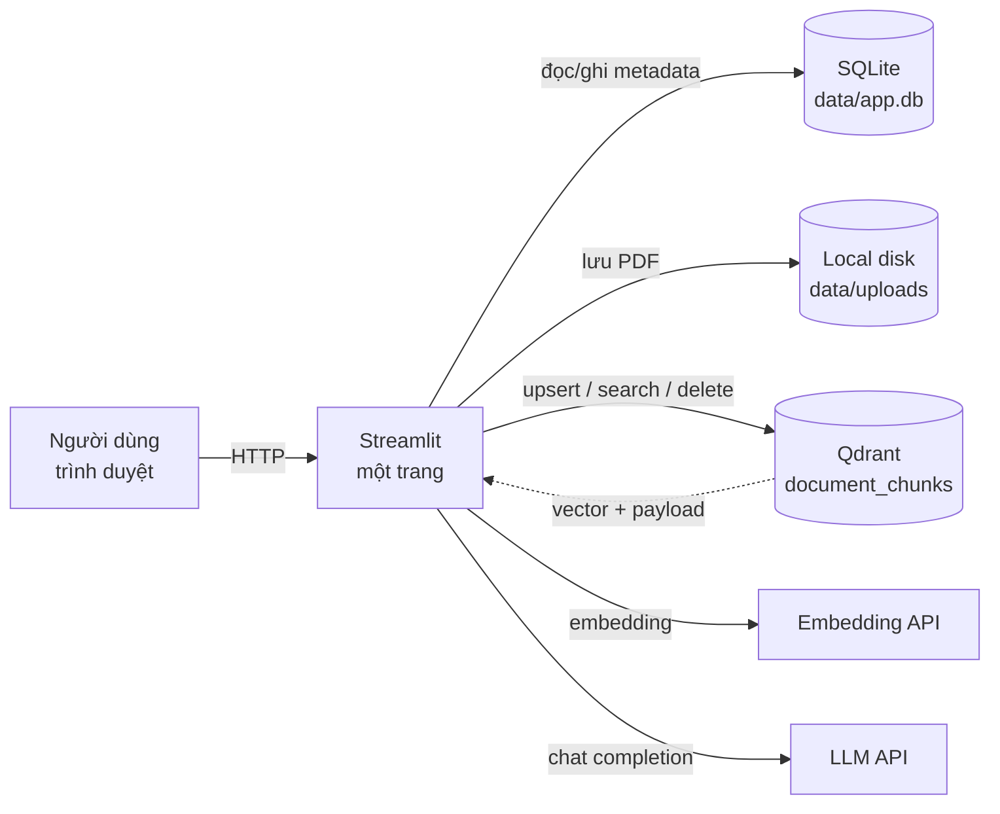

# Kế hoạch triển khai — Ứng dụng đơn giản "Upload PDF & Chat với AI"

| Mục | Giá trị |
|---|---|
| Mã tài liệu | **IMP-CVD-003** |
| Phiên bản | 1.0 |
| Ngày | 2026-10-23 |
| Nguồn | [User_Stories.md](../requirements/User_Stories.md) US-01…US-09 (đã rút gọn) · [PRD.md](../requirements/PRD.md) · [SADD.md](../design/SADD.md) (tham khảo, đã đơn giản hoá) |
| Stack | Python 3.12 · Streamlit · Qdrant · SQLite · PyMuPDF · OpenAI-compatible API |
| Phạm vi | Một trang web nội bộ: upload PDF → xử lý → chat với AI về nội dung tài liệu |
| Đối tượng | 1 người dùng / demo nội bộ, **không có đăng nhập, không phân quyền** |
| Task breakdown | [docs/implement/tasks/README.md](tasks/README.md) — 26 task chi tiết |

---

## 0. Tóm tắt điều hành

Mục tiêu: có một ứng dụng chạy được trong **8–12 ngày công** (1 developer), hoặc **5–7 ngày** nếu có 2 người song song, cho phép:

```text
Mở trang → kéo/thả PDF → thấy trạng thái xử lý → hỏi câu tự nhiên
→ AI trả lời dựa trên nội dung PDF → xem nguồn (tên tệp + trang)
→ xoá tài liệu → câu trả lời sau đó không còn dùng tài liệu đã xoá
```

| Hạng mục | Chốt |
|---|---|
| Giao diện | **Một trang Streamlit duy nhất**, không login, không router |
| Vector DB | **Qdrant** (Docker), collection `document_chunks` |
| Metadata | **SQLite** (`data/app.db`) — nhẹ, không cần server |
| File gốc | Local disk (`data/uploads/`) |
| AI | LLM + Embedding qua API tương thích OpenAI; có thể dùng OpenAI, Ollama, vLLM… |
| Xử lý PDF | Đồng bộ trong lúc upload, có progress; không worker/queue |
| Lịch sử chat | `st.session_state` (mất khi refresh); có thể thêm SQLite sau |
| Xác thực | **Không có** — chỉ chạy localhost hoặc mạng nội bộ tin cậy |

**Cảnh báo bảo mật:** không có đăng nhập nghĩa là **bất kỳ ai truy cập được cổng Streamlit đều có thể upload, đọc và xoá tài liệu**. Không expose ra Internet. Nếu cần chia sẻ nội bộ, đặt sau VPN/reverse proxy có xác thực ở tầng hạ tầng.

---

## 1. Phạm vi

### 1.1 Trong phạm vi

| Tính năng | Hành vi |
|---|---|
| Upload PDF | Chọn/kéo-thả một hoặc nhiều PDF; lưu file; hiển thị trạng thái `PROCESSING → READY/ERROR` |
| Kiểm tra PDF | Chỉ PDF; chặn file quá lớn/quá nhiều trang; báo lỗi PDF mã hoá, PDF hỏng, PDF scan không có text |
| Xử lý | Extract text theo trang → chunk → embedding → upsert Qdrant |
| Danh sách tài liệu | Tên, số trang, trạng thái, ngày upload; nút xoá |
| Chat | Ô hỏi; chỉ bật khi có ít nhất 1 tài liệu `READY`; trả lời dựa trên ngữ cảnh |
| Nguồn | Hiển thị tên tệp + số trang của các chunk được dùng |
| Không tìm thấy | Nếu không có chunk đạt ngưỡng: trả thông báo cố định, không gọi LLM |
| Xoá | Xoá document khỏi SQLite, points khỏi Qdrant, file trên disk |
| Cấu hình | `.env`: Qdrant URL, model, API key, giới hạn upload, top-k, ngưỡng điểm |

### 1.2 Kế thừa từ US-01…US-09 (đã đơn giản hoá)

| Story cũ | Trong app mới |
|---|---|
| US-01 Tải một PDF | Upload PDF, lưu file, xử lý, trạng thái `READY` |
| US-02 Tải nhiều PDF | `accept_multiple_files=True`; xử lý lần lượt; một file lỗi không chặn file khác |
| US-03 Biết file bị từ chối | Thông báo rõ: không phải PDF, quá dung lượng, quá trang, mã hoá, scan không text |
| US-04 Thấy trạng thái | Chip `Đang xử lý / Sẵn sàng / Lỗi`; xử lý đồng bộ nên trạng thái cập nhật ngay sau upload |
| US-05 Xem danh sách | Danh sách tất cả tài liệu (không phân quyền) |
| US-06 Xoá tài liệu | Xoá cứng; Qdrant không còn point; chat sau đó không trích dẫn tài liệu đã xoá |
| US-07 Hỏi tự nhiên | Chat input; chặn khi chưa có tài liệu `READY` |
| US-08 Chỉ dựa trên tài liệu | Prompt strict + retrieval + ngưỡng điểm + NOT_FOUND |
| US-09 Tổng hợp nhiều tài liệu | Top-k có thể lấy chunk từ nhiều tài liệu; prompt yêu cầu tổng hợp và ghi nguồn |

### 1.3 Không làm (cắt bỏ so với kế hoạch cũ)

| Cắt bỏ | Lý do |
|---|---|
| Đăng nhập, OIDC, role, 403, session expiry | Yêu cầu mới: bỏ xác thực |
| PostgreSQL + pgvector | Thay bằng Qdrant + SQLite |
| Redis, worker, job queue, reaper | Xử lý đồng bộ trong request |
| MinIO/S3 | Lưu file local |
| Soft delete + purge job | Xoá cứng ngay |
| Audit log, telemetry, admin config | Không cần cho demo đơn giản |
| Streaming token + nút Dừng | Có thể dùng `st.write_stream`; không cần huỷ giữa chừng |
| Khung Nguồn mở đúng trang PDF | Chỉ hiển thị nguồn dạng danh sách |
| Lịch sử hội thoại nhiều phiên | Chat trong `st.session_state` |
| Multi-user, phân quyền tài liệu | Không có auth |
| OCR PDF scan | Báo lỗi "chưa hỗ trợ PDF scan" |

---

## 2. Kiến trúc



**Luồng upload:**

```text
Người dùng chọn PDF
→ kiểm tra đuôi + magic bytes + dung lượng + số trang (PyMuPDF)
→ lưu file vào data/uploads/{doc_id}.pdf
→ INSERT documents(status=PROCESSING)
→ extract text từng trang
→ nếu mọi trang < MIN_TEXT_CHARS → ERROR PDF_NO_TEXT
→ chunk theo trang (700 token, overlap 100)
→ embed theo batch
→ upsert Qdrant: point id = uuid5(doc_id + chunk_index)
→ UPDATE documents(status=READY, page_count)
→ st.rerun() để danh sách hiện trạng thái mới
```

**Luồng chat:**

```text
Người dùng nhập câu hỏi
→ embed câu hỏi
→ Qdrant search top_k, score_threshold, filter doc_id nếu có chọn phạm vi
→ nếu không có hit: trả "Không tìm thấy thông tin trong tài liệu đã tải lên"
→ build prompt: system + context [S1] file - tr. N + lịch sử chat + câu hỏi
→ gọi LLM (stream hoặc không)
→ hiển thị câu trả lời + danh sách nguồn
→ lưu vào st.session_state.messages
```

**Luồng xoá:**

```text
Người dùng bấm Xoá
→ Qdrant delete filter doc_id
→ DELETE documents
→ xoá file data/uploads/{doc_id}.pdf
→ xoá lịch sử chat trong st.session_state (tránh câu trả lời cũ còn nhắc tài liệu đã xoá)
→ st.rerun()
```

> Nếu muốn giữ lịch sử chat khi xoá tài liệu, ghi rõ trong UI rằng các câu trả lời cũ vẫn là ảnh chụp tại thời điểm trả lời; chỉ các câu hỏi mới bị chặn nguồn đã xoá. Bản đơn giản chọn xoá lịch sử để tránh hiểu nhầm.

---

## 3. Công nghệ và cấu hình

### 3.1 Thư viện chính

| Thư viện | Dùng cho |
|---|---|
| `streamlit` | UI một trang |
| `qdrant-client` | Tạo collection, upsert, search, delete |
| `openai` | Gọi LLM/Embedding qua API tương thích OpenAI |
| `pymupdf` | Đọc PDF, đếm trang, extract text |
| `tiktoken` (tuỳ chọn) | Đếm token để chunk; có fallback theo ký tự |
| `python-dotenv` / `pydantic-settings` | Đọc `.env` |
| `pytest` | Test |

### 3.2 `docker-compose.yml` cho Qdrant

```yaml
services:
  qdrant:
    image: qdrant/qdrant:v1.12.4
    ports:
      - "6333:6333"
      - "6334:6334"
    volumes:
      - qdrant_data:/qdrant/storage

volumes:
  qdrant_data:
```

### 3.3 `.env.example`

```env
# Qdrant
QDRANT_URL=http://localhost:6333
QDRANT_API_KEY=
QDRANT_COLLECTION=document_chunks

# LLM / Embedding (mặc định: Ollama local)
OPENAI_BASE_URL=http://localhost:11434/v1
OPENAI_API_KEY=ollama
LLM_MODEL=llama3.1
EMBEDDING_MODEL=nomic-embed-text
EMBEDDING_DIM=768

# Giới hạn
MAX_UPLOAD_MB=25
MAX_PAGES=400
MIN_TEXT_CHARS_PER_PAGE=20
CHUNK_SIZE_TOKENS=700
CHUNK_OVERLAP_TOKENS=100
EMBEDDING_BATCH_SIZE=64

# Retrieval
TOP_K=8
SCORE_THRESHOLD=0.25
MAX_CHUNKS_PER_DOC=4
MAX_CONTEXT_CHARS=24000

# Lưu trữ
DATA_DIR=./data
```

**Ví dụ dùng OpenAI (tuỳ chọn):**

```env
OPENAI_BASE_URL=https://api.openai.com/v1
OPENAI_API_KEY=sk-...
LLM_MODEL=gpt-4o-mini
EMBEDDING_MODEL=text-embedding-3-small
EMBEDDING_DIM=1536
```

> **Lưu ý:** `EMBEDDING_DIM` phải khớp với model. Nếu đổi model/chiều vector, phải xoá và tạo lại collection Qdrant, sau đó re-index toàn bộ PDF.

---

## 4. Cấu trúc code đề xuất

```text
chat_voi_document/
├── app/
│   ├── main.py            # trang Streamlit duy nhất
│   ├── config.py          # đọc .env
│   ├── db.py              # SQLite: init, CRUD documents
│   ├── pdf.py             # validate, inspect, extract pages
│   ├── chunking.py        # chunk theo trang + overlap
│   ├── embeddings.py      # embed batch qua OpenAI-compatible API
│   ├── vector_store.py    # Qdrant: ensure_collection, upsert, search, delete
│   ├── ingest.py          # orchestrate upload → READY/ERROR
│   ├── llm.py             # adapter gọi LLM streaming
│   ├── rag.py             # build context, prompt, NOT_FOUND
│   ├── errors.py          # mã lỗi + thông điệp tiếng Việt
│   ├── prompts.py         # prompt template (hoặc prompts/*.md)
│   ├── eval.py            # runner eval (tuỳ chọn, P3)
│   └── ui.py              # component sidebar/chat (tuỳ chọn tách)
├── data/
│   ├── uploads/           # PDF gốc
│   └── app.db             # SQLite
├── tests/
│   ├── conftest.py
│   ├── test_config.py
│   ├── test_db.py
│   ├── test_pdf.py
│   ├── test_chunking.py
│   ├── test_embeddings.py
│   ├── test_vector_store.py
│   ├── test_rag.py
│   └── integration/
├── docker-compose.yml
├── pyproject.toml
├── .env.example
└── README.md
```

Không cần chia `domain/application/infrastructure` phức tạp. Giữ module nhỏ, hàm rõ ràng, dễ đọc.

---

## 5. Dữ liệu

### 5.1 SQLite

```sql
CREATE TABLE IF NOT EXISTS documents (
    id            TEXT PRIMARY KEY,          -- uuid4 hex
    file_name     TEXT NOT NULL,
    stored_path   TEXT NOT NULL,
    size_bytes    INTEGER NOT NULL,
    page_count    INTEGER,
    status        TEXT NOT NULL,             -- PROCESSING | READY | ERROR
    error_code    TEXT,
    created_at    TEXT NOT NULL,             -- ISO8601 UTC
    processed_at  TEXT
);
```

Chat history: `st.session_state["messages"] = [{"role": "user"|"assistant", "content": str}]`.

Nếu sau này cần lịch sử bền, thêm bảng `messages(id, role, content, created_at)` — không cần trong bản này.

### 5.2 Qdrant — collection `document_chunks`

```python
from qdrant_client import QdrantClient
from qdrant_client.models import Distance, VectorParams, PayloadSchemaType

client = QdrantClient(url=settings.qdrant_url, api_key=settings.qdrant_api_key or None)

if not client.collection_exists(settings.qdrant_collection):
    client.create_collection(
        collection_name=settings.qdrant_collection,
        vectors_config=VectorParams(
            size=settings.embedding_dim,
            distance=Distance.COSINE,
        ),
    )
    client.create_payload_index(
        collection_name=settings.qdrant_collection,
        field_name="doc_id",
        field_schema=PayloadSchemaType.KEYWORD,
    )
```

**Payload mỗi point:**

```json
{
  "doc_id": "a1b2c3...",
  "file_name": "hop-dong.pdf",
  "page": 7,
  "chunk_index": 12,
  "text": "...",
  "char_start": 1200,
  "char_end": 2800
}
```

**Point ID:** `str(uuid.uuid5(uuid.NAMESPACE_URL, f"{doc_id}:{chunk_index}"))` — idempotent khi re-index.

**Search:**

```python
hits = client.search(
    collection_name=settings.qdrant_collection,
    query_vector=query_vector,
    limit=settings.top_k,
    score_threshold=settings.score_threshold,
    query_filter=Filter(
        must=[FieldCondition(key="doc_id", match=MatchAny(any=selected_doc_ids))]
    ) if selected_doc_ids else None,
    with_payload=True,
)
```

**Delete theo tài liệu:**

```python
client.delete(
    collection_name=settings.qdrant_collection,
    points_selector=FilterSelector(
        filter=Filter(must=[FieldCondition(key="doc_id", match=MatchValue(value=doc_id))])
    ),
)
```

---

## 6. Kế hoạch công việc

Ước lượng cho **1 developer**, đã gồm test cơ bản. Có thể làm song song UI và backend nếu có 2 người.

### P0 — Khung ứng dụng (0,5–1 ngày)

| ID | Task | Xong khi |
|---|---|---|
| S-01 | Tạo `pyproject.toml`, cài dependencies, `.env.example`, `README` | `uv sync` / `pip install -e .` chạy |
| S-02 | `docker-compose.yml` Qdrant + volume | `docker compose up -d`; Qdrant dashboard `:6333/dashboard` mở được |
| S-03 | `config.py` đọc env, kiểm tra `EMBEDDING_DIM` | Thiếu API key/bad config báo lỗi rõ |
| S-04 | `db.py` init SQLite + CRUD documents | Test CRUD pass |
| S-05 | `vector_store.py` ensure collection + health check | Collection tự tạo; payload index có |

### P1 — Upload và xử lý PDF (2–3 ngày)

| ID | Task | Xong khi |
|---|---|---|
| S-06 | `pdf.py`: kiểm tra magic `%PDF-`, dung lượng, số trang, `needs_pass` | PDF hợp lệ → `PdfInfo`; PDF mã hoá/lỗi → mã lỗi |
| S-07 | Extract text theo trang; chuẩn hoá Unicode NFC | Trả `list[PageText(page, text)]` |
| S-08 | `chunking.py`: chunk theo trang, 700 token, overlap 100, giữ `char_start/char_end` | Không chunk vượt trang; không chunk rỗng; test pass |
| S-09 | `embeddings.py`: embed batch, retry 2 lần, timeout | Batch 64; lỗi API báo rõ |
| S-10 | `vector_store.upsert_chunks`: point idempotent, payload đầy đủ | Re-index không tạo point trùng |
| S-11 | `ingest_pdf`: lưu file → DB PROCESSING → extract → chunk → embed → upsert → READY/ERROR | Upload 1 PDF → READY; PDF scan → ERROR `PDF_NO_TEXT` |
| S-12 | UI sidebar: `st.file_uploader`, danh sách, chip trạng thái, nút xoá | Upload xong thấy tài liệu; xoá được |
| S-13 | Xử lý nhiều file: lặp tuần tự, mỗi file try/except riêng | File lỗi không chặn file sau |
| S-14 | Thông báo lỗi thân thiện: không phải PDF, quá lớn, quá trang, mã hoá, scan | Đúng tên file + lý do |

### P2 — Chat với tài liệu (2 ngày)

| ID | Task | Xong khi |
|---|---|---|
| S-15 | `vector_store.py` + `rag.py`: search và build context, đánh số `[S1]…`, kèm tên file + trang | Prompt có ngữ cảnh, giới hạn `MAX_CONTEXT_CHARS` |
| S-16 | `llm.py`: gọi LLM streaming qua OpenAI-compatible API | Trả token; lỗi API có thông báo |
| S-17 | Prompt strict: chỉ dùng ngữ cảnh, cùng ngôn ngữ, không bịa, NOT_FOUND | Hỏi ngoài phạm vi → thông báo cố định |
| S-18 | UI chat: `st.chat_message`, `st.chat_input`, lịch sử trong session | Hỏi–đáp nhiều lượt trong phiên |
| S-19 | Chỉ bật chat khi có ≥ 1 tài liệu READY | 0 tài liệu → input disabled + hướng dẫn upload |
| S-20 | Hiển thị nguồn: expander "Nguồn" với tên file + trang + đoạn trích | Câu trả lời có nguồn; nhiều tài liệu → nhiều nguồn |
| S-21 | Lọc trùng nguồn, giới hạn `MAX_CHUNKS_PER_DOC` | Không bị một tài liệu chiếm hết ngữ cảnh |

### P3 — Kiểm thử và hoàn thiện (2–3 ngày)

| ID | Task | Xong khi |
|---|---|---|
| S-22 | Unit test: chunking, PDF validation, prompt, parse nguồn | `pytest` xanh |
| S-23 | Integration test Qdrant: upsert → search → delete | Chạy với Qdrant Docker |
| S-24 | Bộ eval 20–30 câu: trong tài liệu, đa tài liệu, ngoài phạm vi | Có báo cáo đúng/sai + nguồn |
| S-25 | Kiểm thử thủ công 6 luồng chính + trạng thái biên | Checklist pass |
| S-26 | README: chạy Qdrant, cấu hình model, upload, chat, xoá, troubleshooting | Người mới chạy được ≤ 15 phút |

**Tổng: ~11,5 ngày công chi tiết** (xem [task breakdown](tasks/README.md)). Có thể rút còn 6–8 ngày nếu cắt P3 xuống mức tối thiểu hoặc có 2 người song song.

---

## 7. Hợp đồng hàm chính

### 7.1 `pdf.py`

```python
@dataclass(frozen=True)
class PdfInfo:
    page_count: int
    needs_pass: bool
    is_pdf: bool

@dataclass(frozen=True)
class PageText:
    page: int
    text: str

def inspect_pdf(path: Path, *, max_pages: int) -> PdfInfo:
    """Mở PDF, đếm trang, kiểm tra mã hoá. Không extract text."""

def extract_pages(path: Path) -> list[PageText]:
    """Extract text từng trang; chuẩn hoá NFC; bỏ trang rỗng."""
```

### 7.2 `chunking.py`

```python
@dataclass(frozen=True)
class Chunk:
    page: int
    chunk_index: int
    text: str
    char_start: int
    char_end: int

def chunk_pages(
    pages: list[PageText],
    *,
    size_tokens: int = 700,
    overlap_tokens: int = 100,
) -> list[Chunk]:
    """Chunk trong từng trang; không vượt ranh giới trang; giữ offset."""
```

### 7.3 `vector_store.py`

```python
def ensure_collection() -> None: ...
def upsert_chunks(doc_id: str, file_name: str, chunks: list[Chunk],
                  vectors: list[list[float]]) -> None: ...
def search(query_vector: list[float], *,
           limit: int, score_threshold: float,
           doc_ids: list[str] | None = None) -> list[SearchHit]: ...
def delete_document(doc_id: str) -> None: ...
```

### 7.4 `rag.py`

```python
NOT_FOUND = "Không tìm thấy thông tin này trong các tài liệu đã tải lên."

def answer_question(
    question: str,
    history: list[dict],
    *,
    selected_doc_ids: list[str] | None = None,
) -> tuple[str, list[SearchHit]]:
    """
    1. embed question
    2. search Qdrant
    3. không có hit → (NOT_FOUND, [])
    4. build prompt + gọi LLM
    5. trả (answer, hits)
    """
```

### 7.5 `main.py` — luồng trang

```python
st.set_page_config(page_title="Chat với tài liệu", layout="wide")

# Sidebar: upload + danh sách + xoá
with st.sidebar:
    uploaded = st.file_uploader("Tải PDF", type=["pdf"], accept_multiple_files=True)
    if uploaded:
        for f in uploaded:
            ingest_pdf(f, ...)
        st.rerun()

    docs = list_documents()
    for doc in docs:
        render_document_row(doc)   # tên, trang, chip, nút xoá

# Main: chat
ready_docs = [d for d in docs if d.status == "READY"]
if not ready_docs:
    st.info("Tải PDF đầu tiên để bắt đầu hỏi.")
    st.chat_input("Tải PDF để bắt đầu", disabled=True)
else:
    render_chat_history()
    question = st.chat_input("Hỏi về nội dung tài liệu…")
    if question:
        answer, hits = answer_question(question, st.session_state.messages)
        st.session_state.messages.append({"role": "user", "content": question})
        st.session_state.messages.append({"role": "assistant", "content": answer})
        render_sources(hits)
        st.rerun()
```

---

## 8. UI tối thiểu

```text
┌─────────────────────────────────────────────────────────────┐
│  Chat với tài liệu                                          │
├───────────────────┬─────────────────────────────────────────┤
│ TÀI LIỆU          │  HỘI THOẠI                              │
│                   │                                         │
│ [Kéo thả PDF]     │  Bạn: Hạn chót nộp hồ sơ là?            │
│                   │                                         │
│ hop-dong.pdf      │  AI: Hạn chót là 30/11/2026 [S1]...     │
│ 32 trang · READY  │      Nguồn ▸ hop-dong.pdf · tr. 7       │
│ [Xoá]             │                                         │
│                   │  ┌───────────────────────────────────┐  │
│ bao-gia.pdf       │  │ Hỏi về nội dung tài liệu…   [Gửi]│  │
│ 12 trang · READY  │  └───────────────────────────────────┘  │
│ [Xoá]             │  ⓘ AI có thể sai. Kiểm tra lại tài liệu. │
└───────────────────┴─────────────────────────────────────────┘
```

**Trạng thái UI:**

| Trạng thái | Hiển thị |
|---|---|
| Chưa có tài liệu | Chat input disabled + "Tải PDF đầu tiên để bắt đầu" |
| Đang xử lý | Chip "Đang xử lý" + spinner/progress |
| Sẵn sàng | Chip "Sẵn sàng" + số trang |
| Lỗi | Chip "Lỗi" + lý do + nút Xoá |
| Không tìm thấy | Thẻ trung tính + thông báo cố định, không nguồn |
| Lỗi LLM | Thông báo "Tạm thời không trả lời được, thử lại" |

---

## 9. Kiểm thử và nghiệm thu

### 9.1 Test tối thiểu

| Loại | Nội dung |
|---|---|
| Unit | Chunking (không vượt trang, overlap, offset), PDF validation, prompt builder, parse nguồn |
| Integration | Qdrant: ensure collection → upsert → search → delete; SQLite CRUD |
| Manual/UI | Upload 1 PDF, upload nhiều PDF, PDF lỗi, chat, not-found, xoá, chat lại |
| Eval | 10 câu trong tài liệu, 10 câu cần ≥ 2 tài liệu, 10 câu ngoài phạm vi |

### 9.2 Checklist nghiệm thu

- [ ] Upload PDF hợp lệ → tài liệu xuất hiện với trạng thái `READY`.
- [ ] Upload nhiều PDF → tất cả được xử lý; một file lỗi không chặn file khác.
- [ ] File `.docx`, PDF mã hoá, PDF scan → thông báo đúng lý do.
- [ ] Danh sách hiển thị tên, số trang, trạng thái, ngày.
- [ ] Chat bị vô hiệu khi chưa có tài liệu `READY`.
- [ ] Hỏi câu có trong tài liệu → trả lời đúng, có nguồn tên file + trang.
- [ ] Hỏi câu ngoài phạm vi → "Không tìm thấy thông tin…", không bịa.
- [ ] Hỏi câu cần 2 tài liệu → câu trả lời tổng hợp, nguồn từ cả 2.
- [ ] Xoá tài liệu → biến mất khỏi danh sách; chat sau đó không trích dẫn tài liệu đã xoá.
- [ ] Qdrant restart → dữ liệu vector vẫn còn (volume).
- [ ] `README` đủ để người mới chạy trong ≤ 15 phút.

### 9.3 Ngưỡng chất lượng tạm

| Chỉ số | Ngưỡng |
|---|---|
| Câu trả lời đúng nội dung | ≥ 8/10 câu trong tài liệu |
| Câu trả lời đa tài liệu | ≥ 8/10 câu có nguồn từ ≥ 2 tài liệu |
| Not-found đúng | ≥ 9/10 câu ngoài phạm vi |
| Nguồn đúng tài liệu/trang | ≥ 9/10 câu có nguồn |

---

## 10. Rủi ro và lưu ý

| Rủi ro | Ảnh hưởng | Giảm thiểu |
|---|---|---|
| Không có auth | Ai truy cập được cũng đọc/xoá được tài liệu | Chỉ chạy localhost/VPN; không expose Internet; thêm auth ở reverse proxy nếu cần |
| Xử lý đồng bộ | Upload PDF lớn làm UI chờ lâu | Giới hạn 25 MB/400 trang; hiển thị progress; có thể chuyển sang background thread sau |
| PDF scan không có text | Không chat được | Báo lỗi rõ; không đưa vào READY |
| Embedding dimension đổi | Qdrant collection không khớp | Ghi rõ trong README; xoá/recreate collection + re-index |
| LLM bịa | Câu trả lời sai | Prompt strict + `SCORE_THRESHOLD` + NOT_FOUND + hiển thị nguồn |
| Một tài liệu chiếm hết context | Câu trả lời thiếu tài liệu khác | `MAX_CHUNKS_PER_DOC` + top-k đa dạng |
| Qdrant mất volume | Mất vector | Docker volume + backup định kỳ |
| Chi phí API | Tốn tiền | Giới hạn upload, top-k, context; dùng Ollama local nếu cần |
| SQLite/upload dir mất | Mất metadata/file | Backup `data/`; Qdrant volume |

---

## 11. Cách chạy

```bash
# 1. Qdrant
docker compose up -d

# 2. Cài đặt
cp .env.example .env
# sửa OPENAI_API_KEY / model / embedding dim
uv sync          # hoặc: pip install -e .

# 3. Chạy app
uv run streamlit run app/main.py
# mở http://localhost:8501

# 4. Test
uv run pytest
```

---

## 12. Thứ tự thực hiện đề xuất

1. **S-01 → S-05**: khung + Qdrant + SQLite; upload file chưa xử lý.
2. **S-06 → S-11**: PDF → chunk → embed → Qdrant; kiểm tra bằng script trước khi làm UI.
3. **S-12 → S-14**: sidebar upload/list/delete + lỗi.
4. **S-15 → S-21**: chat + nguồn + not-found.
5. **S-22 → S-26**: test, eval, README.

**Mốc demo:**

- **M1 (sau S-11):** upload 1 PDF, Qdrant có point, search thấy chunk.
- **M2 (sau S-14):** UI upload/list/delete hoạt động.
- **M3 (sau S-21):** chat trả lời + nguồn + not-found.
- **M4 (sau S-26):** test/eval/README xong, sẵn sàng demo.

---

## 13. Việc có thể làm sau (nếu cần)

| Ưu tiên | Hạng mục |
|---|---|
| 1 | Background ingestion + progress bar không chặn UI |
| 2 | Lịch sử chat bền trong SQLite |
| 3 | Chọn phạm vi tài liệu (filter `doc_id` trong Qdrant) |
| 4 | Bấm nguồn mở đúng trang PDF (render page bằng PyMuPDF) |
| 5 | Streaming có nút Dừng |
| 6 | Auth đơn giản (mật khẩu dùng chung hoặc OIDC) nếu đưa lên mạng nội bộ |
| 7 | OCR PDF scan |
| 8 | Multi-user + phân quyền tài liệu |

---

*Hết tài liệu. Nếu cần, bước tiếp theo có thể là scaffold ngay S-01…S-05 hoặc viết `docker-compose.yml` + `app/main.py` khung.*
