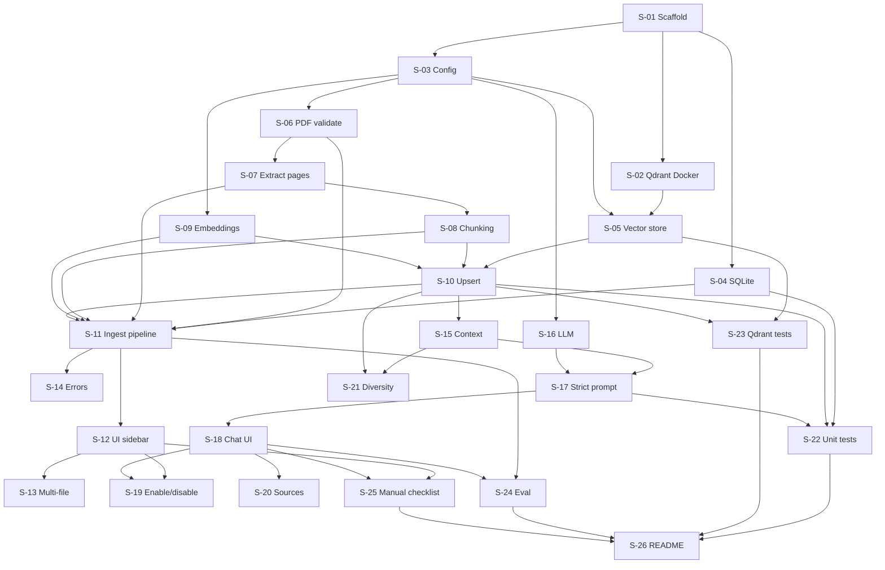

# Task breakdown — Ứng dụng "Upload PDF & Chat với AI" (Qdrant)

> **Thay thế mục lục cũ:** file này thay cho mục lục task MVP cũ (các task `PLT-*`, `F-*`, `T-*` đã bị xoá trong working tree). Nội dung cũ vẫn còn trong git history nếu cần tham khảo.
>
> **Nguồn:** [Implement_plan_Simple_Qdrant.md](../Implement_plan_Simple_Qdrant.md) (IMP-CVD-003 v1.0)
> **Mục đích:** mỗi file là **một task giao được cho một developer**, đủ hợp đồng, file, thuật toán, biên và test để bắt đầu code mà không cần hỏi lại.

## 1. Cách dùng

1. Đọc [kế hoạch](../Implement_plan_Simple_Qdrant.md) §0–§5 trước.
2. Nhận task theo thứ tự phụ thuộc ở §4.
3. Mỗi task phải đạt **Definition of Done chung** (§5) + **tiêu chí xong riêng** trong file.
4. Một task = một PR nhỏ. Nếu task > 1 ngày, tách tiếp theo ghi chú trong file.

## 2. Tổng quan

| Phase | Nội dung | Task | Ước lượng |
|---|---|---|---|
| **P0** | Khung, Qdrant, SQLite, config | S-01…S-05 | 2,0d |
| **P1** | Upload, PDF, chunk, embedding, UI tài liệu | S-06…S-14 | 4,25d |
| **P2** | Retrieval, prompt, LLM, chat, nguồn | S-15…S-21 | 2,75d |
| **P3** | Test, eval, checklist, README | S-22…S-26 | 2,5d |
| **Tổng** | | **26 task** | **~11,5d** |

> Ước lượng là ngày công lý tưởng của **1 developer**, đã gồm test của task, chưa gồm review/họp. Nếu có 2 người (backend + UI) có thể rút còn ~6–7 ngày bằng cách chạy song song P1/P2.

## 3. Danh sách task

### P0 — Khung ứng dụng

| Task | Nội dung | Ước lượng | Phụ thuộc |
|---|---|---|---|
| [S-01](S-01-scaffold-project.md) | Scaffold project, dependencies, `.env.example`, cấu trúc thư mục | 0,5d | — |
| [S-02](S-02-qdrant-docker.md) | Qdrant bằng Docker Compose, volume, healthcheck | 0,25d | S-01 |
| [S-03](S-03-config.md) | `Settings` đọc `.env`, validate, tạo `data/` | 0,25d | S-01 |
| [S-04](S-04-sqlite-db.md) | SQLite schema + CRUD `documents` | 0,5d | S-01 |
| [S-05](S-05-qdrant-vector-store.md) | Qdrant client, ensure collection, health, delete | 0,5d | S-02, S-03 |

### P1 — Upload và xử lý PDF

| Task | Nội dung | Ước lượng | Phụ thuộc |
|---|---|---|---|
| [S-06](S-06-pdf-validation.md) | Validate PDF: đuôi, magic, size, pages, mã hoá, corrupt | 0,5d | S-03 |
| [S-07](S-07-pdf-extract-pages.md) | Extract text theo trang, NFC, phát hiện PDF scan | 0,25d | S-06 |
| [S-08](S-08-chunking.md) | Chunk theo trang, overlap, giữ offset | 0,5d | S-07 |
| [S-09](S-09-embeddings.md) | Embedding batch qua API OpenAI-compatible | 0,5d | S-03 |
| [S-10](S-10-qdrant-upsert.md) | Upsert point + payload vào Qdrant, idempotent | 0,5d | S-05, S-08, S-09 |
| [S-11](S-11-ingest-pipeline.md) | Orchestrate upload → extract → chunk → embed → Qdrant → READY/ERROR | 0,75d | S-04…S-10 |
| [S-12](S-12-ui-sidebar.md) | Sidebar upload/list/status/delete | 0,75d | S-11 |
| [S-13](S-13-multi-file-upload.md) | Upload nhiều file, cô lập lỗi từng file | 0,25d | S-12 |
| [S-14](S-14-error-messages.md) | Mã lỗi + thông điệp tiếng Việt + hiển thị UI | 0,25d | S-06, S-11, S-12 |

### P2 — Chat với tài liệu

| Task | Nội dung | Ước lượng | Phụ thuộc |
|---|---|---|---|
| [S-15](S-15-rag-context-prompt.md) | Build context `[S#]`, giới hạn char, dedupe nguồn | 0,5d | S-10 |
| [S-16](S-16-llm-streaming.md) | Gọi LLM streaming qua API OpenAI-compatible | 0,5d | S-03 |
| [S-17](S-17-strict-prompt-not-found.md) | Prompt strict + NOT_FOUND khi không có hit | 0,25d | S-15, S-16 |
| [S-18](S-18-chat-ui.md) | Chat UI, lịch sử session, streaming, lỗi | 0,75d | S-17 |
| [S-19](S-19-chat-enable-disable.md) | Bật/tắt chat theo tài liệu READY | 0,25d | S-12, S-18 |
| [S-20](S-20-sources-display.md) | Hiển thị nguồn tên file + trang + đoạn trích | 0,25d | S-18 |
| [S-21](S-21-diversity-filter.md) | Giới hạn chunk/tài liệu, dedupe, đa dạng nguồn | 0,25d | S-10, S-15 |

### P3 — Kiểm thử và hoàn thiện

| Task | Nội dung | Ước lượng | Phụ thuộc |
|---|---|---|---|
| [S-22](S-22-unit-tests.md) | Unit test chunking, PDF, prompt, DB, config | 0,75d | S-04…S-17 |
| [S-23](S-23-qdrant-integration-tests.md) | Integration test Qdrant: upsert/search/delete | 0,5d | S-05, S-10, S-11 |
| [S-24](S-24-eval-dataset-runner.md) | Bộ eval 20–30 câu + runner + báo cáo | 0,75d | S-11, S-18 |
| [S-25](S-25-manual-test-checklist.md) | Checklist kiểm thử thủ công 5 luồng + biên | 0,25d | S-12…S-21 |
| [S-26](S-26-readme-runbook.md) | README: setup, chạy, model, troubleshooting | 0,25d | tất cả |

## 4. Thứ tự thực hiện

**Đường găng đề xuất:** S-01 → S-03 → S-06 → S-07 → S-08 → S-09 → S-10 → S-11 → S-12 → S-18 → S-24 → S-26.

## 5. Definition of Done chung

Mỗi task chỉ được đóng khi:

- [ ] Code chạy được local, không có import vòng.
- [ ] Có test tương ứng (unit/integration) hoặc lý do rõ nếu chỉ test thủ công.
- [ ] `pytest` xanh; không gọi mạng thật trong unit test.
- [ ] Không hard-code API key/đường dẫn tuyệt đối; đọc từ `Settings`.
- [ ] Không log nội dung câu hỏi/trả lời/PDF; chỉ log ID, số trang, độ dài.
- [ ] Lỗi được map sang mã + thông điệp thân thiện, không lộ stack trace ra UI.
- [ ] Cập nhật `README`/docstring nếu thay đổi cách chạy.
- [ ] PR nhỏ, có mô tả cách kiểm tra.

## 6. Quy ước mã

| Quy ước | Giá trị |
|---|---|
| Python | 3.12 |
| Format/lint | `ruff format`, `ruff check` |
| Type | mypy cho module chính (không bắt buộc strict toàn bộ) |
| Test | `pytest`, fixture trong `tests/conftest.py` |
| DB | SQLite, mở connection ngắn, `PRAGMA journal_mode=WAL` |
| Vector | Qdrant, collection `document_chunks`, cosine |
| ID | `uuid4().hex` cho document; `uuid5` cho point |
| Thời gian | ISO8601 UTC |
| Ngôn ngữ UI | Tiếng Việt, tập trung trong `app/ui_text.py` hoặc hằng số |

## 7. Ghi chú phạm vi

- **Không có auth**: không làm login/role/403. Cảnh báo bảo mật ở README.
- **Không có worker/queue**: ingest đồng bộ trong request; task S-11 ghi rõ giới hạn.
- **Không có PostgreSQL/Redis/MinIO**: chỉ Qdrant + SQLite + local disk.
- **Không có OCR**: PDF scan trả lỗi `PDF_NO_TEXT`.
- **Không có source viewer**: chỉ hiển thị nguồn dạng danh sách.
