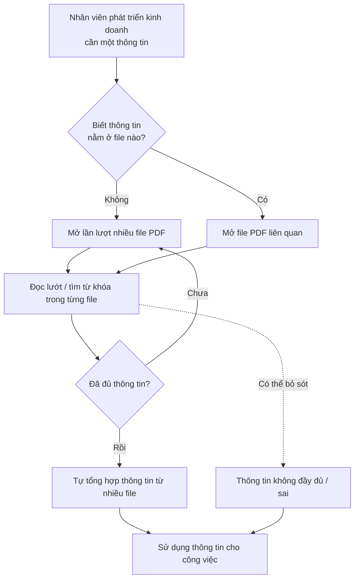
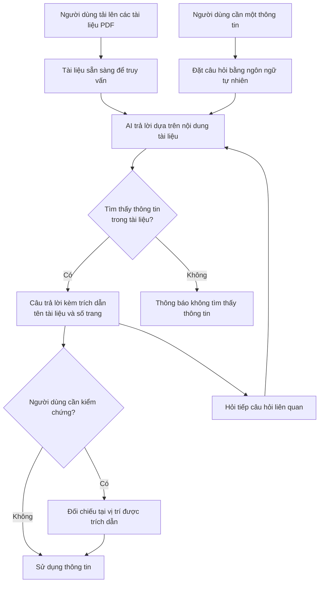

# Tài liệu Yêu cầu Nghiệp vụ (BRD) — Công cụ "Chat với tài liệu" (MVP)

> **Chuẩn áp dụng:** IEEE 29148-2018 — Requirements engineering
> **Giai đoạn SDLC:** 5.2 Requirements and discovery
> **Prompt nguồn:** [docs/BRD_Prompt_IEEE_standard.md](../BRD_Prompt_IEEE_standard.md)

---

## 0. Tóm tắt kiểm tra đầu vào (Validation summary)

**Đầu vào đã nhận**

| Đầu vào | Trạng thái | Ghi chú |
|---|---|---|
| Bối cảnh nghiệp vụ (mục 2.1 của prompt) | Đã nhận | Mô tả vấn đề, mục tiêu MVP, cho phép đội BA đề xuất thêm tính năng (SRC-001) |
| Bảng nguồn bằng chứng (mục 2.2) | Chưa có | Các dòng SRC-002, SRC-003 vẫn là placeholder |
| Fill-In Block (mục 8) | Chưa có | Chưa có tên tổ chức, nhà tài trợ, chủ sở hữu nghiệp vụ, mốc thời gian, ngân sách |
| Phỏng vấn stakeholder, số liệu baseline, quy trình hiện tại, chính sách bảo mật | Chưa có | Mọi baseline và target đều để `[TBD: OQ-xxx]` |
| House template | Không bắt buộc | Không có file `requirements/BRD-Template.md` trong repo; dùng cấu trúc mục 4 của prompt |

**Ba rủi ro lớn nhất đối với chất lượng yêu cầu**

1. **Chưa có baseline cho các chỉ số.** Chưa ai đo thời gian tìm kiếm thông tin hiện nay, nên chưa chứng minh được lợi ích (BO-001) → OQ-001, OQ-002.
2. **Chưa rõ phân loại bảo mật của tài liệu và việc có được phép gửi tài liệu cho dịch vụ AI bên ngoài hay không.** Điều này có thể làm thay đổi phạm vi và ràng buộc → OQ-007, RSK-002.
3. **Phạm vi tính năng do BA đề xuất chưa được quản lý phê duyệt.** Các yêu cầu đề xuất mang nhãn `[Đề xuất BA]` và chỉ có hiệu lực khi OQ-014 được giải quyết → RSK-006.

**Quy ước ngôn ngữ chuẩn (ánh xạ động từ IEEE 29148)**

| Tiếng Anh | Tiếng Việt dùng trong tài liệu | Ý nghĩa |
|---|---|---|
| shall | **phải** | Bắt buộc |
| should | **nên** | Mong muốn, không bắt buộc |
| may | **có thể** | Được phép, tùy chọn |

Tài liệu không dùng "sẽ", "cần", "có khả năng" làm động từ chuẩn của yêu cầu.

---

## 1. Kiểm soát tài liệu (Document control)

| Trường | Giá trị |
|---|---|
| Tiêu đề | Tài liệu Yêu cầu Nghiệp vụ — Công cụ "Chat với tài liệu" (MVP) |
| Mã tài liệu | BRD-CVD-001 |
| Phiên bản | 0.1 |
| Trạng thái | Draft |
| Tác giả | Minh Tran |
| Người đóng góp | Đội BA `[TBD: OQ-003]` |
| Người review | Đại diện đội phát triển kinh doanh, đội kỹ thuật, bảo mật/IT `[TBD: OQ-003]` |
| Người phê duyệt | Quản lý yêu cầu dự án (nhà tài trợ) `[TBD: OQ-003]` |
| Phân loại bảo mật | Nội bộ (Internal) `[Unverified]` |

**Lịch sử phiên bản**

| Phiên bản | Ngày | Tác giả | Tóm tắt thay đổi |
|---|---|---|---|
| 0.1 | 2026-10-19 | Minh Tran | Bản nháp đầu tiên, dựa trên bối cảnh nghiệp vụ SRC-001 |

**Danh sách phân phối**

| Người/nhóm nhận | Mục đích |
|---|---|
| Quản lý dự án (nhà tài trợ) | Phê duyệt |
| Đội phát triển kinh doanh | Xác nhận nhu cầu và tiêu chí chấp nhận |
| Đội BA | Hoàn thiện, duy trì truy vết |
| Đội kỹ thuật | Đánh giá tính khả thi, làm đầu vào cho PRD/SRS |
| Bảo mật / IT / Pháp chế | Review ràng buộc dữ liệu (nếu áp dụng) |

---

## 2. Tóm tắt điều hành (Executive summary)

**Vấn đề.** Dự án kinh doanh có nhiều tài liệu PDF, và đội phát triển kinh doanh khó nắm được đầy đủ nội dung của chúng. Mỗi lần cần một thông tin, người dùng phải mở và tổng hợp từ nhiều file PDF, rất tốn thời gian (SRC-001). Hiện chưa đo được mức tác động: thời gian tìm kiếm trung bình, số lượt tìm kiếm mỗi tuần, và số lỗi do thiếu thông tin đều là `[TBD: OQ-001]`.

**Thay đổi đề xuất.** Xây dựng một MVP dạng ứng dụng web. Người dùng tải lên tài liệu PDF rồi đặt câu hỏi bằng ngôn ngữ tự nhiên cho AI. AI trả lời dựa trên nội dung của các tài liệu đã tải lên, kèm trích dẫn nguồn để người dùng tự kiểm chứng (SRC-001). Mục tiêu của MVP là kiểm chứng giá trị nghiệp vụ trước khi quyết định đầu tư mở rộng.

**Lợi ích kỳ vọng và cách đo**

- Giảm thời gian tìm một thông tin trong bộ tài liệu (MET-001).
- Câu trả lời đúng và có trích dẫn kiểm chứng được (MET-002, MET-003).
- Đội phát triển kinh doanh dùng công cụ thường xuyên trong giai đoạn thử nghiệm (MET-004, MET-005).

**Đầu tư, tiến độ, rủi ro.** Ngân sách và mốc thời gian chưa được cung cấp `[TBD: OQ-004]`. Các rủi ro chính:

- AI trả lời sai hoặc tự bịa nội dung (RSK-001).
- Lộ tài liệu mật khi xử lý bằng dịch vụ AI (RSK-002).
- PDF dạng scan hoặc có nhiều bảng biểu bị trích xuất kém (RSK-003).

**Quyết định cần phê duyệt.**

1. Phê duyệt phạm vi MVP tại mục 5.
2. Chọn tính năng đề xuất BA nào được đưa vào MVP (OQ-014).
3. Chỉ định chủ sở hữu cho các câu hỏi mở chặn tiến độ: OQ-001, OQ-004, OQ-007.

---

## 3. Bối cảnh nghiệp vụ và phát biểu vấn đề

### 3.1 Quy trình hiện tại (current state)

Quy trình dưới đây được suy ra từ mô tả trong SRC-001 và chưa được xác nhận qua phỏng vấn `[Unverified]`.

### 3.2 Quy trình đề xuất (proposed state)

Sơ đồ này chỉ thể hiện thay đổi về mặt nghiệp vụ, không phải thiết kế giải pháp.

### 3.3 Đối tượng bị ảnh hưởng

| Đối tượng | Bị ảnh hưởng như thế nào | Bằng chứng |
|---|---|---|
| Đội phát triển kinh doanh | Mất thời gian tìm và tổng hợp thông tin từ nhiều PDF; khó nắm đầy đủ nội dung | SRC-001 |
| Quản lý dự án | Năng suất của đội giảm; quyết định có thể dựa trên thông tin chưa đầy đủ | SRC-001 (suy luận) `[Unverified]` |

### 3.4 Chi phí của việc không thay đổi

| Khía cạnh | Tác động | Trạng thái số liệu |
|---|---|---|
| Chi phí nhân lực | Thời gian tìm kiếm × số lượt tìm × số người | `[TBD: OQ-001]` |
| Rủi ro nghiệp vụ | Bỏ sót hoặc dùng sai thông tin trong đề xuất, đàm phán, báo cáo | `[Unverified]`, `[TBD: OQ-001]` |
| Tiếp nhận người mới | Người mới mất nhiều thời gian để nắm bộ tài liệu dự án | `[Unverified]` |

### 3.5 Nguyên nhân gốc và triệu chứng

| Triệu chứng | Nguyên nhân gốc (giả thuyết) | Trạng thái |
|---|---|---|
| Tìm thông tin tốn thời gian | Thông tin phân tán trong nhiều file PDF, không có điểm truy vấn tập trung | SRC-001 |
| Khó nắm đầy đủ thông tin | Khối lượng tài liệu vượt quá khả năng đọc và ghi nhớ của từng người | SRC-001 |
| Phải tự tổng hợp thủ công | Tìm theo từ khóa trong từng file không tổng hợp được câu trả lời từ nhiều nguồn | `[Unverified]` |

### 3.6 Vì sao làm bây giờ

Quản lý đã yêu cầu phát triển MVP (SRC-001). Lý do về mặt thời điểm (sự kiện kích hoạt, hạn chót nghiệp vụ) chưa được cung cấp `[TBD: OQ-004]`.

---

## 4. Động lực nghiệp vụ và mục tiêu

| ID | Động lực nghiệp vụ | Mục tiêu (kết quả, không phải hoạt động) | Metric ID | Baseline | Target | Thời hạn | Nguồn |
|---|---|---|---|---|---|---|---|
| BO-001 | Tìm thông tin trong PDF tốn nhiều thời gian | Giảm thời gian để đội phát triển kinh doanh có được một thông tin cần thiết từ bộ tài liệu dự án | MET-001 | `[TBD: OQ-001]` | `[TBD: OQ-002]` | Kết thúc giai đoạn thử nghiệm MVP `[TBD: OQ-004]` | SRC-001 |
| BO-002 | Đội khó nắm bắt đầy đủ nội dung tài liệu | Đội phát triển kinh doanh nhận được thông tin đúng, có nguồn kiểm chứng được từ bộ tài liệu | MET-002, MET-003 | Không áp dụng (năng lực mới) | `[TBD: OQ-002]` | `[TBD: OQ-004]` | SRC-001 |
| BO-003 | Quản lý cần kiểm chứng giá trị trước khi đầu tư tiếp | Có đủ bằng chứng sử dụng thực tế để ra quyết định go/no-go cho giai đoạn tiếp theo | MET-004, MET-005 | Không áp dụng (năng lực mới) | `[TBD: OQ-015]` | `[TBD: OQ-004]` | SRC-001 (MVP) |

### 4.1 Định nghĩa chỉ số

| Metric ID | Định nghĩa | Công thức | Nguồn dữ liệu | Chủ sở hữu | Tần suất | Ngày baseline |
|---|---|---|---|---|---|---|
| MET-001 | Thời gian trung bình từ lúc người dùng bắt đầu tìm một thông tin đến lúc có câu trả lời dùng được | Tổng thời gian của các lượt tìm trong bộ câu hỏi mẫu ÷ số lượt tìm. Đo cho cả cách làm hiện tại và khi dùng công cụ | Thử nghiệm có bấm giờ với bộ câu hỏi mẫu (DEP-002) | `[TBD: OQ-003]` | Một lần trước MVP (baseline), một lần cuối thử nghiệm | `[TBD: OQ-001]` |
| MET-002 | Tỷ lệ câu trả lời đúng trên bộ câu hỏi mẫu | Số câu trả lời được chuyên gia nghiệp vụ đánh giá "đúng" ÷ tổng số câu hỏi mẫu × 100% | Bộ câu hỏi mẫu kèm đáp án chuẩn (DEP-002) | `[TBD: OQ-003]` | Mỗi bản phát hành MVP | Không áp dụng |
| MET-003 | Tỷ lệ câu trả lời có trích dẫn đúng | Số câu trả lời có trích dẫn trỏ đúng tài liệu và trang chứa thông tin ÷ số câu trả lời có trích dẫn × 100% | Bộ câu hỏi mẫu (DEP-002) | `[TBD: OQ-003]` | Mỗi bản phát hành MVP | Không áp dụng |
| MET-004 | Tỷ lệ người dùng hoạt động hằng tuần trong nhóm thử nghiệm | Số người dùng đặt ít nhất 1 câu hỏi trong tuần ÷ số người dùng được cấp quyền × 100% | Nhật ký sử dụng của công cụ | `[TBD: OQ-003]` | Hằng tuần | Không áp dụng |
| MET-005 | Mức hài lòng của người dùng | Điểm trung bình khảo sát thang 1–5 cho câu hỏi "Công cụ giúp tôi tìm thông tin nhanh hơn" | Khảo sát cuối thử nghiệm | `[TBD: OQ-003]` | Cuối giai đoạn thử nghiệm | Không áp dụng |

> Các target của MET-001 đến MET-005 phải do nhà tài trợ xác nhận (OQ-002, OQ-015). Để tiện thảo luận, BA đề xuất các giá trị khởi điểm sau `[Unverified]`: MET-001 giảm ≥ 50% so với baseline; MET-002 ≥ 80%; MET-003 ≥ 90%; MET-004 ≥ 60%; MET-005 ≥ 4,0/5.

---

## 5. Phạm vi (Scope)

### 5.1 Trong phạm vi (MVP)

- Tải lên tài liệu định dạng PDF và quản lý cơ bản: xem danh sách, xóa (SRC-001).
- Hỏi đáp bằng ngôn ngữ tự nhiên dựa trên nội dung các tài liệu đã tải lên (SRC-001).
- Trích dẫn nguồn trong câu trả lời để kiểm chứng `[Đề xuất BA]`.
- Hội thoại nhiều lượt, có ngữ cảnh của các câu hỏi trước trong cùng phiên `[Đề xuất BA]`.
- Kiểm soát truy cập: chỉ người dùng được cấp quyền mới sử dụng được `[Đề xuất BA]`.
- Đối tượng sử dụng: đội phát triển kinh doanh của dự án (SRC-001).
- Kênh: ứng dụng web (SRC-001).

### 5.2 Ngoài phạm vi

| Hạng mục | Lý do |
|---|---|
| Định dạng khác PDF (Word, Excel, PowerPoint, ảnh, trang web) | Bối cảnh chỉ nêu PDF (SRC-001) |
| Ứng dụng di động native | Bối cảnh chỉ nêu ứng dụng web (SRC-001) |
| Chỉnh sửa nội dung tài liệu PDF | Không phục vụ mục tiêu truy vấn thông tin |
| Kết nối tự động với kho tài liệu bên ngoài (Google Drive, SharePoint…) | Vượt phạm vi MVP; có thể xem xét ở giai đoạn sau |
| Người dùng bên ngoài tổ chức (khách hàng, đối tác) | Đối tượng sử dụng là đội nội bộ (SRC-001) |

### 5.3 Hoãn lại (giai đoạn sau MVP)

| Hạng mục | Lý do hoãn |
|---|---|
| Phân quyền chi tiết theo từng tài liệu hoặc nhóm tài liệu | Phụ thuộc OQ-008; tăng độ phức tạp |
| Xử lý PDF dạng ảnh scan (OCR) | Phụ thuộc OQ-010 |
| Báo cáo thống kê sử dụng cho quản lý | Đo MET-004 ở MVP chỉ cần nhật ký sử dụng |
| Xuất câu trả lời hoặc hội thoại ra file | Chưa có bằng chứng về nhu cầu |
| So sánh nội dung giữa các tài liệu | Chưa có bằng chứng về nhu cầu |

### 5.4 Ranh giới

- **Bắt đầu:** khi người dùng có tài liệu PDF trong tay và tải lên công cụ.
- **Kết thúc:** khi người dùng nhận được câu trả lời có trích dẫn. Việc dùng thông tin đó trong công việc tiếp theo (đề xuất, báo cáo) nằm ngoài công cụ.
- **Không thay thế:** hệ thống lưu trữ tài liệu chính thức của tổ chức (nếu có) `[TBD: OQ-012]`.

---

## 6. Stakeholder và nhu cầu

### 6.1 Danh sách stakeholder

| ID | Stakeholder / nhóm | Vai trò nghiệp vụ | Mối quan tâm | Ảnh hưởng | Nhu cầu (`SN-xxx`) | Nguồn |
|---|---|---|---|---|---|---|
| STK-001 | Quản lý dự án | Người yêu cầu MVP, nhà tài trợ | Năng suất của đội; bằng chứng để quyết định đầu tư | Cao | SN-007, SN-008 | SRC-001 |
| STK-002 | Đội phát triển kinh doanh | Người dùng cuối | Tìm thông tin nhanh, đầy đủ, đáng tin | Cao | SN-001, SN-002, SN-003, SN-004, SN-005, SN-006 | SRC-001 |
| STK-003 | Đội BA | Phân tích, đề xuất tính năng, duy trì yêu cầu | Phạm vi rõ ràng, có truy vết | Trung bình | SN-009 | SRC-001 |
| STK-004 | Đội phát triển / kỹ thuật | Xây dựng và vận hành MVP | Yêu cầu khả thi, đo kiểm được | Trung bình | SN-010 | `[Unverified]` |
| STK-005 | Bảo mật thông tin / IT / Pháp chế | Kiểm soát việc xử lý dữ liệu nhạy cảm | Tài liệu không bị lộ ra ngoài; tuân thủ chính sách | Cao (**có thể chặn triển khai**) | SN-011 | `[Unverified]` — cần xác nhận sự tồn tại và vai trò (OQ-007) |
| STK-006 | Chủ sở hữu nội dung tài liệu (bên cung cấp tài liệu, khách hàng, đối tác) | Đặt điều kiện bảo mật trên tài liệu | Tài liệu được dùng đúng thỏa thuận bảo mật | Trung bình | SN-011 | `[Unverified]` (OQ-007) |

### 6.2 Nhu cầu của stakeholder

| ID | Stakeholder | Phát biểu nhu cầu (theo cách nói của stakeholder) | Vấn đề hiện tại | Bằng chứng | Ưu tiên |
|---|---|---|---|---|---|
| SN-001 | STK-002 | "Tôi muốn đưa các tài liệu PDF của dự án vào một chỗ để hỏi." | Tài liệu phân tán, phải mở từng file | SRC-001 | Must |
| SN-002 | STK-002 | "Tôi muốn hỏi bằng câu bình thường và nhận câu trả lời, không phải tự đọc hết tài liệu." | Tìm thủ công tốn thời gian | SRC-001 | Must |
| SN-003 | STK-002 | "Tôi muốn câu trả lời tổng hợp từ nhiều tài liệu cùng lúc." | Phải tự tổng hợp từ nhiều file | SRC-001 | Must |
| SN-004 | STK-002 | "Tôi cần biết câu trả lời lấy từ đâu để kiểm tra lại." | Không tin được câu trả lời nếu không có nguồn | `[Unverified]` — suy luận từ RSK-001 | Must |
| SN-005 | STK-002 | "Tôi muốn hỏi tiếp mà không phải nhắc lại bối cảnh." | Mỗi lần tìm phải bắt đầu lại từ đầu | `[Unverified]` `[Đề xuất BA]` | Should |
| SN-006 | STK-002 | "Tôi muốn nắm nhanh nội dung chính của một tài liệu mới." | Khó nắm đầy đủ nội dung tài liệu | SRC-001 `[Đề xuất BA]` | Could |
| SN-007 | STK-001 | "Tôi cần biết công cụ có thực sự giúp đội tiết kiệm thời gian không." | Chưa đo được tác động | SRC-001 (mục tiêu MVP) | Must |
| SN-008 | STK-001 | "Tôi cần biết chất lượng câu trả lời có đủ tin cậy không." | Chưa có cơ chế đánh giá | `[Unverified]` | Must |
| SN-009 | STK-003 | "Cần thu thập phản hồi người dùng để ưu tiên tính năng giai đoạn sau." | Chưa có dữ liệu sử dụng thực tế | `[Unverified]` | Should |
| SN-010 | STK-004 | "Cần giới hạn rõ về dung lượng và số lượng tài liệu để vận hành ổn định và kiểm soát chi phí." | Chưa có giới hạn | `[Unverified]` (OQ-005) | Must |
| SN-011 | STK-005, STK-006 | "Tài liệu chỉ được người có quyền truy cập và chỉ được xử lý theo chính sách dữ liệu." | Chưa có đánh giá bảo mật | `[Unverified]` (OQ-007) | Must |

---

## 7. Yêu cầu nghiệp vụ (Business requirements)

Thang ưu tiên: **Must** (thiếu thì sáng kiến thất bại), **Should** (giá trị lớn nhưng có cách làm thay), **Could** (mong muốn), **Won't** (loại trừ ở bản phát hành này). Yêu cầu mang nhãn `[Đề xuất BA]` chỉ có hiệu lực sau khi OQ-014 được giải quyết.

### 7.1 Nhóm A — Quản lý tài liệu

| ID | Yêu cầu | Lý do | Nguồn | Ưu tiên | Tiêu chí chấp nhận | Phương pháp kiểm chứng | Trạng thái |
|---|---|---|---|---|---|---|---|
| BR-001 | Công cụ **phải** cho phép người dùng được cấp quyền tải lên tệp định dạng PDF có dung lượng không vượt quá giới hạn tại BRU-004. | Đưa tài liệu vào phạm vi truy vấn | BO-001 / SN-001 | Must | AC-001 | Test | Draft |
| BR-002 | Công cụ **phải** cho phép người dùng tải lên nhiều tệp PDF trong một lần thao tác, tối đa số tệp quy định tại BRU-005. | Bộ tài liệu dự án gồm nhiều file | BO-001 / SN-001 | Should | AC-002 | Test | Draft |
| BR-003 | Khi một tệp không được chấp nhận hoặc không trích xuất được nội dung, công cụ **phải** thông báo cho người dùng tên tệp và lý do. | Người dùng biết tài liệu nào chưa được dùng để trả lời | BO-002 / SN-001 | Must | AC-003 | Test | Draft |
| BR-004 | Công cụ **phải** hiển thị cho người dùng trạng thái của từng tài liệu đã tải lên: đang xử lý, sẵn sàng truy vấn, hoặc lỗi. | Người dùng biết khi nào có thể hỏi về tài liệu | BO-001 / SN-001 | Must | AC-004 | Demonstration | Draft |
| BR-005 | Công cụ **phải** hiển thị danh sách các tài liệu người dùng được phép truy vấn, gồm tên tệp và ngày tải lên. | Người dùng biết phạm vi kiến thức của công cụ | BO-002 / SN-001 | Must | AC-005 | Demonstration | Draft |
| BR-006 | Công cụ **phải** cho phép người dùng được cấp quyền xóa một tài liệu đã tải lên. | Loại bỏ tài liệu lỗi thời hoặc tải nhầm | BO-002 / SN-001, SN-011 | Must | AC-006 | Test | Draft |

### 7.2 Nhóm B — Hỏi đáp với tài liệu

| ID | Yêu cầu | Lý do | Nguồn | Ưu tiên | Tiêu chí chấp nhận | Phương pháp kiểm chứng | Trạng thái |
|---|---|---|---|---|---|---|---|
| BR-007 | Công cụ **phải** cho phép người dùng đặt câu hỏi bằng ngôn ngữ tự nhiên về nội dung các tài liệu ở trạng thái sẵn sàng truy vấn. | Năng lực cốt lõi của MVP | BO-001 / SN-002 | Must | AC-007 | Demonstration | Draft |
| BR-008 | Công cụ **phải** trả lời câu hỏi chỉ dựa trên nội dung các tài liệu người dùng được phép truy vấn, theo BRU-002. | Câu trả lời phản ánh đúng tài liệu dự án | BO-002 / SN-002, SN-008 | Must | AC-008 | Test (bộ câu hỏi mẫu) | Draft |
| BR-009 | Khi thông tin trả lời nằm ở nhiều tài liệu, công cụ **phải** tổng hợp thông tin từ các tài liệu đó vào cùng một câu trả lời. | Thay thế việc tổng hợp thủ công | BO-001 / SN-003 | Must | AC-009 | Test (bộ câu hỏi mẫu) | Draft |
| BR-010 | Công cụ **phải** kèm theo mỗi câu trả lời có thông tin trích dẫn tên tài liệu và số trang chứa thông tin, theo BRU-003. | Người dùng kiểm chứng được câu trả lời | BO-002 / SN-004 | Must | AC-010 | Test (bộ câu hỏi mẫu) | Draft `[Đề xuất BA]` |
| BR-011 | Khi các tài liệu không chứa thông tin để trả lời, công cụ **phải** thông báo rõ cho người dùng là không tìm thấy thông tin trong tài liệu, không đưa ra câu trả lời suy đoán. | Hạn chế quyết định dựa trên thông tin AI tự bịa | BO-002 / SN-008 | Must | AC-011 | Test (bộ câu hỏi ngoài phạm vi) | Draft |
| BR-012 | Công cụ **phải** trả lời đạt tỷ lệ đúng không thấp hơn target của MET-002 trên bộ câu hỏi mẫu (DEP-002). | Định lượng độ tin cậy | BO-002 / SN-008 | Must | AC-012 | Analysis | Draft — target `[TBD: OQ-002]` |
| BR-013 | Công cụ **phải** bắt đầu hiển thị câu trả lời trong thời gian không vượt quá ngưỡng thống nhất tại OQ-011, đo cho 90% câu hỏi trong bộ câu hỏi mẫu. | Thời gian chờ ảnh hưởng trực tiếp tới BO-001 | BO-001 / SN-002 | Must | AC-013 | Test | Draft — ngưỡng `[TBD: OQ-011]` |
| BR-014 | Công cụ **phải** hiểu và trả lời câu hỏi bằng ngôn ngữ được xác định tại OQ-006. | Người dùng hỏi bằng ngôn ngữ làm việc của họ | BO-001 / SN-002 | Must | AC-014 | Test | Draft — ngôn ngữ `[TBD: OQ-006]` |
| BR-015 | Công cụ **nên** cho phép người dùng giới hạn phạm vi câu hỏi vào một hoặc một số tài liệu do người dùng chọn. | Tăng độ chính xác khi người dùng biết tài liệu liên quan | BO-002 / SN-003 | Should | AC-015 | Demonstration | Draft `[Đề xuất BA]` |
| BR-016 | Cho phép người dùng mở tới vị trí được trích dẫn trong tài liệu gốc từ câu trả lời — **nên** có. | Rút ngắn thời gian kiểm chứng | BO-001 / SN-004 | Should | AC-016 | Demonstration | Draft `[Đề xuất BA]` |

### 7.3 Nhóm C — Hội thoại và lịch sử

| ID | Yêu cầu | Lý do | Nguồn | Ưu tiên | Tiêu chí chấp nhận | Phương pháp kiểm chứng | Trạng thái |
|---|---|---|---|---|---|---|---|
| BR-017 | Trong cùng một cuộc hội thoại, công cụ **nên** hiểu câu hỏi tiếp nối có tham chiếu tới câu hỏi hoặc câu trả lời trước đó. | Không phải nhắc lại bối cảnh | BO-001 / SN-005 | Should | AC-017 | Test | Draft `[Đề xuất BA]` |
| BR-018 | Công cụ **nên** lưu lịch sử các cuộc hội thoại của từng người dùng và cho phép người dùng đó xem lại, trong thời hạn lưu giữ tại OQ-012. | Tra cứu lại câu trả lời cũ mà không phải hỏi lại | BO-001 / SN-005 | Should | AC-018 | Demonstration | Draft `[Đề xuất BA]` |
| BR-019 | Công cụ **nên** cho phép người dùng bắt đầu một cuộc hội thoại mới không mang ngữ cảnh của cuộc hội thoại trước. | Tránh câu hỏi mới bị ảnh hưởng bởi ngữ cảnh cũ không liên quan | BO-002 / SN-005 | Should | AC-019 | Demonstration | Draft `[Đề xuất BA]` |

### 7.4 Nhóm D — Tính năng hỗ trợ nắm bắt tài liệu (đề xuất BA)

| ID | Yêu cầu | Lý do | Nguồn | Ưu tiên | Tiêu chí chấp nhận | Phương pháp kiểm chứng | Trạng thái |
|---|---|---|---|---|---|---|---|
| BR-020 | Công cụ **có thể** cung cấp bản tóm tắt nội dung chính của một tài liệu khi người dùng yêu cầu. | Giúp nắm nhanh tài liệu mới | BO-002 / SN-006 | Could | AC-020 | Review (chuyên gia nghiệp vụ) | Draft `[Đề xuất BA]` |
| BR-021 | Công cụ **có thể** gợi ý tối đa 3 câu hỏi liên quan tới nội dung tài liệu cho người dùng chưa biết bắt đầu từ đâu. | Giảm rào cản khi bắt đầu sử dụng | BO-003 / SN-006 | Could | AC-021 | Demonstration | Draft `[Đề xuất BA]` |

### 7.5 Nhóm E — Đo lường và phản hồi

| ID | Yêu cầu | Lý do | Nguồn | Ưu tiên | Tiêu chí chấp nhận | Phương pháp kiểm chứng | Trạng thái |
|---|---|---|---|---|---|---|---|
| BR-022 | Công cụ **phải** cho phép người dùng đánh giá từng câu trả lời là hữu ích hoặc không hữu ích. | Có dữ liệu đánh giá chất lượng trong thực tế | BO-003 / SN-008, SN-009 | Must | AC-022 | Test | Draft `[Đề xuất BA]` |
| BR-023 | Công cụ **phải** ghi nhận số câu hỏi theo từng người dùng theo tuần để tính MET-004. | Đo mức độ sử dụng cho quyết định go/no-go | BO-003 / SN-007 | Must | AC-023 | Inspection | Draft |

### 7.6 Nhóm F — Truy cập và bảo vệ dữ liệu

| ID | Yêu cầu | Lý do | Nguồn | Ưu tiên | Tiêu chí chấp nhận | Phương pháp kiểm chứng | Trạng thái |
|---|---|---|---|---|---|---|---|
| BR-024 | Công cụ **phải** chỉ cho phép người dùng đã được cấp quyền truy cập vào tài liệu và hội thoại. | Bảo vệ tài liệu dự án | SN-011 | Must | AC-024 | Test | Draft |
| BR-025 | Sau khi tài liệu bị xóa, công cụ **phải** không sử dụng nội dung tài liệu đó để trả lời bất kỳ câu hỏi nào. | Người dùng kiểm soát được phạm vi dữ liệu | SN-011 | Must | AC-025 | Test | Draft |
| BR-026 | Tổ chức **phải** xử lý tài liệu đã tải lên theo chính sách phân loại và chia sẻ dữ liệu được xác định tại OQ-007. | Tuân thủ nghĩa vụ bảo mật với chủ sở hữu tài liệu | SN-011 | Must | AC-026 | Review (Bảo mật/Pháp chế) | Draft — phụ thuộc OQ-007 |

### 7.7 Nhóm G — Giới hạn vận hành

| ID | Yêu cầu | Lý do | Nguồn | Ưu tiên | Tiêu chí chấp nhận | Phương pháp kiểm chứng | Trạng thái |
|---|---|---|---|---|---|---|---|
| BR-027 | Công cụ **phải** hỗ trợ tổng số tài liệu và số người dùng đồng thời theo quy mô thử nghiệm xác định tại OQ-005. | Bảo đảm MVP dùng được với bộ tài liệu thật của dự án | BO-003 / SN-010 | Must | AC-027 | Test | Draft — quy mô `[TBD: OQ-005]` |

### 7.8 Yêu cầu loại trừ ở bản phát hành này (Won't)

| ID | Yêu cầu | Lý do loại trừ | Trạng thái |
|---|---|---|---|
| BR-028 | Công cụ trả lời câu hỏi về nội dung PDF dạng ảnh scan không có lớp văn bản. | Hoãn lại (mục 5.3), phụ thuộc OQ-010 | Won't |
| BR-029 | Công cụ xuất câu trả lời hoặc hội thoại ra tệp. | Hoãn lại (mục 5.3) | Won't |

### 7.9 Tiêu chí chấp nhận (Acceptance criteria)

| ID | BR | Tiêu chí chấp nhận |
|---|---|---|
| AC-001 | BR-001 | Một tệp PDF hợp lệ, dung lượng bằng giới hạn BRU-004, được tải lên thành công và xuất hiện trong danh sách tài liệu. Một tệp vượt giới hạn bị từ chối kèm thông báo. |
| AC-002 | BR-002 | Chọn đồng thời số tệp bằng giới hạn BRU-005 trong một thao tác: tất cả đều được tiếp nhận và xuất hiện trong danh sách. |
| AC-003 | BR-003 | Tải lên một tệp .docx, một tệp PDF có mật khẩu và một PDF chỉ có ảnh scan: với mỗi tệp, người dùng nhận thông báo nêu đúng tên tệp và lý do. |
| AC-004 | BR-004 | Ngay sau khi tải lên, tài liệu hiển thị "đang xử lý". Khi xử lý xong, trạng thái chuyển sang "sẵn sàng" mà người dùng không phải tải lại tài liệu. Tài liệu xử lý thất bại hiển thị "lỗi". |
| AC-005 | BR-005 | Danh sách hiển thị đủ 100% tài liệu người dùng được phép truy vấn, mỗi dòng có tên tệp và ngày tải lên, và không có tài liệu ngoài quyền của họ. |
| AC-006 | BR-006 | Sau khi xác nhận xóa, tài liệu biến mất khỏi danh sách của mọi người dùng. |
| AC-007 | BR-007 | Người dùng nhập 10 câu hỏi dạng câu hoàn chỉnh (không phải từ khóa) trong bộ câu hỏi mẫu: cả 10 câu đều nhận được phản hồi. |
| AC-008 | BR-008 | Hỏi 10 câu mà đáp án đúng theo kiến thức phổ thông khác với nội dung tài liệu: ≥ 9/10 câu trả lời theo nội dung tài liệu. |
| AC-009 | BR-009 | Với các câu hỏi mẫu cần thông tin từ ≥ 2 tài liệu, câu trả lời chứa thông tin từ tất cả tài liệu liên quan và có trích dẫn tới từng tài liệu đó, đạt ≥ target MET-002. |
| AC-010 | BR-010 | 100% câu trả lời có thông tin đều có trích dẫn tên tài liệu và số trang. Tỷ lệ trích dẫn đúng đạt ≥ target MET-003. |
| AC-011 | BR-011 | Hỏi 10 câu mà tài liệu không chứa thông tin: ≥ 9/10 câu nhận phản hồi "không tìm thấy thông tin trong tài liệu". |
| AC-012 | BR-012 | Tỷ lệ đúng đo trên bộ câu hỏi mẫu, do chuyên gia nghiệp vụ chấm, ≥ target MET-002. |
| AC-013 | BR-013 | Chạy toàn bộ câu hỏi mẫu: phân vị 90 của thời gian từ lúc gửi câu hỏi đến lúc câu trả lời bắt đầu hiển thị ≤ ngưỡng OQ-011. |
| AC-014 | BR-014 | Với mỗi ngôn ngữ trong OQ-006, câu hỏi bằng ngôn ngữ đó nhận câu trả lời bằng cùng ngôn ngữ, đạt ≥ target MET-002. |
| AC-015 | BR-015 | Khi chọn 1 tài liệu, 100% trích dẫn trong câu trả lời chỉ trỏ tới tài liệu đó. |
| AC-016 | BR-016 | Từ một trích dẫn, người dùng mở được tài liệu gốc tại đúng trang được trích dẫn. |
| AC-017 | BR-017 | Hỏi một câu, sau đó hỏi tiếp một câu chứa đại từ tham chiếu (ví dụ "còn hạn chót của nó?"): câu trả lời thứ hai đúng đối tượng của câu đầu trong ≥ 8/10 kịch bản mẫu. |
| AC-018 | BR-018 | Người dùng đăng xuất rồi đăng nhập lại vẫn xem được toàn bộ hội thoại trong thời hạn lưu giữ, và không xem được hội thoại của người khác. |
| AC-019 | BR-019 | Trong hội thoại mới, câu hỏi tham chiếu tới hội thoại cũ không được trả lời bằng ngữ cảnh cũ. |
| AC-020 | BR-020 | Chuyên gia nghiệp vụ đánh giá ≥ 4/5 bản tóm tắt mẫu là "phản ánh đúng các ý chính", không có thông tin ngoài tài liệu. |
| AC-021 | BR-021 | Với một tài liệu sẵn sàng truy vấn, công cụ hiển thị 1–3 câu hỏi gợi ý, và mỗi câu khi được hỏi đều có câu trả lời kèm trích dẫn từ tài liệu đó. |
| AC-022 | BR-022 | Mỗi câu trả lời có lựa chọn "hữu ích"/"không hữu ích". Đánh giá được ghi nhận và truy xuất được theo câu trả lời. |
| AC-023 | BR-023 | Cho dữ liệu sử dụng của một tuần, tính được số câu hỏi theo từng người dùng, khớp 100% với số câu hỏi đã thực hiện trong kịch bản kiểm thử. |
| AC-024 | BR-024 | Người chưa được cấp quyền không xem được danh sách tài liệu, không đặt được câu hỏi, không xem được hội thoại (0/0 truy cập thành công trong kịch bản kiểm thử). |
| AC-025 | BR-025 | Sau khi xóa tài liệu, hỏi lại 5 câu mà trước đó được trả lời từ tài liệu đó: không câu trả lời nào trích dẫn hoặc chứa thông tin riêng của tài liệu đã xóa. |
| AC-026 | BR-026 | Bảo mật/Pháp chế ký xác nhận rằng cách xử lý tài liệu tuân thủ chính sách tại OQ-007. |
| AC-027 | BR-027 | Với số tài liệu và số người dùng đồng thời theo OQ-005, AC-013 vẫn đạt. |

---

## 8. Quy tắc nghiệp vụ (Business rules)

| ID | Quy tắc | Loại | Phạm vi | Người chịu trách nhiệm thực thi | Nguồn |
|---|---|---|---|---|---|
| BRU-001 | Chỉ tệp định dạng PDF được chấp nhận làm tài liệu truy vấn. | Policy | Quản lý tài liệu | Product owner | SRC-001 |
| BRU-002 | Câu trả lời chỉ được dựa trên nội dung tài liệu đã tải lên, không bổ sung kiến thức bên ngoài tài liệu. | Policy | Hỏi đáp | Product owner | `[Đề xuất BA]` — chờ xác nhận OQ-009 |
| BRU-003 | Mỗi câu trả lời chứa thông tin từ tài liệu phải nêu tên tài liệu và số trang nguồn. | Policy | Hỏi đáp | Product owner | `[Đề xuất BA]` |
| BRU-004 | Dung lượng tối đa của một tệp PDF là `[TBD: OQ-005]` MB, và số trang tối đa là `[TBD: OQ-005]`. | Decision | Quản lý tài liệu | Product owner | OQ-005 |
| BRU-005 | Số tệp tối đa trong một lần tải lên là `[TBD: OQ-005]`. | Decision | Quản lý tài liệu | Product owner | OQ-005 |
| BRU-006 | Tài liệu đã xóa không được dùng làm nguồn cho bất kỳ câu trả lời nào sau thời điểm xóa. | Policy | Quản lý tài liệu, Hỏi đáp | Product owner | SN-011 |
| BRU-007 | Phạm vi tài liệu mà mỗi người dùng được truy vấn (dùng chung cả đội hay riêng từng người) theo quyết định tại OQ-008. | Policy | Truy cập | Quản lý dự án | OQ-008 |

---

## 9. Ràng buộc (Constraints)

| ID | Ràng buộc | Loại | Bên áp đặt | Tác động | Nguồn |
|---|---|---|---|---|---|
| CON-001 | Giải pháp được cung cấp dưới dạng ứng dụng web. | Organizational | Quản lý dự án | Loại trừ ứng dụng desktop và mobile native ở MVP | SRC-001 |
| CON-002 | Câu trả lời được tạo bởi AI. | Technical | Quản lý dự án | Phải quản lý rủi ro AI trả lời sai (RSK-001) và chi phí vận hành AI (RSK-005) | SRC-001 |
| CON-003 | Sản phẩm của sáng kiến là MVP, phạm vi tối thiểu đủ để kiểm chứng giá trị. | Organizational | Quản lý dự án | Mọi yêu cầu ngoài Must phải được cân nhắc theo thời gian và ngân sách | SRC-001 |
| CON-004 | Đầu vào chỉ là tài liệu PDF. | Organizational | Quản lý dự án | Xem BRU-001 | SRC-001 |
| CON-005 | Ngân sách và mốc thời gian | Budget / Time | Quản lý dự án | Chưa xác định được tính khả thi của toàn bộ tập yêu cầu | `[TBD: OQ-004]` |
| CON-006 | Chính sách bảo mật và phân loại dữ liệu của tổ chức | Regulatory / Contractual | Bảo mật / Pháp chế / Chủ sở hữu tài liệu | Có thể giới hạn việc dùng dịch vụ AI bên ngoài | `[TBD: OQ-007]` |

---

## 10. Giả định, phụ thuộc và rủi ro

| ID | Hạng mục | Loại | Mô tả | Tác động nếu sai | Chủ sở hữu | Xác nhận / giảm thiểu | Hạn |
|---|---|---|---|---|---|---|---|
| ASM-001 | PDF có lớp văn bản | Assumption | Phần lớn tài liệu dự án là PDF có văn bản trích xuất được, không phải ảnh scan | Nhiều tài liệu không truy vấn được; phải đưa OCR vào MVP | Đội BA | Khảo sát mẫu tài liệu thực tế của dự án | `[TBD: OQ-004]` |
| ASM-002 | Người dùng nội bộ, quy mô nhỏ | Assumption | Người dùng MVP là thành viên đội phát triển kinh doanh, số lượng nhỏ | Ảnh hưởng tới BR-027 và chi phí | Quản lý dự án | Xác nhận danh sách người dùng thử nghiệm (OQ-005) | `[TBD]` |
| ASM-003 | Ngôn ngữ tài liệu | Assumption | Tài liệu và câu hỏi chủ yếu bằng tiếng Việt và/hoặc tiếng Anh | Chất lượng trả lời giảm với ngôn ngữ khác | Đội BA | Xác nhận với đội phát triển kinh doanh (OQ-006) | `[TBD]` |
| ASM-004 | Được phép xử lý bằng AI | Assumption | Tài liệu được phép xử lý bởi dịch vụ AI theo chính sách tổ chức | Có thể phải đổi phương án giải pháp hoặc loại một số tài liệu | Bảo mật / Pháp chế | Review chính sách (OQ-007) | Trước khi bắt đầu phát triển |
| ASM-005 | Người dùng tự kiểm chứng | Assumption | Người dùng kiểm chứng câu trả lời qua trích dẫn trước khi dùng cho quyết định quan trọng | Tác động của RSK-001 tăng | Quản lý dự án | Truyền thông khi đưa công cụ vào dùng | Khi bắt đầu thử nghiệm |
| DEP-001 | Quyết định chính sách dữ liệu | Dependency | Quyết định của Bảo mật/Pháp chế về việc xử lý tài liệu bằng dịch vụ AI | Chặn BR-026 và tiến độ phát triển | Bảo mật / Pháp chế | Theo dõi qua OQ-007 | Trước khi bắt đầu phát triển |
| DEP-002 | Bộ tài liệu mẫu và bộ câu hỏi mẫu | Dependency | Đội phát triển kinh doanh cung cấp tài liệu mẫu và ≥ 30 câu hỏi kèm đáp án chuẩn và vị trí nguồn `[Đề xuất BA]` | Không đo được MET-001, MET-002, MET-003; không kiểm chứng được BR-008 đến BR-013 | Đội phát triển kinh doanh | Lên lịch workshop thu thập | Trước khi kiểm thử chấp nhận |
| DEP-003 | Cơ chế cấp quyền người dùng | Dependency | Quyết định cách xác thực người dùng (tài khoản riêng hay hệ thống đăng nhập hiện có của tổ chức) | Chặn BR-024 | IT | Theo dõi qua OQ-013 | `[TBD]` |
| RSK-001 | AI trả lời sai | Risk | AI tạo ra thông tin không có trong tài liệu → người dùng tin là đúng → quyết định kinh doanh sai | Cao | Product owner | BR-010, BR-011, BRU-002; đo MET-002/MET-003; truyền thông ASM-005 | Liên tục |
| RSK-002 | Lộ tài liệu mật | Risk | Tài liệu nhạy cảm được xử lý bởi bên thứ ba không phù hợp → vi phạm thỏa thuận bảo mật → thiệt hại pháp lý và uy tín | Cao | Bảo mật / Pháp chế | OQ-007, BR-024, BR-026; chỉ dùng tài liệu đã được phân loại cho phép | Trước khi bắt đầu phát triển |
| RSK-003 | Trích xuất kém | Risk | PDF scan, bảng biểu, bố cục nhiều cột → nội dung trích xuất sai → câu trả lời sai hoặc thiếu | Trung bình | Đội kỹ thuật | Kiểm tra ASM-001; đưa tài liệu nhiều bảng biểu vào DEP-002; BR-003 | Trước khi kiểm thử chấp nhận |
| RSK-004 | Người dùng không áp dụng | Risk | Câu trả lời chậm hoặc kém tin cậy → người dùng quay lại cách cũ → MVP không chứng minh được giá trị | Trung bình | Quản lý dự án | BR-013, BR-022; theo dõi MET-004 hằng tuần | Trong thử nghiệm |
| RSK-005 | Chi phí AI vượt dự kiến | Risk | Số lượng tài liệu và câu hỏi lớn → chi phí dịch vụ AI tăng → vượt ngân sách | Trung bình | Đội kỹ thuật | BRU-004, BRU-005, BR-027; ước tính chi phí theo OQ-005 | Trước khi bắt đầu phát triển |
| RSK-006 | Mở rộng phạm vi | Risk | Thêm nhiều tính năng đề xuất → MVP bị trễ → mất thời điểm kiểm chứng | Trung bình | Quản lý dự án | Chốt OQ-014; giữ nhãn `[Đề xuất BA]` cho tới khi phê duyệt | Khi phê duyệt BRD |

---

## 11. Truy vết (Traceability)

### 11.1 Ma trận truy vết

| Mục tiêu nghiệp vụ | Nhu cầu stakeholder | Yêu cầu nghiệp vụ | Tiêu chí chấp nhận | ID PRD/SRS phía sau |
|---|---|---|---|---|
| BO-001 | SN-001 | BR-001, BR-002, BR-004 | AC-001, AC-002, AC-004 | [TBD] |
| BO-002 | SN-001 | BR-003, BR-005, BR-006 | AC-003, AC-005, AC-006 | [TBD] |
| BO-001 | SN-002 | BR-007, BR-013, BR-014 | AC-007, AC-013, AC-014 | [TBD] |
| BO-002 | SN-002, SN-008 | BR-008 | AC-008 | [TBD] |
| BO-001 | SN-003 | BR-009 | AC-009 | [TBD] |
| BO-002 | SN-003 | BR-015 | AC-015 | [TBD] |
| BO-002 | SN-004 | BR-010 | AC-010 | [TBD] |
| BO-001 | SN-004 | BR-016 | AC-016 | [TBD] |
| BO-001 | SN-005 | BR-017, BR-018 | AC-017, AC-018 | [TBD] |
| BO-002 | SN-005 | BR-019 | AC-019 | [TBD] |
| BO-002 | SN-006 | BR-020 | AC-020 | [TBD] |
| BO-003 | SN-006 | BR-021 | AC-021 | [TBD] |
| BO-002 | SN-008 | BR-011, BR-012 | AC-011, AC-012 | [TBD] |
| BO-003 | SN-007 | BR-023 | AC-023 | [TBD] |
| BO-003 | SN-008, SN-009 | BR-022 | AC-022 | [TBD] |
| BO-003 | SN-010 | BR-027 | AC-027 | [TBD] |
| — (bảo vệ dữ liệu) | SN-011 | BR-024, BR-025, BR-026 | AC-024, AC-025, AC-026 | [TBD] |

### 11.2 Báo cáo độ bao phủ

| Kiểm tra | Kết quả |
|---|---|
| Mục tiêu không có yêu cầu | Không có. BO-001, BO-002, BO-003 đều có ≥ 1 BR |
| Yêu cầu không có mục tiêu hoặc nhu cầu (orphan) | Không có. BR-024 đến BR-026 truy vết tới SN-011 (nhu cầu tuân thủ), không gắn BO nào; đây là chủ ý, vì chúng là điều kiện bắt buộc chứ không phải mục tiêu lợi ích |
| Nhu cầu không có yêu cầu | Không có. SN-001 đến SN-011 đều có ≥ 1 BR |
| Yêu cầu thiếu tiêu chí chấp nhận hoặc phương pháp kiểm chứng | Không có. BR-001 đến BR-027 đều có AC và phương pháp kiểm chứng. Lưu ý: AC-009 đến AC-014 và AC-027 chưa đánh giá được cho tới khi có target hoặc ngưỡng từ OQ-002, OQ-005, OQ-006, OQ-011 |

---

## 12. Câu hỏi mở và quyết định

| ID | Câu hỏi / quyết định cần có | Vì sao quan trọng | Chủ sở hữu | Cần trước | Trạng thái | Kết quả |
|---|---|---|---|---|---|---|
| OQ-001 | Hiện nay mất trung bình bao lâu để tìm một thông tin trong bộ tài liệu? Bao nhiêu lượt mỗi tuần, bao nhiêu người? | Baseline của MET-001; định lượng chi phí của việc không thay đổi | Quản lý dự án + Đội phát triển kinh doanh | Trước khi phê duyệt BRD | Open | — |
| OQ-002 | Target của MET-001, MET-002, MET-003 là bao nhiêu? | Chặn BR-012 và kiểm chứng BO-001, BO-002 | Quản lý dự án | Trước khi phê duyệt BRD | Open | — |
| OQ-003 | Ai là nhà tài trợ, chủ sở hữu nghiệp vụ, product owner, chủ sở hữu từng chỉ số? | Hoàn thiện kiểm soát tài liệu và phê duyệt | Quản lý dự án | Trước khi review BRD | Open | — |
| OQ-004 | Ngân sách, mốc thời gian MVP, thời gian thử nghiệm, và lý do "vì sao bây giờ"? | Đánh giá tính khả thi (CON-005) | Quản lý dự án | Trước khi phê duyệt BRD | Open | — |
| OQ-005 | Quy mô thử nghiệm: bao nhiêu người dùng, bao nhiêu tài liệu, dung lượng/số trang lớn nhất của một tài liệu? | Chặn BRU-004, BRU-005, BR-027; ước tính chi phí | Đội phát triển kinh doanh + Đội kỹ thuật | Trước khi viết PRD | Open | — |
| OQ-006 | Tài liệu và câu hỏi dùng ngôn ngữ nào (tiếng Việt, tiếng Anh, hay cả hai)? | Chặn BR-014 | Đội phát triển kinh doanh | Trước khi viết PRD | Open | — |
| OQ-007 | Tài liệu dự án thuộc mức phân loại bảo mật nào? Có được phép gửi cho dịch vụ AI bên ngoài không? Có ràng buộc hợp đồng nào với chủ sở hữu tài liệu không? | Chặn BR-026, DEP-001; có thể thay đổi phạm vi | Bảo mật / Pháp chế | Trước khi bắt đầu phát triển | Open | — |
| OQ-008 | Tài liệu tải lên được dùng chung cho cả đội hay riêng từng người? | Chặn BRU-007; ảnh hưởng BR-005, BR-006, BR-024 | Quản lý dự án | Trước khi viết PRD | Open | — |
| OQ-009 | AI có được bổ sung kiến thức chung ngoài tài liệu không, hay chỉ dựa trên tài liệu? | Xác nhận BRU-002, BR-008 | Quản lý dự án | Trước khi phê duyệt BRD | Open | — |
| OQ-010 | Có cần hỗ trợ PDF dạng ảnh scan trong MVP không? | Quyết định BR-028 (Won't hay Must) | Đội phát triển kinh doanh | Sau khi kiểm tra ASM-001 | Open | — |
| OQ-011 | Thời gian chờ tối đa người dùng chấp nhận được trước khi câu trả lời bắt đầu hiển thị là bao lâu? | Chặn BR-013 | Đội phát triển kinh doanh | Trước khi viết PRD | Open | — |
| OQ-012 | Tài liệu và lịch sử hội thoại được lưu giữ trong bao lâu? Công cụ có phải là nơi lưu trữ chính thức không? | Ảnh hưởng BR-018 và ranh giới phạm vi | Quản lý dự án + Bảo mật | Trước khi viết PRD | Open | — |
| OQ-013 | Người dùng được xác thực bằng tài khoản riêng của công cụ hay hệ thống đăng nhập hiện có của tổ chức? | Chặn BR-024 (DEP-003) | IT | Trước khi viết PRD | Open | — |
| OQ-014 | Những yêu cầu `[Đề xuất BA]` nào (BR-010, BR-015 đến BR-022) được đưa vào MVP? | Chốt phạm vi; kiểm soát RSK-006 | Quản lý dự án | Khi phê duyệt BRD | Open | — |
| OQ-015 | Tiêu chí go/no-go cho giai đoạn tiếp theo: target của MET-004, MET-005 và các điều kiện khác? | Chặn BO-003 | Quản lý dự án | Trước khi bắt đầu thử nghiệm | Open | — |

---

## 13. Thuật ngữ và tài liệu tham khảo

### 13.1 Thuật ngữ

| Thuật ngữ | Định nghĩa |
|---|---|
| BRD | Business Requirements Document — tài liệu yêu cầu nghiệp vụ |
| MVP | Minimum Viable Product — sản phẩm khả dụng tối thiểu, dùng để kiểm chứng giá trị |
| PRD / SRS | Product Requirements Document / Software Requirements Specification — tài liệu yêu cầu sản phẩm và đặc tả phần mềm phía sau BRD |
| Tài liệu | Một tệp PDF đã được người dùng tải lên công cụ |
| Sẵn sàng truy vấn | Trạng thái tài liệu đã được xử lý xong và có thể dùng để trả lời câu hỏi |
| Trích dẫn | Thông tin đi kèm câu trả lời, chỉ ra tên tài liệu và số trang chứa thông tin |
| Hội thoại | Chuỗi các câu hỏi và câu trả lời liên tiếp, có chung ngữ cảnh |
| Câu trả lời suy đoán (hallucination) | Nội dung do AI tạo ra không có căn cứ trong tài liệu |
| Bộ câu hỏi mẫu | Tập câu hỏi kèm đáp án chuẩn và vị trí nguồn, do đội phát triển kinh doanh cung cấp, dùng để đo chất lượng (DEP-002) |
| PDF có lớp văn bản | PDF mà văn bản trích xuất được trực tiếp, không phải ảnh chụp/scan |
| OCR | Optical Character Recognition — nhận dạng chữ từ ảnh |
| Người dùng được cấp quyền | Người đã được tổ chức cho phép truy cập công cụ theo BRU-007 |
| Phân vị 90 | Giá trị mà 90% số lần đo không vượt quá |

### 13.2 Bảng nguồn

| Source ID | Nguồn | Loại | Chủ sở hữu | Ngày / Phiên bản | Bằng chứng |
|---|---|---|---|---|---|
| SRC-001 | Bối cảnh nghiệp vụ trong [docs/BRD_Prompt_IEEE_standard.md](../BRD_Prompt_IEEE_standard.md), mục 2.1 | Yêu cầu từ quản lý (brief) | Quản lý dự án | v1.0 | Vấn đề nghiệp vụ, mục tiêu MVP, dạng ứng dụng web, đầu vào PDF |

### 13.3 Tài liệu tham khảo

| Tài liệu | Phiên bản | Vị trí | Ngày truy cập |
|---|---|---|---|
| ISO/IEC/IEEE 29148 — Systems and software engineering — Life cycle processes — Requirements engineering | 2018 | ISO / IEEE | 2026-10-19 |
| BRD Prompt — IEEE standard | 1.0 | [docs/BRD_Prompt_IEEE_standard.md](../BRD_Prompt_IEEE_standard.md) | 2026-10-19 |

---

## 14. Phê duyệt

| Vai trò | Họ tên | Quyết định | Chữ ký / ngày |
|---|---|---|---|
| Nhà tài trợ (Executive sponsor) | `[TBD: OQ-003]` | [Phê duyệt / Phê duyệt có điều kiện / Từ chối] | |
| Chủ sở hữu nghiệp vụ (Business owner) | `[TBD: OQ-003]` | [Phê duyệt / Từ chối] | |
| Product manager / Product owner | `[TBD: OQ-003]` | [Phê duyệt / Từ chối] | |
| Bảo mật / Pháp chế | `[TBD: OQ-007]` | [Phê duyệt / Từ chối] | |

**Điều kiện phê duyệt:** phải giải quyết OQ-001, OQ-002, OQ-004, OQ-007, OQ-009, OQ-014 trước khi baseline.
**Phiên bản được phê duyệt:** chưa có (bản hiện tại 0.1 — Draft).

---

## 15. Phụ lục

### 15.1 Danh sách kiểm tra (theo mục 5 của prompt)

**Chất lượng yêu cầu**

| Kiểm tra | Kết quả | Ghi chú |
|---|---|---|
| Mỗi yêu cầu dùng cú pháp "phải/nên/có thể" và chỉ một nghĩa vụ | Đạt | BR-016 được viết theo cấu trúc "nên có" |
| Không có ngôn ngữ thiết kế/giải pháp | Đạt | "Ứng dụng web" và "AI" được ghi là ràng buộc (CON-001, CON-002) |
| Có định lượng ở nơi số lượng ảnh hưởng chấp nhận | **Chưa đạt** | BR-012, BR-013, BR-014, BR-027 phụ thuộc OQ-002, OQ-011, OQ-006, OQ-005 |
| Không còn từ mơ hồ (nhanh, dễ dùng…) | Đạt | |
| Thuật ngữ chuyên biệt có trong glossary | Đạt | |
| Không trùng lặp hoặc mâu thuẫn | Đạt | |
| ID duy nhất, cố định | Đạt | |

**Đầy đủ và truy vết**

| Kiểm tra | Kết quả | Ghi chú |
|---|---|---|
| Mỗi BO có ≥ 1 yêu cầu | Đạt | |
| Mỗi yêu cầu truy vết tới BO hoặc SN | Đạt | |
| Mỗi yêu cầu có ≥ 1 AC | Đạt | |
| Mỗi yêu cầu có phương pháp kiểm chứng | Đạt | |
| Mỗi nhóm stakeholder có ≥ 1 nhu cầu | Đạt | STK-005, STK-006 chưa được xác minh |
| Phạm vi, loại trừ, giả định, phụ thuộc, rủi ro đầy đủ | Đạt | |
| Mỗi câu hỏi mở có chủ sở hữu và hạn | Đạt | Chủ sở hữu ghi theo vai trò; tên cụ thể chờ OQ-003 |

**Xác nhận nghiệp vụ**

| Kiểm tra | Kết quả | Ghi chú |
|---|---|---|
| Phát biểu vấn đề có bằng chứng | **Một phần** | Chỉ có SRC-001; chưa có phỏng vấn hoặc số liệu |
| Baseline và target có nguồn, đo được | **Chưa đạt** | OQ-001, OQ-002, OQ-015 |
| Lợi ích và chi phí nêu bằng ngôn ngữ nghiệp vụ | **Một phần** | Chi phí chưa có (OQ-004) |
| Nhà tài trợ xác nhận vấn đề và kết quả mong muốn | **Chưa đạt** | Chưa review |
| Người đọc nghiệp vụ hiểu được mà không cần dịch kỹ thuật | Đạt | |

### 15.2 Lỗi ghi nhận trên yêu cầu Must

| Yêu cầu | Kiểm tra không đạt | Câu hỏi mở chặn |
|---|---|---|
| BR-012 | Chưa định lượng target | OQ-002 |
| BR-013 | Chưa định lượng ngưỡng thời gian | OQ-011 |
| BR-014 | Chưa xác định ngôn ngữ | OQ-006 |
| BR-026 | Chưa xác định chính sách | OQ-007 |
| BR-027 | Chưa định lượng quy mô | OQ-005 |

---

## Tuyên bố mức độ sẵn sàng

**Ready with conditions** — Sẵn sàng để review với stakeholder, **chưa sẵn sàng phê duyệt (baseline)**.

Các hạng mục chặn phê duyệt:

- **Yêu cầu Must chưa đạt kiểm tra:** BR-012, BR-013, BR-014, BR-026, BR-027.
- **Câu hỏi mở chặn:** OQ-001, OQ-002, OQ-004, OQ-005, OQ-006, OQ-007, OQ-009, OQ-011, OQ-014.
- **Phụ thuộc chặn:** DEP-001 (chính sách dữ liệu), DEP-002 (bộ câu hỏi mẫu).
