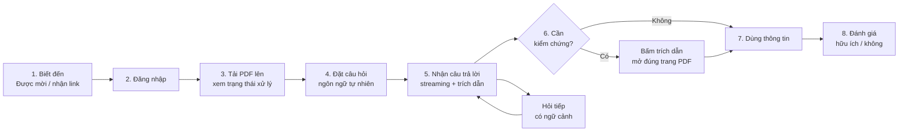

# Tài liệu Yêu cầu Sản phẩm (PRD) — Công cụ "Chat với tài liệu" (MVP)

> **Chuẩn áp dụng:** IEEE 29148-2018 — Requirements engineering
> **Đầu vào:** [BRD.md](BRD.md) (BRD-CVD-001 v0.1) · **Prompt nguồn:** [PRD_Prompt_IEEE_standard.md](PRD_Prompt_IEEE_standard.md)
> **Quy ước:** động từ chuẩn **phải / nên / có thể** (shall / should / may). `[TBD: OQ-xxx]` = chưa có quyết định, kế thừa từ BRD. `[Đề xuất BA]` = chỉ có hiệu lực khi OQ-014 được giải quyết. `[Giả định PM]` = giả định của PRD này, cần xác nhận.

| Trường | Giá trị |
|---|---|
| Mã tài liệu | PRD-CVD-001 |
| Phiên bản / Trạng thái | 0.1 / Draft |
| Tác giả | Minh Tran |
| Ngày | 2026-10-19 |
| Truy vết ngược | BRD-CVD-001: BO-001…003, SN-001…011, BR-001…027, AC-001…027 |

---

## 0. Kiểm tra nền tảng sản phẩm (Product foundation validation)

Prompt mẫu có các trường placeholder. Bảng dưới là phần được điền từ BRD và đánh giá độ vững chắc.

| Trường | Nội dung điền từ BRD | Đánh giá |
|---|---|---|
| Tên sản phẩm | Công cụ "Chat với tài liệu" (MVP, ứng dụng web) | Đạt |
| Người dùng mục tiêu | Đội phát triển kinh doanh (STK-002); quản lý dự án là người ra quyết định đầu tư | Đạt. Quy mô chưa rõ (OQ-005) |
| Vấn đề | Thông tin nằm rải rác trong nhiều PDF; mỗi lần cần phải mở và tự tổng hợp; khó nắm đầy đủ nội dung | **Yếu về số liệu.** Chỉ có mô tả định tính (SRC-001), chưa có baseline (OQ-001) |
| Giải pháp cốt lõi | Tải PDF lên, hỏi bằng ngôn ngữ tự nhiên, nhận câu trả lời tổng hợp từ nhiều tài liệu, kèm trích dẫn tên tài liệu + số trang để tự kiểm chứng | Đạt. Khác biệt so với tìm từ khóa: tổng hợp đa tài liệu + nguồn kiểm chứng được |
| Trụ cột UX | Không có trong BRD. PRD đề xuất 4 trụ cột (xem bên dưới) | `[Giả định PM]` |

**Bốn trụ cột UX đề xuất** (suy ra từ rủi ro RSK-001, RSK-004 và ràng buộc CON-001, CON-003):

1. **Tin cậy bằng bằng chứng (Evidence-first):** không có câu trả lời nào thiếu nguồn; "không tìm thấy" là kết quả hợp lệ, không bao giờ suy đoán (BR-010, BR-011).
2. **Hỏi ngay, không thiết lập:** từ tải lên đến câu hỏi đầu tiên ít thao tác nhất; trạng thái xử lý luôn nhìn thấy (BR-004).
3. **Phản hồi tức thời cảm nhận được:** hiển thị câu trả lời dạng streaming; ngưỡng chờ chốt ở OQ-011 (BR-013).
4. **Web-first, desktop-first:** tối ưu cho trình duyệt máy tính (đọc tài liệu + đối chiếu trích dẫn); mobile responsive ở mức dùng được, không phải app native (CON-001).

**Các điểm yếu có thể làm lệch PRD** (kế thừa từ BRD, chưa giải quyết):

| # | Rủi ro | Hệ quả với PRD | Câu hỏi mở |
|---|---|---|---|
| 1 | Chưa có baseline và target | OKR ở mục 1.2 dùng giá trị khởi điểm do BA đề xuất, **chưa được nhà tài trợ xác nhận** | OQ-001, OQ-002, OQ-015 |
| 2 | Chưa biết có được gửi tài liệu cho dịch vụ AI bên ngoài | Kiến trúc triển khai (đám mây vs. tự host) có thể thay đổi; mục 5.1 đặt đây là cổng chặn | OQ-007 |
| 3 | Chưa chốt các tính năng `[Đề xuất BA]` | PRD vẫn viết đầy đủ nhưng gắn nhãn; P0 chỉ gồm các Must của BRD **và** các mục đề xuất BA mà BRD đã xếp Must (BR-010, BR-022) | OQ-014 |

---

## 1. Tóm tắt điều hành và chiến lược

### 1.1 Tầm nhìn sản phẩm

Trở thành "điểm truy vấn duy nhất" cho tri thức nằm trong tài liệu dự án: bất kỳ ai trong đội phát triển kinh doanh đều có thể hỏi một câu và nhận câu trả lời đúng, có nguồn, trong vài giây, thay vì mở từng tệp PDF. MVP chỉ cần chứng minh một điều: **đội làm việc nhanh hơn và tin được câu trả lời** — đủ để quản lý ra quyết định go/no-go (BO-003).

### 1.2 Mục tiêu và kết quả then chốt (OKR)

Các target dưới đây là giá trị khởi điểm do BA đề xuất trong BRD mục 4.1 `[Unverified]`, cần nhà tài trợ xác nhận (OQ-002, OQ-015). Thời hạn: hết giai đoạn thử nghiệm MVP `[TBD: OQ-004]`.

| Objective | Key Result | Metric | Baseline | Target (đề xuất) |
|---|---|---|---|---|
| **O1. Tiết kiệm thời gian tìm thông tin** (BO-001) | KR1.1 Giảm thời gian trung bình để có một thông tin dùng được | MET-001 | `[TBD: OQ-001]` | giảm ≥ 50% |
| | KR1.2 Câu trả lời bắt đầu hiển thị nhanh | p90 thời gian đến token đầu tiên (BR-013) | — | ≤ `[TBD: OQ-011]` |
| **O2. Câu trả lời đáng tin và kiểm chứng được** (BO-002) | KR2.1 Tỷ lệ trả lời đúng trên bộ câu hỏi mẫu | MET-002 | — | ≥ 80% |
| | KR2.2 Tỷ lệ trích dẫn đúng tài liệu + trang | MET-003 | — | ≥ 90% |
| | KR2.3 Tỷ lệ từ chối đúng khi tài liệu không có thông tin | AC-011 | — | ≥ 9/10 câu ngoài phạm vi |
| **O3. Có bằng chứng sử dụng để quyết định đầu tư** (BO-003) | KR3.1 Người dùng hoạt động hằng tuần | MET-004 | — | ≥ 60% |
| | KR3.2 Mức hài lòng | MET-005 | — | ≥ 4,0/5 |
| | KR3.3 Tỷ lệ câu trả lời được đánh giá "hữu ích" | Telemetry `answer_feedback` (BR-022) | — | `[TBD: OQ-015]` |

**Không phải mục tiêu của MVP:** mở rộng định dạng tệp, tích hợp kho tài liệu ngoài, phục vụ người dùng bên ngoài tổ chức (BRD mục 5.2).

---

## 2. Persona và hành trình người dùng

### 2.1 Persona

| | **P-A. Nhân viên phát triển kinh doanh (chính)** | **P-B. Quản lý dự án (phụ)** | **P-C. Quản trị viên / IT (phụ)** `[Giả định PM]` |
|---|---|---|---|
| Nguồn | STK-002 | STK-001 | STK-004, STK-005 |
| Bối cảnh | Chuẩn bị đề xuất, đàm phán, báo cáo; thường xuyên cần số liệu/điều khoản nằm trong nhiều PDF | Đầu tư và chịu trách nhiệm kết quả MVP | Cấp quyền, kiểm soát dữ liệu, vận hành |
| Mục tiêu | Có câu trả lời đúng nhanh, biết nguồn để dùng trong công việc | Biết công cụ có tiết kiệm thời gian và đủ tin cậy không | Chỉ đúng người truy cập; tuân thủ chính sách dữ liệu |
| Nỗi đau | Mở từng file, tự tổng hợp, sợ bỏ sót; không tin AI nếu không thấy nguồn | Không có số liệu để quyết định | Rủi ro lộ tài liệu; chi phí AI khó kiểm soát |
| Thành công là | Hỏi một câu, nhận câu trả lời có trích dẫn, bấm vào xem đúng trang | Thấy MET-001…005 đạt target | Truy cập được kiểm soát, giới hạn dung lượng được tuân thủ |
| Nhu cầu BRD | SN-001…006 | SN-007, SN-008 | SN-010, SN-011 |

Persona P-C chỉ có trong PRD vì BRD yêu cầu cấp quyền người dùng (BR-024) nhưng chưa nói ai thực hiện (OQ-013).

### 2.2 Hành trình người dùng cấp cao (P-A)



| Bước | Hành động người dùng | Điều hệ thống phải làm | Rủi ro bỏ cuộc | Yêu cầu |
|---|---|---|---|---|
| 1–2 | Vào ứng dụng, đăng nhập | Chỉ cho người được cấp quyền vào | Đăng nhập rườm rà (OQ-013) | BR-024 |
| 3 | Chọn/kéo thả PDF | Kiểm tra định dạng/dung lượng, hiển thị tiến trình và trạng thái | Chờ lâu không biết khi nào hỏi được | BR-001…006 |
| 4 | Nhập câu hỏi | Nhận câu hỏi trọn câu, giữ ngữ cảnh phiên | Không biết hỏi gì (→ BR-021) | BR-007, BR-017 |
| 5 | Đọc câu trả lời | Stream câu trả lời, tổng hợp đa tài liệu, đính kèm trích dẫn | Trả lời chậm hoặc sai | BR-008…013 |
| 6 | Bấm trích dẫn | Mở tài liệu gốc đúng trang | Không kiểm chứng được → mất tin | BR-016 |
| 8 | Bấm 👍/👎 | Ghi nhận đánh giá theo câu trả lời | — | BR-022 |

---

## 3. Yêu cầu chức năng và User Story

Thang ưu tiên: **P0** (bắt buộc cho launch) · **P1** (nên có) · **P2** (nice-to-have). Ánh xạ từ BRD: Must → P0, Should → P1, Could → P2.

### 3.1 Ma trận Epic / Feature

| Epic | Mô tả | Story | Yêu cầu BRD | Ưu tiên cao nhất |
|---|---|---|---|---|
| **E1. Quản lý tài liệu** | Tải lên, trạng thái, danh sách, xóa | US-01…06 | BR-001…006 | P0 |
| **E2. Hỏi đáp có nguồn** | Hỏi, trả lời đa tài liệu, trích dẫn, từ chối khi không có thông tin | US-07…13 | BR-007…016 | P0 |
| **E3. Hội thoại** | Ngữ cảnh nhiều lượt, lịch sử, hội thoại mới | US-14…16 | BR-017…019 | P1 |
| **E4. Hỗ trợ nắm tài liệu** | Tóm tắt, câu hỏi gợi ý | US-17…18 | BR-020, 021 | P2 |
| **E5. Phản hồi và đo lường** | Đánh giá câu trả lời, ghi nhận sử dụng | US-19…20 | BR-022, 023 | P0 |
| **E6. Truy cập và bảo vệ dữ liệu** | Xác thực, phân quyền, xóa triệt để | US-21…23 | BR-024…026 | P0 |
| **E7. Giới hạn vận hành** | Quy mô, hiệu năng, kiểm soát chi phí | US-24 | BR-027 | P0 |

### 3.2 E1 — Quản lý tài liệu

**US-01 (P0)** — Là *nhân viên phát triển kinh doanh*, tôi muốn **tải một tệp PDF lên**, để **đưa tài liệu vào phạm vi hỏi đáp** (BR-001, AC-001).

- **AC-01.1** — *Given* tôi đã đăng nhập, *When* tôi tải lên PDF hợp lệ có dung lượng ≤ giới hạn BRU-004 `[TBD: OQ-005]`, *Then* tệp xuất hiện trong danh sách tài liệu với trạng thái "Đang xử lý".
- **AC-01.2** — *Given* tôi đã đăng nhập, *When* tôi tải lên tệp vượt giới hạn dung lượng hoặc số trang, *Then* hệ thống từ chối ngay, nêu tên tệp, giới hạn và dung lượng thực tế, tệp không vào danh sách.

**US-03 (P0)** — Là *nhân viên phát triển kinh doanh*, tôi muốn **biết rõ tệp nào bị từ chối và vì sao**, để **không tưởng nhầm tài liệu đã được dùng để trả lời** (BR-003, AC-003).

- **AC-03.1** — *Given* tôi tải lên tệp .docx, *When* hệ thống kiểm tra định dạng, *Then* hiển thị "<tên tệp>: chỉ hỗ trợ PDF".
- **AC-03.2** — *Given* tôi tải lên PDF có mật khẩu, *When* hệ thống xử lý, *Then* hiển thị "<tên tệp>: tệp được bảo vệ bằng mật khẩu, không thể đọc".
- **AC-03.3** — *Given* tôi tải lên PDF chỉ có ảnh scan (không có lớp văn bản), *When* hệ thống không trích xuất được văn bản, *Then* hiển thị "<tên tệp>: không có văn bản trích xuất được (PDF dạng ảnh scan chưa được hỗ trợ)" và trạng thái "Lỗi".

**US-04 (P0)** — Là *nhân viên phát triển kinh doanh*, tôi muốn **thấy trạng thái từng tài liệu**, để **biết khi nào có thể hỏi** (BR-004, AC-004).

- **AC-04.1** — *Given* tôi vừa tải tệp lên, *When* hệ thống đang xử lý, *Then* tài liệu hiển thị "Đang xử lý".
- **AC-04.2** — *Given* tài liệu đang "Đang xử lý", *When* xử lý hoàn tất, *Then* trạng thái chuyển thành "Sẵn sàng" mà **không cần tải lại trang**.
- **AC-04.3** — *Given* xử lý thất bại, *When* kết thúc, *Then* trạng thái "Lỗi" kèm lý do (xem US-03) và nút "Thử lại" hoặc "Xóa".

**US-05 (P0)** — Là *nhân viên phát triển kinh doanh*, tôi muốn **xem danh sách tài liệu tôi được phép hỏi**, để **biết phạm vi kiến thức của công cụ** (BR-005, AC-005).

- **AC-05.1** — *Given* tôi đã đăng nhập, *When* mở danh sách, *Then* thấy 100% tài liệu trong quyền truy cập, mỗi dòng có tên tệp, ngày tải lên, trạng thái.
- **AC-05.2** — *Given* tài liệu nằm ngoài quyền của tôi (theo OQ-008), *When* mở danh sách, *Then* tài liệu đó không xuất hiện.

**US-06 (P0)** — Là *người dùng được cấp quyền*, tôi muốn **xóa một tài liệu**, để **loại bỏ tài liệu lỗi thời hoặc tải nhầm** (BR-006, BR-025, AC-006, AC-025).

- **AC-06.1** — *Given* tôi chọn xóa một tài liệu, *When* tôi xác nhận ở hộp thoại, *Then* tài liệu biến mất khỏi danh sách của mọi người dùng.
- **AC-06.2** — *Given* tài liệu đã bị xóa, *When* bất kỳ ai hỏi câu từng được trả lời từ tài liệu đó, *Then* câu trả lời không chứa thông tin hay trích dẫn từ tài liệu đã xóa.

**US-02 (P1)** — Là *nhân viên phát triển kinh doanh*, tôi muốn **tải lên nhiều PDF cùng lúc**, để **nạp nhanh cả bộ tài liệu dự án** (BR-002, AC-002). Ví dụ: chọn đúng số tệp tối đa BRU-005 `[TBD: OQ-005]` → tất cả được tiếp nhận; tệp lỗi không chặn các tệp còn lại.

### 3.3 E2 — Hỏi đáp có nguồn

**US-07 (P0)** — Là *nhân viên phát triển kinh doanh*, tôi muốn **hỏi bằng câu tự nhiên**, để **không phải tự đọc hết tài liệu** (BR-007, AC-007).

- **AC-07.1** — *Given* có ít nhất một tài liệu "Sẵn sàng", *When* tôi gửi câu hỏi trọn câu, *Then* hệ thống trả phản hồi (câu trả lời hoặc thông báo không tìm thấy).
- **AC-07.2** — *Given* không có tài liệu nào "Sẵn sàng", *When* tôi vào màn hình hỏi, *Then* ô nhập bị vô hiệu và hiển thị hướng dẫn tải tài liệu (xem mục 4.2, trạng thái rỗng).

**US-08 (P0)** — Là *nhân viên phát triển kinh doanh*, tôi muốn **câu trả lời chỉ dựa trên tài liệu của dự án**, để **tin được nội dung** (BR-008, BRU-002, AC-008) — chờ xác nhận OQ-009.

- **AC-08.1** — *Given* một câu hỏi mà đáp án theo kiến thức phổ thông khác với tài liệu, *When* hệ thống trả lời, *Then* câu trả lời theo nội dung tài liệu (≥ 9/10 câu trong bộ kiểm thử).

**US-09 (P0)** — Là *nhân viên phát triển kinh doanh*, tôi muốn **một câu trả lời tổng hợp từ nhiều tài liệu**, để **không phải tự ghép thủ công** (BR-009, AC-009).

- **AC-09.1** — *Given* thông tin nằm ở ≥ 2 tài liệu "Sẵn sàng", *When* tôi hỏi, *Then* một câu trả lời duy nhất chứa thông tin từ tất cả tài liệu liên quan, mỗi phần có trích dẫn riêng.

**US-10 (P0)** — Là *nhân viên phát triển kinh doanh*, tôi muốn **thấy tên tài liệu và số trang cho mỗi thông tin**, để **kiểm chứng trước khi dùng** (BR-010, BRU-003, AC-010) `[Đề xuất BA]`.

- **AC-10.1** — *Given* câu trả lời có thông tin từ tài liệu, *When* hiển thị, *Then* 100% đoạn thông tin có trích dẫn dạng `[Tên tệp, tr. N]`.
- **AC-10.2** — *Given* trích dẫn hiển thị, *When* đối chiếu với tài liệu gốc, *Then* thông tin nằm đúng tài liệu và trang được nêu (tỷ lệ ≥ target MET-003).

**US-11 (P0)** — Là *nhân viên phát triển kinh doanh*, tôi muốn **được báo rõ khi tài liệu không có thông tin**, để **không bị dẫn đến quyết định sai từ câu trả lời bịa** (BR-011, AC-011).

- **AC-11.1** — *Given* câu hỏi mà không tài liệu nào chứa thông tin, *When* hệ thống trả lời, *Then* hiển thị "Không tìm thấy thông tin này trong các tài liệu đã tải lên", **không** đưa ra nội dung suy đoán và **không** có trích dẫn (≥ 9/10 câu ngoài phạm vi).

**US-12 (P0)** — Là *quản lý dự án*, tôi muốn **câu trả lời đạt chất lượng đã cam kết**, để **tin vào kết quả thử nghiệm** (BR-012, AC-012). *Given* bộ câu hỏi mẫu (≥ 30 câu, DEP-002), *When* chuyên gia nghiệp vụ chấm điểm, *Then* tỷ lệ đúng ≥ target MET-002 `[TBD: OQ-002]`.

**US-13 (P0)** — Là *nhân viên phát triển kinh doanh*, tôi muốn **thấy câu trả lời xuất hiện nhanh**, để **không bỏ cuộc quay lại tìm thủ công** (BR-013, AC-013). *Given* quy mô thử nghiệm OQ-005, *When* chạy toàn bộ câu hỏi mẫu, *Then* p90 thời gian từ lúc gửi đến lúc chữ đầu tiên hiển thị ≤ `[TBD: OQ-011]`.

**US-13b (P0)** — Là *nhân viên phát triển kinh doanh*, tôi muốn **hỏi và nhận câu trả lời bằng ngôn ngữ làm việc của mình**, để **không phải dịch** (BR-014, AC-014). *Given* câu hỏi bằng ngôn ngữ trong OQ-006, *Then* câu trả lời bằng cùng ngôn ngữ.

**US-13c (P1)** — Là *nhân viên phát triển kinh doanh*, tôi muốn **giới hạn câu hỏi vào một số tài liệu tôi chọn** (BR-015, AC-015) `[Đề xuất BA]`: khi chọn 1 tài liệu, 100% trích dẫn chỉ trỏ tới tài liệu đó.

**US-13d (P1)** — Là *nhân viên phát triển kinh doanh*, tôi muốn **bấm vào trích dẫn để mở tài liệu gốc đúng trang** (BR-016, AC-016) `[Đề xuất BA]`. **Khuyến nghị PM:** nâng lên P0 nếu OQ-014 chấp nhận BR-010, vì thiếu đường kiểm chứng nhanh thì giá trị của trích dẫn giảm mạnh.

### 3.4 E3 — Hội thoại (P1)

| ID | User story | BRD | Ưu tiên | Tiêu chí chấp nhận (tóm tắt) |
|---|---|---|---|---|
| US-14 | Là *người dùng*, tôi muốn **hỏi tiếp mà không nhắc lại bối cảnh**, để tiết kiệm thao tác | BR-017 / AC-017 | P1 | Câu hỏi có đại từ tham chiếu ("còn hạn chót của nó?") được hiểu đúng ≥ 8/10 kịch bản mẫu |
| US-15 | Là *người dùng*, tôi muốn **xem lại các hội thoại cũ của mình**, để không hỏi lại | BR-018 / AC-018 | P1 | Đăng xuất rồi đăng nhập vẫn thấy hội thoại trong thời hạn OQ-012; không thấy hội thoại của người khác |
| US-16 | Là *người dùng*, tôi muốn **bắt đầu hội thoại mới không mang ngữ cảnh cũ**, để tránh nhiễu | BR-019 / AC-019 | P1 | Câu hỏi tham chiếu hội thoại cũ không được trả lời bằng ngữ cảnh cũ |

### 3.5 E4 — Hỗ trợ nắm tài liệu (P2)

| ID | User story | BRD | Ưu tiên | Tiêu chí chấp nhận (tóm tắt) |
|---|---|---|---|---|
| US-17 | Là *người dùng*, tôi muốn **tóm tắt một tài liệu mới**, để nắm nhanh ý chính | BR-020 / AC-020 | P2 | Chuyên gia chấm ≥ 4/5 bản tóm tắt mẫu phản ánh đúng, không thêm ngoài tài liệu |
| US-18 | Là *người dùng chưa biết hỏi gì*, tôi muốn **được gợi ý tối đa 3 câu hỏi**, để bắt đầu dễ hơn | BR-021 / AC-021 | P2 | 1–3 gợi ý; mỗi gợi ý khi hỏi đều có câu trả lời kèm trích dẫn |

### 3.6 E5 — Phản hồi và đo lường

**US-19 (P0)** — Là *quản lý dự án*, tôi muốn **người dùng đánh giá từng câu trả lời**, để **có dữ liệu chất lượng thực tế cho quyết định go/no-go** (BR-022, AC-022) `[Đề xuất BA]`.

- **AC-19.1** — *Given* một câu trả lời đã hiển thị xong, *When* tôi bấm "Hữu ích" hoặc "Không hữu ích", *Then* đánh giá được lưu gắn với câu trả lời đó và người dùng thấy xác nhận.
- **AC-19.2** — *Given* tôi đã đánh giá, *When* tôi bấm lại lựa chọn khác, *Then* đánh giá được cập nhật, không tạo bản ghi trùng.
- **AC-19.3** — *Given* tôi chọn "Không hữu ích", *When* đánh giá được lưu, *Then* hiển thị ô tùy chọn nhập lý do (có thể bỏ qua). `[Giả định PM]`

**US-20 (P0)** — Là *quản lý dự án*, tôi muốn **biết mỗi người đặt bao nhiêu câu hỏi mỗi tuần**, để **tính MET-004** (BR-023, AC-023).

- **AC-20.1** — *Given* dữ liệu sử dụng của một tuần trong kịch bản kiểm thử, *When* truy xuất, *Then* số câu hỏi theo từng người dùng khớp 100% với số câu đã thực hiện.

### 3.7 E6 — Truy cập và bảo vệ dữ liệu

**US-21 (P0)** — Là *quản trị viên*, tôi muốn **chỉ người được cấp quyền mới truy cập**, để **bảo vệ tài liệu dự án** (BR-024, AC-024).

- **AC-21.1** — *Given* người chưa được cấp quyền, *When* truy cập ứng dụng hoặc gọi trực tiếp API, *Then* không xem được danh sách tài liệu, không hỏi được, không xem được hội thoại (0 truy cập thành công trong kịch bản kiểm thử).
- **AC-21.2** — *Given* phiên đăng nhập hết hạn, *When* tôi thao tác, *Then* bị chuyển về đăng nhập và nội dung đang nhập được giữ lại nếu có thể.

**US-22 (P0)** — Là *đại diện bảo mật/pháp chế*, tôi muốn **xác nhận cách xử lý tài liệu tuân thủ chính sách**, để **không vi phạm thỏa thuận bảo mật** (BR-026, AC-026). *Given* phương án xử lý AI đã chốt, *When* Bảo mật/Pháp chế review, *Then* có xác nhận bằng văn bản — **điều kiện chặn bắt đầu phát triển** (OQ-007, DEP-001).

**US-23 (P0)** — Là *người dùng*, tôi muốn **dữ liệu đã xóa không còn bị dùng**, để **kiểm soát phạm vi dữ liệu** — xem AC-06.2 (BR-025, BRU-006).

### 3.8 E7 — Giới hạn vận hành

**US-24 (P0)** — Là *đội kỹ thuật*, tôi muốn **giới hạn rõ số tài liệu và người dùng đồng thời**, để **vận hành ổn định và kiểm soát chi phí** (BR-027, AC-027). *Given* số tài liệu và người dùng đồng thời theo OQ-005, *When* chạy kiểm thử tải, *Then* ngưỡng p90 của US-13 vẫn đạt.

### 3.9 Ngoài phạm vi MVP (Won't)

Không phát triển: OCR cho PDF ảnh scan (BR-028, OQ-010), xuất hội thoại ra tệp (BR-029), định dạng ngoài PDF, ứng dụng native, kết nối kho tài liệu ngoài, so sánh nội dung giữa tài liệu, báo cáo thống kê cho quản lý (dùng nhật ký sử dụng).

---

## 4. Yêu cầu UX và UI

### 4.1 Bố cục và luồng tương tác cốt lõi

Màn hình chính là một trang duy nhất, ba vùng, tối ưu cho trình duyệt máy tính:

```
┌───────────────────────────────────────────────────────────────┐
│ Logo · Hội thoại mới                      [Tên người dùng ▾]  │
├──────────────┬────────────────────────────────┬───────────────┤
│ TÀI LIỆU     │ HỘI THOẠI                      │ NGUỒN         │
│ [+ Tải lên]  │                                │ (khung xem    │
│ ☑ hop-dong.pdf  ● Sẵn sàng │ Bạn: Hạn chót...?  │ PDF, mở khi   │
│ ☑ bao-gia.pdf   ◐ Đang xử lý│ AI: Hạn chót là... │ bấm trích dẫn)│
│ ☐ spec.pdf      ✕ Lỗi      │   [hop-dong.pdf, tr.7] │               │
│              │ 👍 👎                          │ tr. 7 / 32    │
│ Lịch sử ▸    │ ┌────────────────────────┐ │               │
│              │ │ Nhập câu hỏi...   [Gửi]│ │               │
│              │ └────────────────────────┘ │               │
└──────────────┴────────────────────────────────┴───────────────┘
```

| Vùng | Yêu cầu bố cục / tương tác |
|---|---|
| **Cột trái — Tài liệu** | Nút tải lên và vùng kéo-thả. Mỗi tài liệu: tên, ngày, chip trạng thái (Đang xử lý / Sẵn sàng / Lỗi) và hộp chọn phạm vi hỏi (BR-015, P1). Xóa bằng menu "⋯" kèm hộp thoại xác nhận. Danh sách cập nhật trạng thái theo thời gian thực. |
| **Cột giữa — Hội thoại** | Câu trả lời hiển thị dạng streaming. Trích dẫn là chip bấm được ngay trong câu trả lời, gắn đúng đoạn thông tin. Dưới mỗi câu trả lời: 👍/👎 (BR-022). Ô nhập cố định phía dưới; Enter để gửi, Shift+Enter xuống dòng. |
| **Cột phải — Nguồn** | Bấm chip trích dẫn mở khung xem PDF tại đúng trang, đánh dấu đoạn liên quan nếu khả thi (BR-016, P1). Nếu chưa có BR-016, chip hiển thị tên tệp + số trang dạng văn bản. |

**Nguyên tắc tương tác bắt buộc**

1. Ô nhập chỉ bật khi có ít nhất một tài liệu "Sẵn sàng".
2. Trong lúc AI trả lời, nút Gửi chuyển thành "Dừng"; người dùng ngắt được.
3. Trích dẫn không bao giờ tách khỏi nội dung nó hỗ trợ; câu trả lời không có nguồn không được trình bày như câu trả lời có nguồn.
4. Câu "Không tìm thấy thông tin" trình bày khác biệt, trung tính, kèm gợi ý (kiểm tra tài liệu đã tải đủ chưa, thử diễn đạt khác).
5. Có dòng nhắc cố định: *"Kiểm tra lại với tài liệu gốc trước khi dùng cho quyết định quan trọng"* (giảm RSK-001, ASM-005).
6. Ngôn ngữ giao diện theo OQ-006.

**Yêu cầu phi chức năng về trải nghiệm** `[Giả định PM]`: tương thích 2 phiên bản mới nhất của Chrome, Edge, Safari, Firefox; layout co lại một cột dùng được trên màn hình ≥ 768 px; điều hướng bằng bàn phím và đạt WCAG 2.1 AA ở các luồng tải lên, hỏi và trích dẫn.

### 4.2 Trường hợp biên và trạng thái lỗi

| Tình huống | Hành vi bắt buộc |
|---|---|
| **Chưa có tài liệu (trạng thái rỗng)** | Hiển thị minh họa + "Tải PDF đầu tiên để bắt đầu hỏi" và nút tải lên; ô nhập bị vô hiệu. |
| **Có tài liệu nhưng chưa có hội thoại** | Hiển thị lời chào, tên các tài liệu sẵn sàng, và (nếu có BR-021) tối đa 3 câu hỏi gợi ý. |
| **Mọi tài liệu đang xử lý** | Ô nhập bị vô hiệu; thông báo "Đang xử lý n tài liệu, thường mất vài phút" `[TBD: OQ-005]`; tự bật khi tài liệu đầu tiên sẵn sàng. |
| **Mất mạng khi tải lên** | Hiển thị "Mất kết nối" tại tệp bị ảnh hưởng, giữ tệp trong danh sách với trạng thái "Lỗi - tải lại"; tự thử lại tối đa 3 lần, rồi cho phép thử lại thủ công. Không tạo bản ghi trùng khi thử lại. |
| **Mất mạng khi đang hỏi** | Giữ nguyên câu hỏi trong ô nhập; hiển thị "Không gửi được. Thử lại"; nếu mất mạng giữa chừng streaming, giữ phần đã nhận, đánh dấu "chưa hoàn tất" và cho phép "Tạo lại". |
| **Dịch vụ AI lỗi/quá tải/timeout** | Thông báo "Hệ thống tạm thời không trả lời được, vui lòng thử lại" (không lộ lỗi kỹ thuật); không tính vào số câu hỏi (MET-004); sau thời gian chờ tối đa `[TBD: OQ-011]` hiển thị thông báo thay vì treo vô hạn. |
| **Tệp không hợp lệ** (sai định dạng, quá lớn, có mật khẩu, hỏng, PDF scan) | Thông báo tại từng tệp theo AC-03.1…03.3; tải nhiều tệp: tệp lỗi không chặn tệp hợp lệ; tệp trùng tên → hỏi "Thay thế hay giữ cả hai". |
| **Câu hỏi không hợp lệ** (rỗng, chỉ khoảng trắng, quá dài) | Vô hiệu nút Gửi khi rỗng; vượt giới hạn ký tự `[TBD: OQ-005]` → hiển thị bộ đếm và chặn gửi. |
| **Câu hỏi ngoài phạm vi tài liệu** | Trả lời "Không tìm thấy thông tin" (BR-011); không dùng kiến thức bên ngoài (nếu OQ-009 xác nhận). |
| **Câu hỏi mơ hồ** | Có thể hỏi lại để làm rõ thay vì đoán `[Giả định PM]`, P2. |
| **Xóa tài liệu khi đang được trích dẫn trong hội thoại cũ** | Hội thoại cũ giữ nguyên văn câu trả lời nhưng chip trích dẫn hiển thị "Tài liệu đã bị xóa" và không mở được (BRU-006). |
| **Hai người xóa/tải cùng lúc** | Trạng thái cuối cùng nhất quán sau khi làm mới; thao tác trên tài liệu đã bị xóa báo "Tài liệu không còn tồn tại". |
| **Hết phiên đăng nhập** | Chuyển về đăng nhập, không mất câu hỏi đang soạn. |
| **Không có quyền** | Trang 403 nêu cách xin quyền (liên hệ P-C); không tiết lộ sự tồn tại của tài liệu. |
| **Người dùng không đánh giá hoặc đánh giá lỗi** | Việc đánh giá không bao giờ chặn luồng chính; lỗi ghi đánh giá → thử lại ngầm, không báo lỗi to. |

---

## 5. Tiêu chí phát hành và chỉ số sau ra mắt

### 5.1 Cổng phát hành (Launch gates)

Mọi cổng đều **phải** đạt trước khi mở cho nhóm thử nghiệm. Các ngưỡng gắn `[TBD]` chỉ có giá trị khi OQ liên quan được chốt.

| Nhóm | Cổng | Ngưỡng | Kiểm chứng | Chặn bởi |
|---|---|---|---|---|
| **Pháp lý/Bảo mật** | G-01 Bảo mật/Pháp chế xác nhận chính sách xử lý dữ liệu và việc dùng dịch vụ AI | Có văn bản xác nhận (AC-026) | Review | OQ-007, DEP-001 |
| | G-02 Kiểm soát truy cập | 0 truy cập thành công của người chưa cấp quyền ở UI và API (AC-024) | Test bảo mật | OQ-013 |
| | G-03 Dữ liệu đã xóa không còn được dùng | 5/5 câu hỏi kiểm tra không còn dấu vết (AC-025) | Test | — |
| | G-04 Không có lỗ hổng mức Critical/High chưa xử lý; dữ liệu mã hóa khi truyền và khi lưu `[Giả định PM]` | 0 Critical/High | Quét + rà soát | — |
| **Chất lượng AI** | G-05 Tỷ lệ trả lời đúng (MET-002) | ≥ `[TBD: OQ-002]` (đề xuất 80%) trên ≥ 30 câu mẫu | Chấm bởi chuyên gia | DEP-002, OQ-002 |
| | G-06 Tỷ lệ trích dẫn đúng (MET-003) | ≥ 90% (đề xuất) | Chấm bởi chuyên gia | DEP-002 |
| | G-07 Từ chối đúng khi ngoài phạm vi | ≥ 9/10 câu (AC-011) | Test | — |
| | G-08 Trả lời theo tài liệu thay vì kiến thức chung | ≥ 9/10 câu (AC-008) | Test | OQ-009 |
| **Hiệu năng** | G-09 p90 thời gian đến chữ đầu tiên | ≤ `[TBD: OQ-011]` ở quy mô OQ-005 (AC-013, AC-027) | Test tải | OQ-005, OQ-011 |
| | G-10 Xử lý tài liệu sau khi tải lên | Ngưỡng `[TBD: OQ-005]`; trạng thái cập nhật không cần tải lại (AC-004) | Test | OQ-005 |
| | G-11 Tính sẵn sàng trong giờ làm việc thử nghiệm `[Giả định PM]` | ≥ 99% | Giám sát | — |
| **QA / Chức năng** | G-12 100% story P0 đạt toàn bộ AC Given-When-Then | 100% pass | Test | — |
| | G-13 Không còn lỗi Severity 1 hoặc 2 mở | 0 | Bug tracker | — |
| | G-14 Kiểm thử lỗi và trạng thái rỗng theo mục 4.2 | 100% các dòng được kiểm thử | Test | — |
| | G-15 Kiểm thử trên PDF thật của dự án gồm PDF nhiều bảng, nhiều cột | Đã thực hiện; kết quả ghi lại (RSK-003) | Test | ASM-001, DEP-002 |
| **Đo lường** | G-16 Toàn bộ sự kiện telemetry P0 ở mục 5.2 hoạt động | 100% sự kiện phát đúng, đúng thuộc tính | Inspection | — |
| | G-17 Có baseline MET-001 đã đo | Đã đo (OQ-001) | Thử nghiệm bấm giờ | OQ-001 |
| **Vận hành** | G-18 Giới hạn dung lượng, số tệp, số người dùng được cấu hình và có cảnh báo chi phí AI | Có giới hạn + cảnh báo (RSK-005) | Inspection | OQ-005 |
| | G-19 Kế hoạch thu hồi (tắt công cụ, xóa dữ liệu theo yêu cầu) | Đã diễn tập | Demonstration | OQ-012 |

**Điều kiện chuyển sang Go/No-Go** (cuối thử nghiệm): MET-001…005 so với target đã được nhà tài trợ phê duyệt (OQ-015).

### 5.2 Phân tích và theo dõi (Analytics & Tracking)

**Nguyên tắc:** sự kiện chỉ gắn `user_id` đã băm và mã định danh (ID) tài liệu/câu hỏi, **không** ghi nội dung câu hỏi, câu trả lời hoặc tài liệu vào hệ thống phân tích; nội dung chỉ nằm trong kho hội thoại có kiểm soát truy cập (RSK-002) `[Giả định PM]`. Mọi sự kiện có thuộc tính chung: `event_id`, `timestamp`, `user_id_hash`, `session_id`, `app_version`.

| Sự kiện | Kích hoạt khi | Thuộc tính chính | Phục vụ | Ưu tiên |
|---|---|---|---|---|
| `login_success` / `login_failed` | Đăng nhập | `reason` | Funnel bước 1–2 | P0 |
| `document_upload_started` | Bắt đầu tải | `doc_id`, `file_size`, `page_count` | Funnel bước 3; BR-001 | P0 |
| `document_upload_rejected` | Bị từ chối | `reason` ∈ {format, size, pages, password, scan, corrupt} | BR-003; RSK-003 | P0 |
| `document_ready` | Xử lý xong | `doc_id`, `processing_ms` | G-10; BR-004 | P0 |
| `document_processing_failed` | Xử lý lỗi | `doc_id`, `error_code` | RSK-003 | P0 |
| `document_deleted` | Xóa | `doc_id` | BR-006 | P0 |
| `question_submitted` | Gửi câu hỏi | `question_id`, `conversation_id`, `scope_doc_count`, `is_followup` | **MET-004** (BR-023); funnel bước 4 | P0 |
| `answer_first_token` | Chữ đầu tiên hiển thị | `question_id`, `latency_ms` | **KR1.2**, BR-013 | P0 |
| `answer_completed` | Câu trả lời xong | `question_id`, `total_ms`, `outcome` ∈ {answered, not_found, error, aborted}, `citation_count`, `docs_cited` | KR2.3; funnel bước 5 | P0 |
| `answer_error` | Lỗi AI/timeout | `question_id`, `error_code` | Độ tin cậy; loại khỏi MET-004 | P0 |
| `answer_feedback` | Bấm 👍/👎 | `question_id`, `value`, `has_reason` | **KR3.3**, BR-022 | P0 |
| `citation_clicked` | Bấm chip trích dẫn | `question_id`, `doc_id`, `page` | Tỷ lệ tự kiểm chứng; BR-016 | P1 |
| `answer_stopped` | Bấm "Dừng" | `question_id`, `elapsed_ms` | Chất lượng/độ chậm | P1 |
| `conversation_started` / `history_opened` | Hội thoại mới / mở lịch sử | `conversation_id` | BR-018, BR-019 | P1 |
| `scope_changed` | Đổi phạm vi tài liệu | `doc_count` | BR-015 | P1 |
| `suggested_question_clicked` / `summary_requested` | Dùng tính năng P2 | `doc_id` | BR-020, BR-021 | P2 |
| `csat_submitted` | Khảo sát cuối thử nghiệm | `score` 1–5 | **MET-005** | P0 |

**Funnel chính cần dựng và theo dõi drop-off**

| Bước | Sự kiện | Câu hỏi cần trả lời |
|---|---|---|
| 1. Được cấp quyền | (danh sách người dùng) | Bao nhiêu người được mời? |
| 2. Đăng nhập lần đầu | `login_success` | Có người được cấp quyền nhưng không bao giờ vào? |
| 3. Có ≥ 1 tài liệu sẵn sàng | `document_ready` | Rớt do tải lỗi/quá lâu? |
| 4. Hỏi câu đầu tiên | `question_submitted` | Thời gian từ đăng nhập đến câu hỏi đầu tiên? |
| 5. Nhận câu trả lời có nguồn | `answer_completed` (answered) | Tỷ lệ `not_found`/`error`? |
| 6. Quay lại tuần sau | `question_submitted` theo tuần | **MET-004** có đạt ≥ 60%? |

**Bảng điều khiển go/no-go (tối thiểu):** MET-004 theo tuần; p50/p90 `answer_first_token`; tỷ lệ 👍 trên tổng đánh giá; tỷ lệ `not_found` và `error`; số lượt `citation_clicked`/`answer_completed`; chi phí AI trên mỗi câu hỏi (RSK-005); lý do tải lên bị từ chối.

---

## 6. Phụ thuộc, câu hỏi mở và lộ trình

### 6.1 Câu hỏi mở chặn PRD (kế thừa từ BRD mục 12)

| OQ | Quyết định cần | Ảnh hưởng đến PRD | Cần trước |
|---|---|---|---|
| OQ-005 | Quy mô: người dùng, số tài liệu, dung lượng/trang tối đa, số tệp mỗi lần tải | AC-01.1/01.2, US-02, US-24, G-09, G-10, G-18 | Trước khi chốt PRD |
| OQ-006 | Ngôn ngữ tài liệu và câu hỏi | US-13b, ngôn ngữ giao diện | Trước khi chốt PRD |
| OQ-007 | Chính sách dữ liệu và việc dùng AI bên ngoài | US-22, G-01; có thể đổi kiến trúc | Trước khi phát triển |
| OQ-008 | Tài liệu dùng chung hay riêng từng người | AC-05.1/05.2, mô hình dữ liệu, quyền | Trước khi chốt PRD |
| OQ-011 | Ngưỡng chờ tối đa | US-13, G-09, timeout ở mục 4.2 | Trước khi chốt PRD |
| OQ-012 | Thời hạn lưu giữ tài liệu/lịch sử | US-15, G-19 | Trước khi chốt PRD |
| OQ-013 | Cách xác thực người dùng | US-21, luồng đăng nhập | Trước khi chốt PRD |
| OQ-014 | Tính năng `[Đề xuất BA]` nào vào MVP | US-10, 13c, 13d, 14…19 | Khi phê duyệt BRD |
| OQ-002, OQ-015 | Target các chỉ số, tiêu chí go/no-go | Mục 1.2, G-05, G-06 | Trước khi phê duyệt |

### 6.2 Đề xuất chia giai đoạn phát hành (dựa trên ưu tiên, chưa gắn lịch vì OQ-004 chưa có)

| Giai đoạn | Nội dung | Điều kiện |
|---|---|---|
| **Alpha (nội bộ đội kỹ thuật)** | E1 (US-01, 03, 04, 05, 06) + E2 (US-07, 08, 11) + E6 (US-21) | Có phương án chính sách dữ liệu tạm (OQ-007) |
| **Beta (nhóm thử nghiệm)** | Toàn bộ P0 còn lại: US-09, 10, 12, 13, 13b, 19, 20, 22, 23, 24 + telemetry P0 | Đạt cổng G-01…G-19 |
| **Mở rộng thử nghiệm** | P1: US-02, 13c, 13d, 14, 15, 16 | MET-004 tuần đầu ≥ target |
| **Sau go/no-go** | P2: US-17, 18; mục hoãn (OCR, xuất file, kho tài liệu ngoài) | Quyết định của nhà tài trợ |

### 6.3 Truy vết sang BRD

| BRD | PRD |
|---|---|
| BO-001 | O1 · US-01…07, 09, 13, 13b |
| BO-002 | O2 · US-03…06, 08, 10…12, 13c |
| BO-003 | O3 · US-18, 19, 20, 24 |
| SN-011 (tuân thủ) | US-06, 21, 22, 23 |
| BR-001…027 | Phủ đủ bởi US-01…24 (xem cột "Yêu cầu BRD" ở mục 3.1) |
| AC-001…027 | Chi tiết hóa thành AC Given-When-Then ở mục 3 |

---

## Tuyên bố mức độ sẵn sàng

**Ready with conditions.** PRD đủ để đội thiết kế và kỹ thuật bắt đầu khám phá (wireframe, kiến trúc sơ bộ, dựng bộ câu hỏi mẫu), **chưa đủ để baseline**.

Điều kiện chặn: OQ-007 (chính sách dữ liệu), OQ-005 / OQ-011 / OQ-006 / OQ-008 / OQ-013 (các giá trị còn `[TBD]` trong AC của story P0), OQ-002 / OQ-015 (target OKR), OQ-014 (phạm vi `[Đề xuất BA]`) và DEP-002 (bộ tài liệu + ≥ 30 câu hỏi mẫu để chấm điểm các cổng G-05…G-07).
