# Tài liệu User Stories — Công cụ "Chat với tài liệu" (MVP)

> **Mã tài liệu:** US-CVD-001 · **Phiên bản:** 0.1 (Draft) · **Ngày:** 2026-10-21 · **Tác giả:** Minh Tran
> **Nguồn:** [PRD.md](PRD.md) (mục 3 — Yêu cầu chức năng và User Story, mục 4.2 — Trường hợp biên) · [BRD.md](BRD.md) · [UIUX_Blueprint_Design.md](../design/UIUX_Blueprint_Design.md) (mục 3.5.2, 4.2)
> **Ảnh màn hình:** chụp từ các thiết kế HTML trong [html_design](../design/html_design/index.html), lưu ở [images/](images/).
> **Quy ước:** P0 bắt buộc · P1 nên có · P2 nice-to-have. `[TBD: OQ-xxx]` chờ quyết định. `[Đề xuất BA]` chỉ hiệu lực khi OQ-014 được giải quyết.

---

## 1. Tổng quan

### 1.1 Persona

| Mã | Persona | Mục tiêu chính |
|---|---|---|
| P-A | Nhân viên phát triển kinh doanh (chính) | Có câu trả lời đúng, nhanh, biết nguồn để kiểm chứng |
| P-B | Quản lý dự án | Có dữ liệu sử dụng và chất lượng để ra quyết định go/no-go |
| P-C | Quản trị viên / IT, Bảo mật | Chỉ đúng người truy cập; tuân thủ chính sách dữ liệu |

### 1.2 Danh mục Epic

| Epic | Story | Ưu tiên cao nhất |
|---|---|---|
| E1. Quản lý tài liệu | US-01…06 | P0 |
| E2. Hỏi đáp có nguồn | US-07…13, 13b, 13c, 13d | P0 |
| E3. Hội thoại | US-14…16 | P1 |
| E4. Hỗ trợ nắm tài liệu | US-17, 18 | P2 |
| E5. Phản hồi và đo lường | US-19, 20 | P0 |
| E6. Truy cập và bảo vệ dữ liệu | US-21…23 | P0 |
| E7. Giới hạn vận hành | US-24 | P0 |

### 1.3 Bản đồ màn hình

| Mã | Màn hình | Ảnh | File thiết kế |
|---|---|---|---|
| SCR-01 | Đăng nhập | [01](images/01-login.png) | [01-login.html](../design/html_design/01-login.html) |
| SCR-02 | Chính — chưa có tài liệu | [02](images/02-main-empty.png) | [02-main-empty.html](../design/html_design/02-main-empty.html) |
| SCR-03 | Chính — có tài liệu, chưa hội thoại | [03](images/03-main-ready.png) | [03-main-ready.html](../design/html_design/03-main-ready.html) |
| SCR-04 | Chính — mọi tài liệu đang xử lý | [04](images/04-main-processing.png) | [04-main-processing.html](../design/html_design/04-main-processing.html) |
| SCR-05 | Chính — đang hội thoại | [05](images/05-main-conversation.png) | [05-main-conversation.html](../design/html_design/05-main-conversation.html) |
| SCR-06 | Hộp thoại xác nhận xoá | [06](images/06-confirm-delete.png) | [06-confirm-delete.html](../design/html_design/06-confirm-delete.html) |
| SCR-07 | Hộp thoại tệp trùng tên | [07](images/07-duplicate-file.png) | [07-duplicate-file.html](../design/html_design/07-duplicate-file.html) |
| SCR-08 | 403 Không có quyền | [08](images/08-forbidden-403.png) | [08-forbidden-403.html](../design/html_design/08-forbidden-403.html) |
| SCR-09 | Lịch sử hội thoại | [09](images/09-history-drawer.png) | [09-history-drawer.html](../design/html_design/09-history-drawer.html) |
| SCR-10 | Hết phiên đăng nhập | [10](images/10-session-expired.png) | [10-session-expired.html](../design/html_design/10-session-expired.html) |
| — | Component & trạng thái | [11](images/11-component-states.png) | [11-component-states.html](../design/html_design/11-component-states.html) |

### 1.4 Ma trận story → màn hình

| Story | Ưu tiên | Màn hình | Story | Ưu tiên | Màn hình |
|---|---|---|---|---|---|
| US-01 | P0 | SCR-03, 07 | US-13c | P1 | SCR-03, 05 |
| US-02 | P1 | SCR-04, 07 | US-13d | P1 | SCR-05 |
| US-03 | P0 | SCR-05, 11 | US-14 | P1 | SCR-05 |
| US-04 | P0 | SCR-04, 05 | US-15 | P1 | SCR-09 |
| US-05 | P0 | SCR-03 | US-16 | P1 | SCR-05 (nút "Hội thoại mới") |
| US-06 | P0 | SCR-06, 05 | US-17 | P2 | SCR-03 (menu ⋯) |
| US-07 | P0 | SCR-02, 03 | US-18 | P2 | SCR-03 |
| US-08 | P0 | SCR-05 | US-19 | P0 | SCR-05, 11 |
| US-09 | P0 | SCR-05 | US-20 | P0 | Không có UI (telemetry) |
| US-10 | P0 | SCR-05, 11 | US-21 | P0 | SCR-01, 08, 10 |
| US-11 | P0 | SCR-05, 11 | US-22 | P0 | Không có UI (quy trình) |
| US-12 | P0 | Không có UI (đo chất lượng) | US-23 | P0 | SCR-05, 06, 11 |
| US-13 | P0 | SCR-05, 11 | US-24 | P0 | SCR-02, 03 (hiển thị giới hạn) |
| US-13b | P0 | Toàn bộ UI (i18n) | | | |

---

## 2. E1 — Quản lý tài liệu

### US-01 — Tải một tệp PDF lên (P0)

**Là** nhân viên phát triển kinh doanh, **tôi muốn** tải một tệp PDF lên, **để** đưa tài liệu vào phạm vi hỏi đáp. · BR-001, AC-001

**Tiêu chí chấp nhận**

- **AC-01.1** — *Given* tôi đã đăng nhập, *When* tôi tải lên PDF hợp lệ có dung lượng ≤ giới hạn BRU-004 `[TBD: OQ-005]`, *Then* tệp xuất hiện trong danh sách tài liệu với trạng thái "Đang xử lý".
- **AC-01.2** — *Given* tôi đã đăng nhập, *When* tôi tải lên tệp vượt giới hạn dung lượng hoặc số trang, *Then* hệ thống từ chối ngay, nêu tên tệp, giới hạn và dung lượng thực tế, tệp không vào danh sách.

**Màn hình:** SCR-03 (vùng kéo-thả ở cột Tài liệu), SCR-07 (tệp trùng tên → "Thay thế" / "Giữ cả hai").

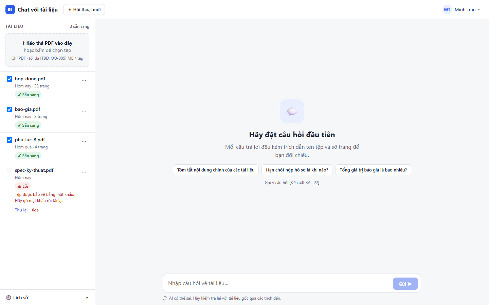

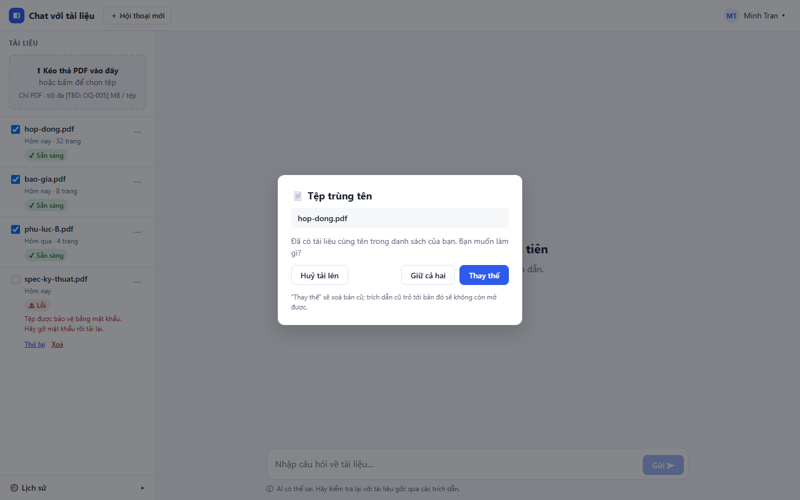

---

### US-02 — Tải lên nhiều PDF cùng lúc (P1)

**Là** nhân viên phát triển kinh doanh, **tôi muốn** tải lên nhiều PDF cùng lúc, **để** nạp nhanh cả bộ tài liệu dự án. · BR-002, AC-002

**Tiêu chí chấp nhận**

- **AC-02.1** — *Given* tôi chọn đúng số tệp tối đa BRU-005 `[TBD: OQ-005]`, *When* tải lên, *Then* tất cả được tiếp nhận.
- **AC-02.2** — *Given* trong lô có tệp lỗi, *When* tải lên, *Then* tệp lỗi không chặn các tệp hợp lệ còn lại (mỗi tệp có tiến trình riêng, tối đa 3 tệp song song).

**Màn hình:** SCR-04 (nhiều tệp, mỗi tệp một thanh tiến trình), SCR-07 (xử lý tệp trùng tên trong lô).

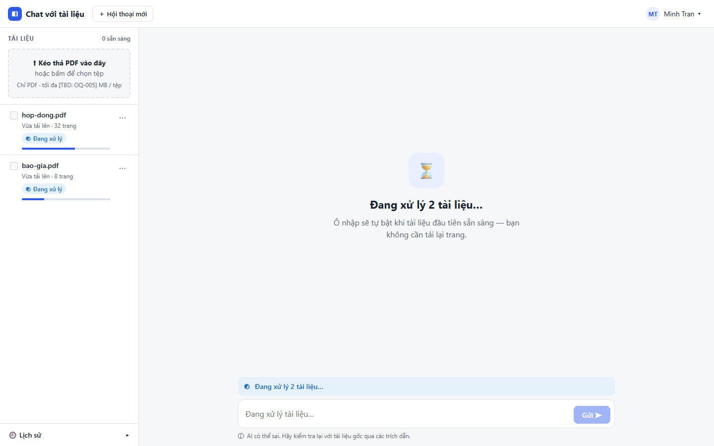

---

### US-03 — Biết tệp nào bị từ chối và vì sao (P0)

**Là** nhân viên phát triển kinh doanh, **tôi muốn** biết rõ tệp nào bị từ chối và vì sao, **để** không tưởng nhầm tài liệu đã được dùng để trả lời. · BR-003, AC-003

**Tiêu chí chấp nhận**

- **AC-03.1** — *Given* tôi tải lên tệp .docx, *When* hệ thống kiểm tra định dạng, *Then* hiển thị "<tên tệp>: chỉ hỗ trợ PDF".
- **AC-03.2** — *Given* tôi tải lên PDF có mật khẩu, *When* hệ thống xử lý, *Then* hiển thị "<tên tệp>: tệp được bảo vệ bằng mật khẩu, không thể đọc".
- **AC-03.3** — *Given* tôi tải lên PDF chỉ có ảnh scan, *When* hệ thống không trích xuất được văn bản, *Then* hiển thị "<tên tệp>: không có văn bản trích xuất được (PDF dạng ảnh scan chưa được hỗ trợ)" và trạng thái "Lỗi".

**Màn hình:** SCR-05 — tệp `spec-ky-thuat.pdf` ở cột trái có chip "Lỗi", lý do và hành động "Thử lại" / "Xoá". Mẫu thông báo lỗi theo từng tệp ở sheet component.

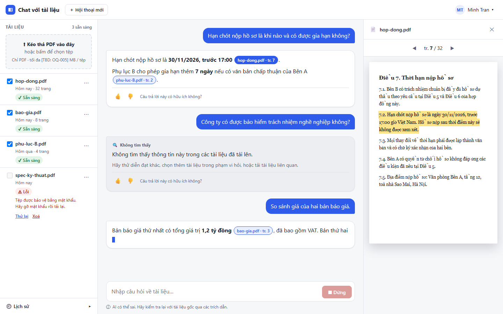

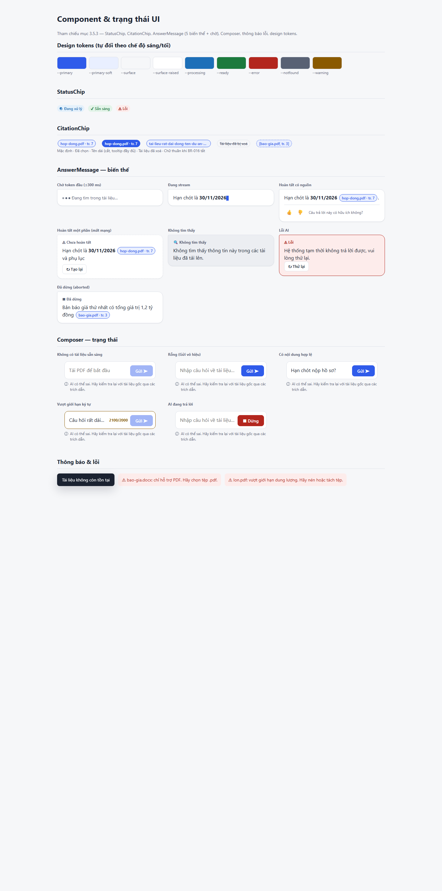

---

### US-04 — Thấy trạng thái từng tài liệu (P0)

**Là** nhân viên phát triển kinh doanh, **tôi muốn** thấy trạng thái từng tài liệu, **để** biết khi nào có thể hỏi. · BR-004, AC-004

**Tiêu chí chấp nhận**

- **AC-04.1** — *Given* tôi vừa tải tệp lên, *When* hệ thống đang xử lý, *Then* tài liệu hiển thị "Đang xử lý".
- **AC-04.2** — *Given* tài liệu đang "Đang xử lý", *When* xử lý hoàn tất, *Then* trạng thái chuyển thành "Sẵn sàng" **không cần tải lại trang** (đẩy qua SSE).
- **AC-04.3** — *Given* xử lý thất bại, *When* kết thúc, *Then* trạng thái "Lỗi" kèm lý do và nút "Thử lại" hoặc "Xoá".

**Màn hình:** SCR-04 (Đang xử lý + banner "Đang xử lý n tài liệu…", ô nhập tự bật khi có tài liệu đầu tiên sẵn sàng), SCR-05 (Sẵn sàng / Lỗi). Trạng thái luôn có biểu tượng + nhãn, không chỉ dựa vào màu.

---

### US-05 — Xem danh sách tài liệu được phép hỏi (P0)

**Là** nhân viên phát triển kinh doanh, **tôi muốn** xem danh sách tài liệu tôi được phép hỏi, **để** biết phạm vi kiến thức của công cụ. · BR-005, AC-005

**Tiêu chí chấp nhận**

- **AC-05.1** — *Given* tôi đã đăng nhập, *When* mở danh sách, *Then* thấy 100% tài liệu trong quyền truy cập, mỗi dòng có tên tệp, ngày tải lên, trạng thái.
- **AC-05.2** — *Given* tài liệu nằm ngoài quyền của tôi (theo OQ-008), *When* mở danh sách, *Then* tài liệu đó không xuất hiện.

**Màn hình:** SCR-03 — cột Tài liệu: tên (cắt giữa nếu dài), ngày, số trang, chip trạng thái, hộp chọn phạm vi, menu "⋯".

---

### US-06 — Xoá một tài liệu (P0)

**Là** người dùng được cấp quyền, **tôi muốn** xoá một tài liệu, **để** loại bỏ tài liệu lỗi thời hoặc tải nhầm. · BR-006, BR-025, AC-006, AC-025

**Tiêu chí chấp nhận**

- **AC-06.1** — *Given* tôi chọn xoá một tài liệu, *When* tôi xác nhận ở hộp thoại, *Then* tài liệu biến mất khỏi danh sách của mọi người dùng.
- **AC-06.2** — *Given* tài liệu đã bị xoá, *When* bất kỳ ai hỏi câu từng được trả lời từ tài liệu đó, *Then* câu trả lời không chứa thông tin hay trích dẫn từ tài liệu đã xoá.

**Màn hình:** SCR-06 — hộp thoại nêu tên tệp và cảnh báo ảnh hưởng tới trích dẫn trong hội thoại cũ. Thao tác trên tài liệu đã bị người khác xoá → toast "Tài liệu không còn tồn tại".

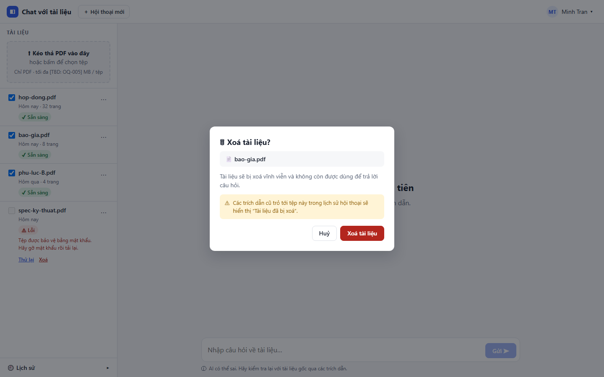

---

## 3. E2 — Hỏi đáp có nguồn

### US-07 — Hỏi bằng câu tự nhiên (P0)

**Là** nhân viên phát triển kinh doanh, **tôi muốn** hỏi bằng câu tự nhiên, **để** không phải tự đọc hết tài liệu. · BR-007, AC-007

**Tiêu chí chấp nhận**

- **AC-07.1** — *Given* có ít nhất một tài liệu "Sẵn sàng", *When* tôi gửi câu hỏi trọn câu, *Then* hệ thống trả phản hồi (câu trả lời hoặc thông báo không tìm thấy).
- **AC-07.2** — *Given* không có tài liệu nào "Sẵn sàng", *When* tôi vào màn hình hỏi, *Then* ô nhập bị vô hiệu và hiển thị hướng dẫn tải tài liệu.

**Màn hình:** SCR-02 (ô nhập vô hiệu, "Tải PDF để bắt đầu"), SCR-03 (ô nhập bật; Enter gửi, Shift+Enter xuống dòng; nút Gửi vô hiệu khi rỗng). Các trạng thái ô nhập (rỗng, hợp lệ, vượt giới hạn ký tự, đang trả lời) ở sheet component.

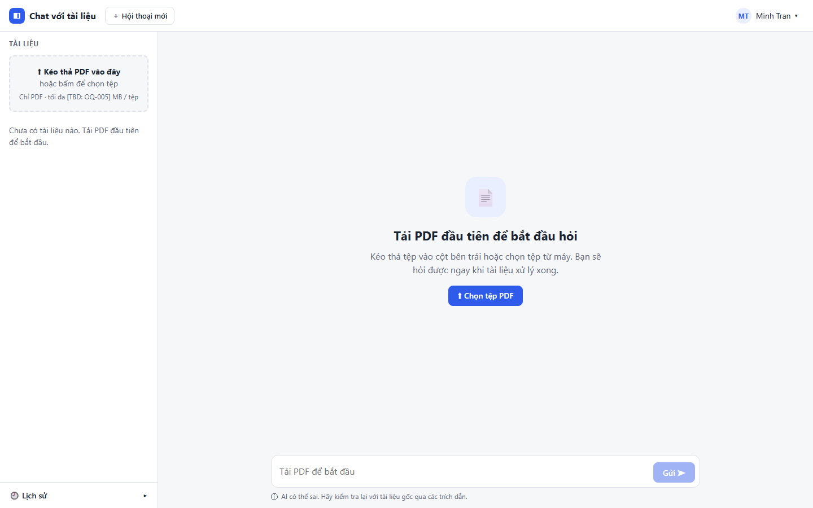

---

### US-08 — Câu trả lời chỉ dựa trên tài liệu của dự án (P0)

**Là** nhân viên phát triển kinh doanh, **tôi muốn** câu trả lời chỉ dựa trên tài liệu của dự án, **để** tin được nội dung. · BR-008, BRU-002, AC-008 — chờ xác nhận OQ-009

**Tiêu chí chấp nhận**

- **AC-08.1** — *Given* một câu hỏi mà đáp án theo kiến thức phổ thông khác với tài liệu, *When* hệ thống trả lời, *Then* câu trả lời theo nội dung tài liệu (≥ 9/10 câu trong bộ kiểm thử).

**Màn hình:** SCR-05 — mỗi đoạn thông tin gắn chip trích dẫn; dòng nhắc cố định "AI có thể sai. Hãy kiểm tra lại với tài liệu gốc…" dưới ô nhập.

---

### US-09 — Câu trả lời tổng hợp từ nhiều tài liệu (P0)

**Là** nhân viên phát triển kinh doanh, **tôi muốn** một câu trả lời tổng hợp từ nhiều tài liệu, **để** không phải tự ghép thủ công. · BR-009, AC-009

**Tiêu chí chấp nhận**

- **AC-09.1** — *Given* thông tin nằm ở ≥ 2 tài liệu "Sẵn sàng", *When* tôi hỏi, *Then* một câu trả lời duy nhất chứa thông tin từ tất cả tài liệu liên quan, mỗi phần có trích dẫn riêng.

**Màn hình:** SCR-05 — câu trả lời đầu tiên có hai chip từ hai tệp (`hop-dong.pdf · tr. 7`, `phu-luc-B.pdf · tr. 2`).

---

### US-10 — Thấy tên tài liệu và số trang cho mỗi thông tin (P0) `[Đề xuất BA]`

**Là** nhân viên phát triển kinh doanh, **tôi muốn** thấy tên tài liệu và số trang cho mỗi thông tin, **để** kiểm chứng trước khi dùng. · BR-010, BRU-003, AC-010

**Tiêu chí chấp nhận**

- **AC-10.1** — *Given* câu trả lời có thông tin từ tài liệu, *When* hiển thị, *Then* 100% đoạn thông tin có trích dẫn dạng `[Tên tệp, tr. N]`.
- **AC-10.2** — *Given* trích dẫn hiển thị, *When* đối chiếu với tài liệu gốc, *Then* thông tin nằm đúng tài liệu và trang được nêu (tỷ lệ ≥ target MET-003).

**Màn hình:** SCR-05 — chip nội tuyến gắn đúng đoạn, không gom cuối câu. Các trạng thái chip (mặc định, đã chọn, tên dài, tài liệu đã xoá, chữ thuần) ở sheet component. Khi đang stream, chip chỉ hiện khi đoạn hoàn chỉnh.

---

### US-11 — Được báo rõ khi tài liệu không có thông tin (P0)

**Là** nhân viên phát triển kinh doanh, **tôi muốn** được báo rõ khi tài liệu không có thông tin, **để** không bị dẫn đến quyết định sai từ câu trả lời bịa. · BR-011, AC-011

**Tiêu chí chấp nhận**

- **AC-11.1** — *Given* câu hỏi mà không tài liệu nào chứa thông tin, *When* hệ thống trả lời, *Then* hiển thị "Không tìm thấy thông tin này trong các tài liệu đã tải lên", **không** suy đoán và **không** có trích dẫn (≥ 9/10 câu ngoài phạm vi).

**Màn hình:** SCR-05 — thẻ trung tính (xám) với biểu tượng 🔍, kèm gợi ý "thử diễn đạt khác / chọn thêm tài liệu". Đây là trạng thái UI riêng, không phải lỗi.

---

### US-12 — Câu trả lời đạt chất lượng đã cam kết (P0)

**Là** quản lý dự án, **tôi muốn** câu trả lời đạt chất lượng đã cam kết, **để** tin vào kết quả thử nghiệm. · BR-012, AC-012

**Tiêu chí chấp nhận**

- **AC-12.1** — *Given* bộ câu hỏi mẫu (≥ 30 câu, DEP-002), *When* chuyên gia nghiệp vụ chấm điểm, *Then* tỷ lệ đúng ≥ target MET-002 `[TBD: OQ-002]`.

**Màn hình:** Không có màn hình riêng — đây là tiêu chí chất lượng AI, kiểm chứng bằng bộ câu hỏi mẫu; UI hỗ trợ qua trích dẫn kiểm chứng được (US-10, US-13d) và đánh giá 👍/👎 (US-19).

---

### US-13 — Thấy câu trả lời xuất hiện nhanh (P0)

**Là** nhân viên phát triển kinh doanh, **tôi muốn** thấy câu trả lời xuất hiện nhanh, **để** không bỏ cuộc quay lại tìm thủ công. · BR-013, AC-013

**Tiêu chí chấp nhận**

- **AC-13.1** — *Given* quy mô thử nghiệm OQ-005, *When* chạy toàn bộ câu hỏi mẫu, *Then* p90 thời gian từ lúc gửi đến lúc chữ đầu tiên hiển thị ≤ `[TBD: OQ-011]`.
- **AC-13.2** *(từ blueprint 2.2, CN-04)* — chỉ báo "đang tìm trong tài liệu…" hiển thị ≤ 300 ms sau khi gửi; trong lúc AI trả lời, nút Gửi đổi thành **Dừng**.

**Màn hình:** SCR-05 — câu trả lời đang stream với con trỏ nhấp nháy, nút "Dừng". Trạng thái chờ token đầu, đã dừng, chưa hoàn tất (mất mạng) và lỗi AI ở sheet component.

---

### US-13b — Hỏi và nhận câu trả lời bằng ngôn ngữ làm việc (P0)

**Là** nhân viên phát triển kinh doanh, **tôi muốn** hỏi và nhận câu trả lời bằng ngôn ngữ làm việc của mình, **để** không phải dịch. · BR-014, AC-014

**Tiêu chí chấp nhận**

- **AC-13b.1** — *Given* câu hỏi bằng ngôn ngữ trong OQ-006, *Then* câu trả lời bằng cùng ngôn ngữ.

**Màn hình:** Toàn bộ giao diện (chuỗi tách khỏi mã, sẵn sàng i18n, chịu giãn chữ +30%). Thiết kế hiện tại bằng tiếng Việt, xem SCR-05.

---

### US-13c — Giới hạn câu hỏi vào một số tài liệu (P1) `[Đề xuất BA]`

**Là** nhân viên phát triển kinh doanh, **tôi muốn** giới hạn câu hỏi vào một số tài liệu tôi chọn, **để** câu trả lời đúng phạm vi cần quan tâm. · BR-015, AC-015

**Tiêu chí chấp nhận**

- **AC-13c.1** — *Given* tôi chỉ chọn 1 tài liệu làm phạm vi, *When* tôi hỏi, *Then* 100% trích dẫn chỉ trỏ tới tài liệu đó.

**Màn hình:** SCR-03, SCR-05 — hộp chọn ở mỗi tài liệu "Sẵn sàng"; chỉ tài liệu "Sẵn sàng" mới chọn được (tài liệu Đang xử lý/Lỗi bị vô hiệu). Danh sách `scopeDocIds` gửi kèm câu hỏi.

---

### US-13d — Bấm trích dẫn để mở tài liệu gốc đúng trang (P1) `[Đề xuất BA]`

**Là** nhân viên phát triển kinh doanh, **tôi muốn** bấm vào trích dẫn để mở tài liệu gốc đúng trang, **để** kiểm chứng nhanh. · BR-016, AC-016

> **Khuyến nghị PM:** nâng lên P0 nếu OQ-014 chấp nhận BR-010.

**Tiêu chí chấp nhận**

- **AC-13d.1** *(từ blueprint, CN-02)* — *Given* câu trả lời có chip trích dẫn, *When* tôi bấm chip, *Then* khung Nguồn mở đúng tài liệu và trang (≤ 1 bấm), đánh dấu đoạn liên quan nếu khả thi (UXQ-08); `Esc` trả focus về chip.
- **AC-13d.2** — *Given* tài liệu được trích dẫn đã bị xoá, *Then* chip hiển thị "Tài liệu đã bị xoá" và không mở được.

**Màn hình:** SCR-05 — cột phải "Nguồn": tên tệp, điều hướng trang `tr. 7 / 32`, đoạn liên quan được tô vàng. Khi chưa chọn trích dẫn: khung Nguồn rỗng kèm hướng dẫn (xem SCR-09).

---

## 4. E3 — Hội thoại (P1)

### US-14 — Hỏi tiếp mà không nhắc lại bối cảnh (P1)

**Là** người dùng, **tôi muốn** hỏi tiếp mà không nhắc lại bối cảnh, **để** tiết kiệm thao tác. · BR-017, AC-017

**Tiêu chí chấp nhận**

- **AC-14.1** — Câu hỏi có đại từ tham chiếu (ví dụ "còn hạn chót của nó?") được hiểu đúng ≥ 8/10 kịch bản mẫu.

**Màn hình:** SCR-05 — nhiều lượt hỏi–đáp liên tiếp trong cùng một hội thoại (`is_followup` được ghi trong telemetry).

---

### US-15 — Xem lại các hội thoại cũ (P1)

**Là** người dùng, **tôi muốn** xem lại các hội thoại cũ của mình, **để** không hỏi lại. · BR-018, AC-018

**Tiêu chí chấp nhận**

- **AC-15.1** — Đăng xuất rồi đăng nhập vẫn thấy hội thoại trong thời hạn OQ-012; không thấy hội thoại của người khác.

**Màn hình:** SCR-09 — ngăn "Lịch sử hội thoại" mở từ nút "Lịch sử ▸" ở cột Tài liệu, nhóm theo Hôm nay / Hôm qua / 7 ngày trước.

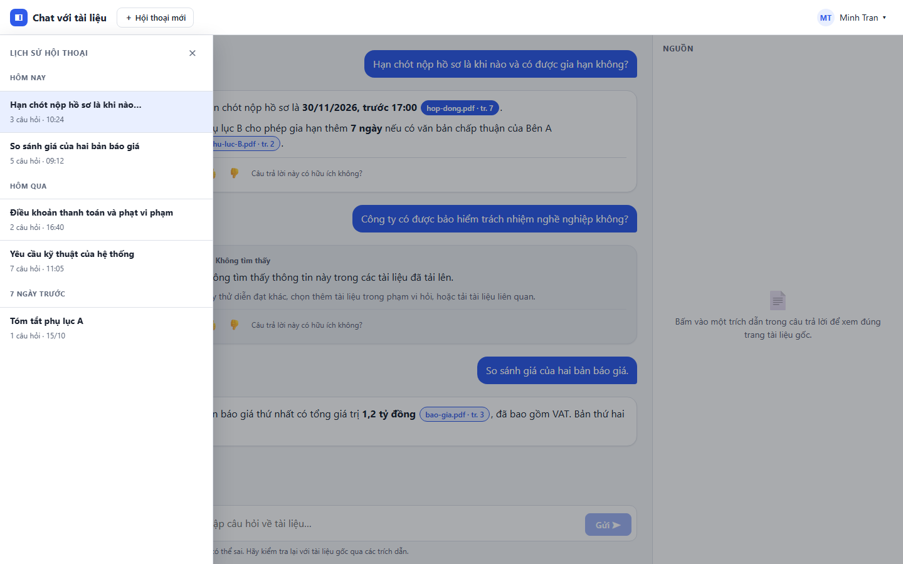

---

### US-16 — Bắt đầu hội thoại mới không mang ngữ cảnh cũ (P1)

**Là** người dùng, **tôi muốn** bắt đầu hội thoại mới không mang ngữ cảnh cũ, **để** tránh nhiễu. · BR-019, AC-019

**Tiêu chí chấp nhận**

- **AC-16.1** — Câu hỏi tham chiếu hội thoại cũ không được trả lời bằng ngữ cảnh cũ.

**Màn hình:** nút "＋ Hội thoại mới" ở TopBar (hiển thị trên mọi màn hình chính); sau khi bấm, người dùng thấy trạng thái SCR-03.

---

## 5. E4 — Hỗ trợ nắm tài liệu (P2)

### US-17 — Tóm tắt một tài liệu mới (P2)

**Là** người dùng, **tôi muốn** tóm tắt một tài liệu mới, **để** nắm nhanh ý chính. · BR-020, AC-020

**Tiêu chí chấp nhận**

- **AC-17.1** — Chuyên gia chấm ≥ 4/5 bản tóm tắt mẫu phản ánh đúng, không thêm nội dung ngoài tài liệu.

**Màn hình:** mục "Tóm tắt" trong menu "⋯" của `DocumentItem` (cờ tính năng P2). Chưa có thiết kế chi tiết riêng — tạm dùng khung hội thoại ở SCR-03/05.

---

### US-18 — Được gợi ý tối đa 3 câu hỏi (P2)

**Là** người dùng chưa biết hỏi gì, **tôi muốn** được gợi ý tối đa 3 câu hỏi, **để** bắt đầu dễ hơn. · BR-021, AC-021

**Tiêu chí chấp nhận**

- **AC-18.1** — Hiển thị 1–3 gợi ý; mỗi gợi ý khi hỏi đều có câu trả lời kèm trích dẫn.

**Màn hình:** SCR-03 — chip gợi ý trong trạng thái "có tài liệu, chưa hội thoại".

---

## 6. E5 — Phản hồi và đo lường

### US-19 — Đánh giá từng câu trả lời (P0) `[Đề xuất BA]`

**Là** quản lý dự án, **tôi muốn** người dùng đánh giá từng câu trả lời, **để** có dữ liệu chất lượng thực tế cho quyết định go/no-go. · BR-022, AC-022

**Tiêu chí chấp nhận**

- **AC-19.1** — *Given* một câu trả lời đã hiển thị xong, *When* tôi bấm "Hữu ích" hoặc "Không hữu ích", *Then* đánh giá được lưu gắn với câu trả lời đó và người dùng thấy xác nhận.
- **AC-19.2** — *Given* tôi đã đánh giá, *When* tôi bấm lại lựa chọn khác, *Then* đánh giá được cập nhật, không tạo bản ghi trùng.
- **AC-19.3** — *Given* tôi chọn "Không hữu ích", *Then* hiển thị ô tuỳ chọn nhập lý do (có thể bỏ qua). `[Giả định PM]`

**Màn hình:** SCR-05 — thanh 👍/👎 dưới mỗi câu trả lời hoàn tất (ẩn khi đang stream, lỗi, chưa hoàn tất); bấm 👎 mở ô lý do (thử trong file HTML). Lỗi ghi đánh giá → thử lại ngầm, không báo lỗi to.

---

### US-20 — Biết mỗi người đặt bao nhiêu câu hỏi mỗi tuần (P0)

**Là** quản lý dự án, **tôi muốn** biết mỗi người đặt bao nhiêu câu hỏi mỗi tuần, **để** tính MET-004. · BR-023, AC-023

**Tiêu chí chấp nhận**

- **AC-20.1** — *Given* dữ liệu sử dụng của một tuần trong kịch bản kiểm thử, *When* truy xuất, *Then* số câu hỏi theo từng người dùng khớp 100% với số câu đã thực hiện (câu lỗi AI không tính).

**Màn hình:** Không có UI người dùng. Sự kiện `question_submitted`, `answer_completed`, `answer_error` được phát ngầm từ luồng hỏi–đáp (SCR-05) và **không chứa nội dung** câu hỏi/trả lời (PRD 5.2). Màn hình báo cáo cho quản lý nằm ngoài phạm vi MVP.

---

## 7. E6 — Truy cập và bảo vệ dữ liệu

### US-21 — Chỉ người được cấp quyền mới truy cập (P0)

**Là** quản trị viên, **tôi muốn** chỉ người được cấp quyền mới truy cập, **để** bảo vệ tài liệu dự án. · BR-024, AC-024

**Tiêu chí chấp nhận**

- **AC-21.1** — *Given* người chưa được cấp quyền, *When* truy cập ứng dụng hoặc gọi trực tiếp API, *Then* không xem được danh sách tài liệu, không hỏi được, không xem được hội thoại (0 truy cập thành công).
- **AC-21.2** — *Given* phiên đăng nhập hết hạn, *When* tôi thao tác, *Then* bị chuyển về đăng nhập và nội dung đang nhập được giữ lại nếu có thể.

**Màn hình:** SCR-01 (đăng nhập — phương thức chờ OQ-013), SCR-08 (403, nêu cách xin quyền, không lộ sự tồn tại của tài liệu), SCR-10 (hết phiên, giữ nháp câu hỏi).

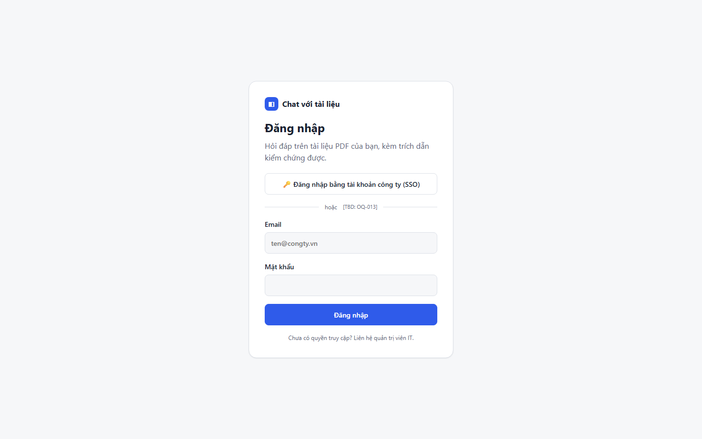

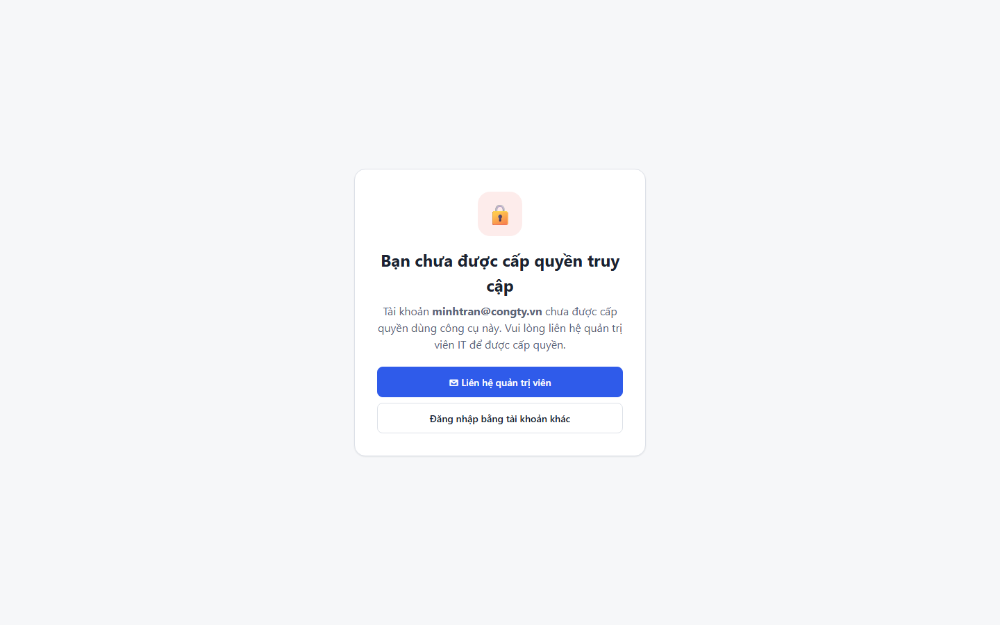

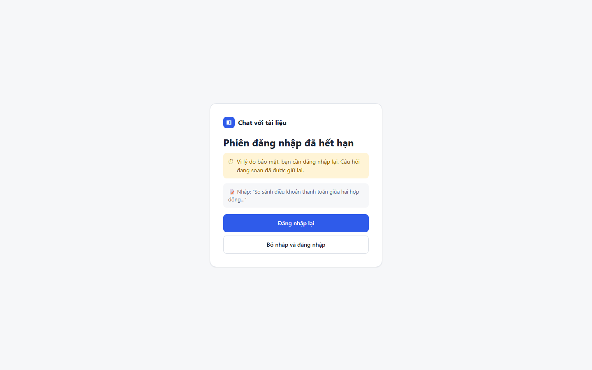

---

### US-22 — Xác nhận xử lý tài liệu tuân thủ chính sách (P0)

**Là** đại diện bảo mật/pháp chế, **tôi muốn** xác nhận cách xử lý tài liệu tuân thủ chính sách, **để** không vi phạm thoả thuận bảo mật. · BR-026, AC-026

**Tiêu chí chấp nhận**

- **AC-22.1** — *Given* phương án xử lý AI đã chốt, *When* Bảo mật/Pháp chế review, *Then* có xác nhận bằng văn bản — **điều kiện chặn bắt đầu phát triển** (OQ-007, DEP-001).

**Màn hình:** Không có UI — đây là điều kiện quy trình (cổng G-01). Ảnh hưởng gián tiếp tới thiết kế: UI không chứa khoá API AI, không ghi nội dung hội thoại vào telemetry/log/URL.

---

### US-23 — Dữ liệu đã xoá không còn bị dùng (P0)

**Là** người dùng, **tôi muốn** dữ liệu đã xoá không còn bị dùng, **để** kiểm soát phạm vi dữ liệu. · BR-025, BRU-006

**Tiêu chí chấp nhận**

- Xem AC-06.2; thêm: chip trích dẫn của tài liệu đã xoá hiển thị "Tài liệu đã bị xoá" và không mở được; tài liệu biến mất khỏi UI ≤ 1 s (CN-10).

**Màn hình:** SCR-06 (xác nhận xoá), SCR-05 (hội thoại cũ), sheet component (chip "đã xoá").

---

## 8. E7 — Giới hạn vận hành

### US-24 — Giới hạn rõ số tài liệu và người dùng đồng thời (P0)

**Là** đội kỹ thuật, **tôi muốn** giới hạn rõ số tài liệu và người dùng đồng thời, **để** vận hành ổn định và kiểm soát chi phí. · BR-027, AC-027

**Tiêu chí chấp nhận**

- **AC-24.1** — *Given* số tài liệu và người dùng đồng thời theo OQ-005, *When* chạy kiểm thử tải, *Then* ngưỡng p90 của US-13 vẫn đạt.

**Màn hình:** các giới hạn hiển thị ở vùng kéo-thả ("Chỉ PDF · tối đa [TBD: OQ-005] MB / tệp"), thông báo lỗi tải lên và bộ đếm ký tự của ô nhập. UI **đọc giá trị từ `GET /api/config`**, không hard-code.

---

## 9. Phụ lục — Trạng thái biên (PRD 4.2) → Màn hình

| Tình huống | Màn hình / thành phần |
|---|---|
| Chưa có tài liệu / có tài liệu chưa hội thoại / mọi tài liệu đang xử lý | SCR-02 / SCR-03 / SCR-04 |
| Tệp không hợp lệ, trùng tên | SCR-05 (chip Lỗi), SCR-07, sheet component |
| Câu hỏi rỗng / quá dài | Composer (sheet component) |
| Câu hỏi ngoài phạm vi | SCR-05 (Không tìm thấy) |
| Lỗi AI, mất mạng giữa chừng | Sheet component (Lỗi AI, Chưa hoàn tất — Tạo lại) |
| Xoá tài liệu đang được trích dẫn | SCR-06, chip "đã xoá" |
| Hết phiên / Không có quyền | SCR-10 / SCR-08 |

## 10. Ghi chú & giới hạn

- Ảnh chụp từ thiết kế HTML tĩnh (Chrome headless, 1440×900, chế độ sáng) — là **mockup**, chưa phải sản phẩm chạy thật; dữ liệu mẫu là giả lập.
- Story **US-12, 20, 22** không có màn hình do là tiêu chí chất lượng/telemetry/quy trình; **US-17** chưa có thiết kế chi tiết riêng; câu hỏi mơ hồ (P2) chưa được thiết kế (UXQ-09).
- AC-02.x, AC-13.2, AC-13d.x, AC-13c.1 được diễn giải từ phần tóm tắt trong PRD và blueprint UI/UX, không phải nguyên văn PRD — cần BA xác nhận.
- Các giá trị `[TBD: OQ-xxx]` kế thừa từ PRD và chưa được chốt.
